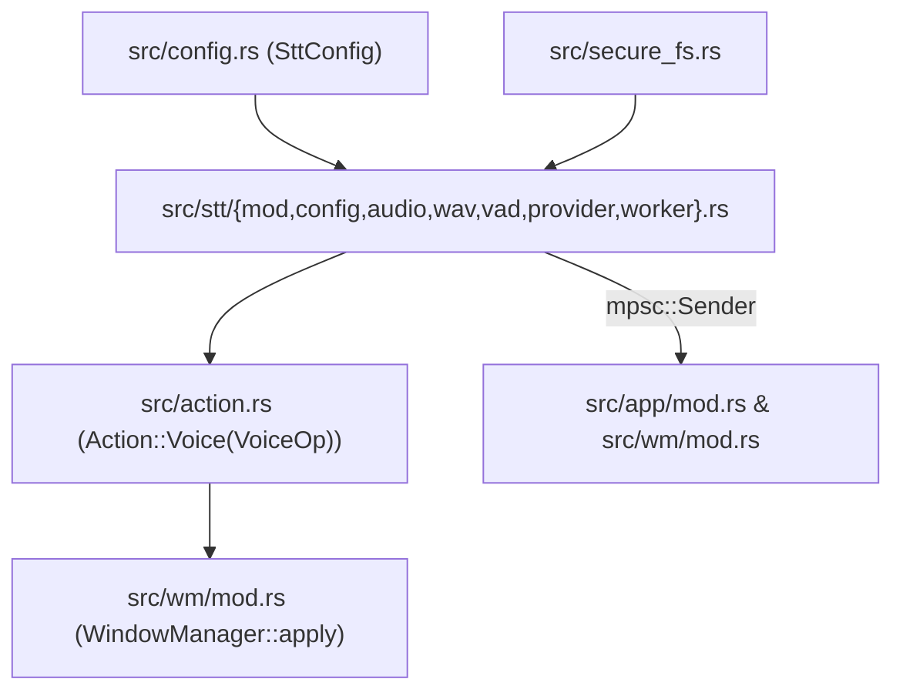

# ADR-058: Isolated Local AI Speech-to-Text (`src/stt/`) Architecture

**Date:** 2026-11-07  
**Status:** Proposed (Phase 58)  
**Deciders:** Bilterm Core Architecture  
**Requirements:** `STT-01`, `STT-02`, `STT-03`, `ARCH-R01`, `ARCH-R02`, `ARCH-R04`, `SEC-R01..04`, `UNI-R01`

---

## 1. Context

Bilterm requires an optional, local-first Speech-to-Text (`STT`) module capable of capturing microphone audio, transcribing speech via local AI servers (`whisper.cpp`, `speaches`/`faster-whisper-server`, `Ollama`, `LocalAI`, `mlx-audio`, or local CLI binaries), and staging the transcribed text inside the active pane's `FloatingCommandPrompt`.

Key engineering constraints:
- **Maximum Independence**: `src/stt/` must have zero upward dependencies on `WindowManager`, `CompositePane`, or Ratatui widgets. It sits as a leaf subsystem in the module DAG alongside `src/vt/` and `src/config/`.
- **Zero Mandatory Bloat**: Default builds (`cargo build`) must not require native C audio headers (`alsa-lib`, `jack`, `coreaudio`) or heavyweight HTTP/TLS dependency trees.
- **Non-Blocking Event Loop**: Audio capture, RMS/VAD calculation, WAV encoding, and HTTP/CLI transcription must run entirely on background Tokio tasks, communicating with the UI loop solely through bounded channels and `Action::Voice(VoiceOp)`.
- **Security Confinement (`SEC-R01..04`)**: Disabled by default, loopback-confined by default, `0600` secret file loading, bounded audio memory buffers, and immediate temp-file scrubbing.

---

## 2. Decision

### 2.1 Module Placement & Dependency DAG

`src/stt/` is structured as an independent leaf module in the Bilterm crate DAG:



Submodule breakdown under `src/stt/` (each strictly `< 500` lines, respecting `ARCH-R04`):
- `src/stt/mod.rs`: Public façade (`SttService`, `SttHandle`, `SttEvent`, `SttStateSnapshot`, `VoiceOp`).
- `src/stt/audio.rs`: `AudioCaptureBackend` trait, Tier 1 OS subprocess pipe capture (`pw-record`, `parecord`, `arecord`, `rec`/`sox`, `ffmpeg`), mock PCM generator for deterministic tests, and Tier 2 `#[cfg(feature = "stt-native-audio")]` hook.
- `src/stt/wav.rs`: Zero-dependency 44-byte RIFF/WAVE `S16_LE` 16 kHz mono encoder/decoder, RMS dBFS level calculator, and `ScrubbedTempWav` RAII `0600` file guard.
- `src/stt/provider.rs`: `SttProvider` trait and three concrete implementations:
  1. `OpenAiCompatSttProvider`: Pure-Rust async HTTP/1.1 `multipart/form-data` client over `tokio::net::TcpStream` / `UnixStream` targeting `/v1/audio/transcriptions`.
  2. `OllamaSttProvider`: Async HTTP/1.1 JSON client targeting Ollama `/api/chat` / `/api/generate` (plus optional shell-command translation prompt).
  3. `LocalCliSttProvider`: `tokio::process::Command` runner invoking `whisper-cli` / `mlx_whisper` against a `ScrubbedTempWav` file.
- `src/stt/worker.rs`: Background Tokio state machine managing active recording stream, 100 ms RMS/VAD ticks, silence auto-stop, timeout bounding, and provider dispatch.

---

### 2.2 Configuration Contract (`[stt]` in `config.toml`)

```toml
[stt]
# Master switch; false by default so no audio devices or sockets are touched unless opted in.
enabled = false

# Provider backend: "openai_compatible" | "ollama" | "local_cli"
provider = "openai_compatible"

# Endpoint URL for HTTP backends (must be 127.0.0.1, ::1, localhost, or unix:///... unless allow_remote_stt = true)
endpoint = "http://127.0.0.1:8080/v1/audio/transcriptions"

# Model identifier sent to the provider (e.g. "whisper-1", "Systran/faster-whisper-small.en", "ggml-base.en.bin")
model = "whisper-1"

# Optional ISO-639-1 language code ("en", "de", "ja", etc.) to bypass auto-detect latency
language = "en"

# Vocabulary biasing prompt for terminal terminology
vocabulary_prompt = "Linux shell, bash, zsh, git, cargo, tmux, bilterm, kubectl, docker, flags, pipes"

# Path to a 0600 file containing the Bearer token (optional for local servers; never passed on argv)
api_key_file = ""

# Security gate: when false (default), non-loopback endpoints are rejected
allow_remote_stt = false

# Audio capture driver: "auto" | "pw-record" | "parecord" | "arecord" | "sox" | "ffmpeg" | "mock"
audio_backend = "auto"

# Maximum single recording duration in seconds (hard memory cap: 60s = 1.92 MB at 16kHz s16le)
max_recording_secs = 60

# Voice Activity Detection (VAD) silence auto-stop in milliseconds (0 = manual stop only)
auto_stop_silence_ms = 1500

# RMS threshold in dBFS above which audio is considered active speech
vad_threshold_db = -38.0

# Behavior on transcription completion: false = stage in FloatingCommandPrompt for review; true = auto-execute
auto_submit = false

# Local CLI command template when provider = "local_cli" (`{wav_path}` is replaced with the 0600 temp WAV path)
cli_command = ["whisper-cli", "--no-timestamps", "-nt", "-f", "{wav_path}"]
```

---

### 2.3 Core Traits & Data Structures

```rust
#[derive(Debug, Clone, PartialEq, Eq, Serialize, Deserialize)]
#[serde(rename_all = "snake_case")]
pub enum SttBackendKind {
    OpenAiCompatible,
    Ollama,
    LocalCli,
    Mock,
}

#[derive(Debug, Clone, PartialEq, Eq, Serialize, Deserialize)]
#[serde(rename_all = "snake_case")]
pub enum VoiceOp {
    /// Toggle recording on/off for the focused pane (start if idle, stop & transcribe if recording).
    Toggle,
    /// Start voice recording targeting the focused (or specified) pane.
    Start { pane_id: Option< usize > },
    /// Stop active recording and dispatch captured audio to the configured STT provider.
    Stop,
    /// Abort active recording immediately and discard captured audio without transcribing.
    Cancel,
    /// Query current STT subsystem status (returned in ActionResult::Data and OIA status).
    Status,
    /// Switch active STT provider kind at runtime.
    SetProvider { provider: SttBackendKind },
    /// Apply a transcription result emitted by the background SttWorker into the target pane.
    ApplyTranscript {
        pane_id: Option<usize>,
        text: String,
        is_final: bool,
    },
    /// Update live recording telemetry (RMS level & elapsed ms) for the OIA `[🎙 REC]` indicator.
    UpdateTelemetry {
        recording: bool,
        transcribing: bool,
        rms_db: i32,
        elapsed_ms: u64,
        error: Option<String>,
    },
}

#[derive(Debug, Clone)]
pub struct TranscriptionRequest {
    /// Complete 44-byte RIFF/WAVE header + 16kHz 16-bit mono PCM payload.
    pub wav_bytes: Vec<u8>,
    pub model: String,
    pub language: Option<String>,
    pub vocabulary_prompt: Option<String>,
}

#[derive(Debug, Clone, PartialEq, Eq, Serialize, Deserialize)]
pub struct TranscriptionResponse {
    pub text: String,
    pub provider: SttBackendKind,
    pub duration_ms: u64,
}
```

---

### 2.4 State Encapsulation & UI Integration (`ARCH-R01`, `ARCH-R02`)

1. **`Action::Voice(VoiceOp)`**:
   - Added to `crate::action::Action`.
   - Every user surface (`Ctrl+B v`, `Alt+V`, `:voice ...`, OIA `[🎙 MIC]` mouse click, TopMenu item, JSON-RPC `"voice.*"`, MCP tool) lowers to `Action::Voice(VoiceOp)` and executes through `WindowManager::apply`.
2. **Private State on `WindowManager`**:
   - `WindowManager` stores a private `stt_status: SttUiStatus` struct (`enabled`, `recording`, `transcribing`, `target_pane_id`, `rms_db`, `elapsed_ms`, `last_transcript`, `last_error`, `active_provider`) and an optional `stt_handle: Option<SttHandle>`.
   - Accessed via read-only getters (`wm.stt_status()`) for OIA bar rendering and RPC inspection, preserving `ARCH-R02`.
3. **Safe Prompt Staging**:
   - When `Action::Voice(VoiceOp::ApplyTranscript { pane_id, text, is_final: true })` executes:
     - Resolves target `CompositePane` (`pane_id.or(self.focused_pane_id)`).
     - Ensures the pane's `FloatingCommandPrompt` is visible/focused (unless in `DECSET 1049` alternate screen without `force_command_prompt`) and appends/inserts `text` (trimmed of stray leading/trailing control characters) into the prompt buffer via a dedicated `CompositePane::insert_dictated_text(&mut self, text: &str)` method.
     - Only calls `CompositePane::submit_command()` if `config.stt.auto_submit` is explicitly `true`.

---

## 3. Consequences

### Positive
- **Zero compile-time or runtime penalty** for users who do not use STT (`default = []` requires zero C audio libraries or TLS crates).
- **Works immediately with the entire local AI ecosystem**: `whisper.cpp`, `speaches`/`faster-whisper`, `LocalAI`, `LM Studio`, `mlx-audio`, `Ollama`, and CLI binaries.
- **Prevents catastrophic blind execution**: staging transcripts inside Bilterm's `FloatingCommandPrompt` gives users visual verification and syntax highlighting before execution.
- **100% deterministic testing**: `SttBackendKind::Mock` + local `TcpListener` mock servers allow full end-to-end verification in CI (`scripts/verify.sh`) without requiring a physical microphone or GPU in CI runners.

### Trade-offs & Mitigations
- **Tier 1 OS Subprocess Recorder Availability**: Requires one of `pw-record`, `parecord`, `arecord`, `sox`/`rec`, or `ffmpeg` on `$PATH`.
  - *Mitigation*: `audio::probe_available_recorder()` checks `$PATH` at `:voice start` and emits an actionable diagnostic in the OIA bar (`"No audio recorder found (install pipewire/alsa-utils/sox/ffmpeg)"`) if none is present.
- **Plain HTTP by Default**: Built-in `TcpStream` HTTP client speaks HTTP/1.1 for local servers (`http://127.0.0.1:<port>`).
  - *Mitigation*: Local inference engines (`whisper.cpp`, `Ollama`, `speaches`) listen on plain HTTP loopback by default; remote endpoints are blocked unless `allow_remote_stt = true`.
