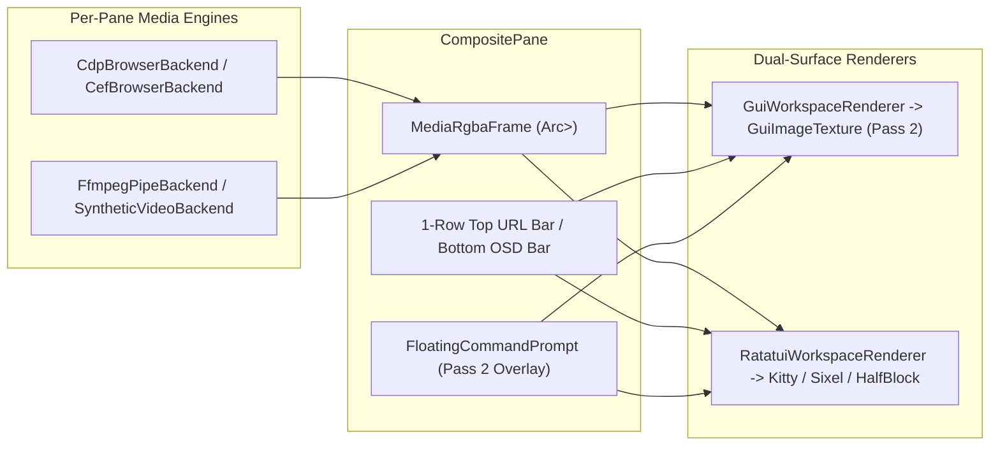

# ADR-059: Unified Browser Engine & Video Player Canvas Architecture (`WEB-01..02`, `VID-01..02`)

- **Status**: Proposed (Phase 59 Spike)
- **Date**: 2026-11-07
- **Requirements**: `WEB-01`, `WEB-02`, `VID-01`, `VID-02`
- **Architecture Rules**: `ARCH-R01` (Unified `Action` Dispatch), `ARCH-R02` (Encapsulated State Invariants), `ARCH-R04` (Module Size Ceiling <= 1000 lines), `SEC-R01..04` (Private `0700`/`0600` confinement & safe subprocess management), `UNI-R01` (Mouse + Key + Colon + Palette + RPC/MCP parity)

---

## 1. Context & Problem Statement

Bilterm users and autonomous agents need to:
1. Open and interact with live web pages (documentation, localhost dev servers, dashboards, OAuth/preview flows) inside a **Chrome Engine Web Browser Canvas** directly within any composite terminal pane (`WEB-01..02`).
2. Decode, play, scrub, and inspect local video files (`.mp4`, `.webm`, `.mkv`, `.gif`) or procedural/streamed video feeds inside a **Video Player Canvas** within any composite pane (`VID-01..02`).
3. Maintain Bilterm's core value proposition: the **Floating Command Prompt** and **IBM 3270 / Borland Turbo Vision** windowing chrome must composite seamlessly over or alongside the active browser/video canvas in **Native GUI mode** (`GuiWorkspaceRenderer` at full 1:1 pixel resolution) and degrade gracefully in **TUI / SSH / `tmux` mode** (`Kitty`, `Sixel`, `iTerm2`, `HalfBlock`, `Octant`, `Braille`).

---

## 2. Decision

### 2.1 New Cohesive Submodules (`ARCH-R04`)

To keep `src/pane/mod.rs`, `src/ui/renderer.rs`, and `src/ui/pixel_canvas.rs` well under the 1000-line ceiling, introduce two focused media-canvas modules:

- `src/pane/browser_canvas/{mod,cdp,cef,chrome_ui}.rs`:
  - `BrowserEngine` trait + `BrowserSessionState` owned by `CompositePane` (`pub(crate) browser_canvas: Option<BrowserCanvasState>`).
  - `CdpBrowserBackend` (default, zero-link out-of-process Chromium via `--headless=new` + CDP screencast/input dispatch) and `SyntheticBrowserBackend` (deterministic offline/CI renderer).
  - Optional `CefBrowserBackend` behind `--features cef-browser` (`CefRenderHandler::OnPaint`).
- `src/pane/video_canvas/{mod,ffmpeg,osd}.rs`:
  - `VideoPlayerEngine` trait + `VideoCanvasState` owned by `CompositePane` (`pub(crate) video_canvas: Option<VideoCanvasState>`).
  - Triple-buffered `VideoFrameRing` + `FfmpegPipeBackend` + deterministic `SyntheticVideoBackend` (`demo://smpte`, `demo://plasma`, `.gif`/`.ppm` sequences).

### 2.2 Core Rust Trait & Data Contracts

```rust
/// Shared RGBA frame buffer with monotonic sequence counter for zero-copy GUI texture upload.
#[derive(Clone, Debug, PartialEq, Eq)]
pub struct MediaRgbaFrame {
    pub seq: u64,
    pub width_px: u16,
    pub height_px: u16,
    pub pts_ms: u64,
    pub rgba: std::sync::Arc<Vec<u8>>,
}

/// Mouse event in normalized or pixel-space coordinates inside a pane's media viewport.
#[derive(Clone, Copy, Debug, PartialEq, Eq)]
pub enum MediaMouseEventKind {
    Down(crossterm::event::MouseButton),
    Up(crossterm::event::MouseButton),
    Drag(crossterm::event::MouseButton),
    Move,
    Wheel { delta_x: i16, delta_y: i16 },
}

#[derive(Clone, Copy, Debug, PartialEq, Eq)]
pub struct MediaMouseEvent {
    pub kind: MediaMouseEventKind,
    pub x_px: u16,
    pub y_px: u16,
    pub modifiers: crossterm::event::KeyModifiers,
}

/// Pluggable Chrome Engine backend (`CdpBrowserBackend`, optional `CefBrowserBackend`, `SyntheticBrowserBackend`).
pub trait BrowserEngine: Send {
    fn navigate(&mut self, url: &str) -> crate::error::Result<()>;
    fn go_back(&mut self) -> crate::error::Result<()>;
    fn go_forward(&mut self) -> crate::error::Result<()>;
    fn reload(&mut self) -> crate::error::Result<()>;
    fn stop(&mut self) -> crate::error::Result<()>;
    fn resize_viewport(&mut self, width_px: u16, height_px: u16, scale_factor: f32) -> crate::error::Result<()>;
    fn dispatch_mouse(&mut self, event: MediaMouseEvent) -> crate::error::Result<()>;
    fn dispatch_key(&mut self, key: crossterm::event::KeyEvent) -> crate::error::Result<()>;
    fn latest_frame(&mut self) -> Option<MediaRgbaFrame>;
    fn current_url(&self) -> &str;
    fn page_title(&self) -> &str;
    fn is_loading(&self) -> bool;
    fn backend_name(&self) -> &'static str;
}

/// Pluggable Video Player backend (`FfmpegPipeBackend`, `SyntheticVideoBackend`).
pub trait VideoPlayerEngine: Send {
    fn open(&mut self, source: &str, width_px: u16, height_px: u16) -> crate::error::Result<()>;
    fn play(&mut self) -> crate::error::Result<()>;
    fn pause(&mut self) -> crate::error::Result<()>;
    fn toggle_play_pause(&mut self) -> crate::error::Result<()>;
    fn seek_relative(&mut self, delta_secs: f64) -> crate::error::Result<()>;
    fn seek_absolute(&mut self, position_secs: f64) -> crate::error::Result<()>;
    fn set_volume(&mut self, volume_pct: u8) -> crate::error::Result<()>;
    fn set_muted(&mut self, muted: bool) -> crate::error::Result<()>;
    fn set_looping(&mut self, looping: bool) -> crate::error::Result<()>;
    fn set_speed(&mut self, speed: f32) -> crate::error::Result<()>;
    fn resize_target(&mut self, width_px: u16, height_px: u16) -> crate::error::Result<()>;
    fn tick(&mut self, now_ms: u64) -> Option<MediaRgbaFrame>;
    fn state_snapshot(&self) -> VideoPlaybackSnapshot;
}
```

### 2.3 Unified `Action` Variants (`ARCH-R01`, `UNI-R01`)

Add two canonical action families in `src/action.rs` (lowering all keyboard, mouse, `:colon`, Command Palette, Top Menu, and JSON-RPC/MCP/CLI paths through `WindowManager::apply`):

```rust
#[derive(Clone, Debug, PartialEq)]
pub enum BrowserOp {
    Open { url: String, pane_id: Option<PaneId> },
    Back { pane_id: Option<PaneId> },
    Forward { pane_id: Option<PaneId> },
    Reload { pane_id: Option<PaneId> },
    Stop { pane_id: Option<PaneId> },
    FocusViewport { pane_id: Option<PaneId>, focused: Option<bool> },
    Zoom { delta_pct: i16, pane_id: Option<PaneId> },
    Click { x_px: u16, y_px: u16, button: u8, pane_id: Option<PaneId> },
    Scroll { delta_x: i16, delta_y: i16, pane_id: Option<PaneId> },
    Close { pane_id: Option<PaneId> },
}

#[derive(Clone, Debug, PartialEq)]
pub enum VideoOp {
    Open { source: String, pane_id: Option<PaneId> },
    Play { pane_id: Option<PaneId> },
    Pause { pane_id: Option<PaneId> },
    TogglePlayPause { pane_id: Option<PaneId> },
    SeekRelative { delta_secs: f64, pane_id: Option<PaneId> },
    SeekPercent { pct: u8, pane_id: Option<PaneId> },
    VolumeDelta { delta_pct: i8, pane_id: Option<PaneId> },
    ToggleMute { pane_id: Option<PaneId> },
    ToggleLoop { pane_id: Option<PaneId> },
    SetSpeed { speed_x100: u16, pane_id: Option<PaneId> },
    Close { pane_id: Option<PaneId> },
}
```

### 2.4 Compositor & Occlusion Integration (`GuiWorkspaceRenderer` + `RatatuiWorkspaceRenderer`)



1. **Row Reservation inside `canvas_rect`**:
   - When `pane.browser_canvas()` is active:
     - Top row (`canvas_rect.y`) renders the **Browser Navigation Bar**: `[◄] [►] [↻] [🔒 https://...] [CHROME/CDP] [✕]`.
     - Remaining rows (`canvas_rect.y + 1 .. canvas_rect.bottom()`) form `browser_viewport_rect`, receiving the `GuiImageTexture` (`id = 910_000 + pane.id as u32`) in GUI mode and `InteractiveImageView` / `CanvasRenderBackend` in TUI mode.
   - When `pane.video_canvas()` is active:
     - Bottom row (`canvas_rect.bottom() - 1`) renders the **Video OSD Transport Bar**: `[▶/⏸] [⏮] [⏭] [━━●─── 01:24/03:50] [🔊 100%] [1.0x] [🔁] [✕]`.
     - Remaining rows (`canvas_rect.y .. canvas_rect.bottom() - 1`) form `video_viewport_rect`, receiving the `GuiImageTexture` (`id = 920_000 + pane.id as u32`) in GUI mode and `InteractiveImageView` / `CanvasRenderBackend` in TUI mode.
2. **Floating Command Prompt Cutout**:
   - Exactly as `PixelCanvasBuffer` masks out `pane_snap.prompt_rect` in `src/ui/renderer.rs:859-870`, `GuiWorkspaceRenderer` masks out any pixel overlapping `prompt_rect` or higher-Z floating modals (`modal_rect`, `drawer_rect`, `mcp_rect`, `qt_rect`), so the floating command prompt remains 100% legible over live 60fps video or web pages.

---

## 3. Consequences

- **Positive**:
  - Zero mandatory C++ build dependencies (`cargo build` and `scripts/verify.sh` remain fast and self-contained).
  - Full Chrome Engine compatibility via installed Chromium/Chrome/Edge (`CdpBrowserBackend`) with optional in-process `cef-browser` feature.
  - Identical state and control surface across GUI, TUI, SSH, `tmux`, JSON-RPC, HTTP, and MCP (`UNI-R01`).
- **Risks & Mitigations**:
  - *Subprocess leaks on crash*: Mitigated by wrapping child PIDs in a drop guard that sends `SIGTERM`/`SIGKILL` (Unix) or Job Object / `TerminateProcess` (Windows) and closes pipes on `Drop` (`controlling-processes-safely`).
  - *High frame bandwidth*: Mitigated by capping frame dimensions to `1920×1080`, ack-pacing CDP screencast frames, and skipping texture re-upload when `frame.seq == last_uploaded_seq`.
