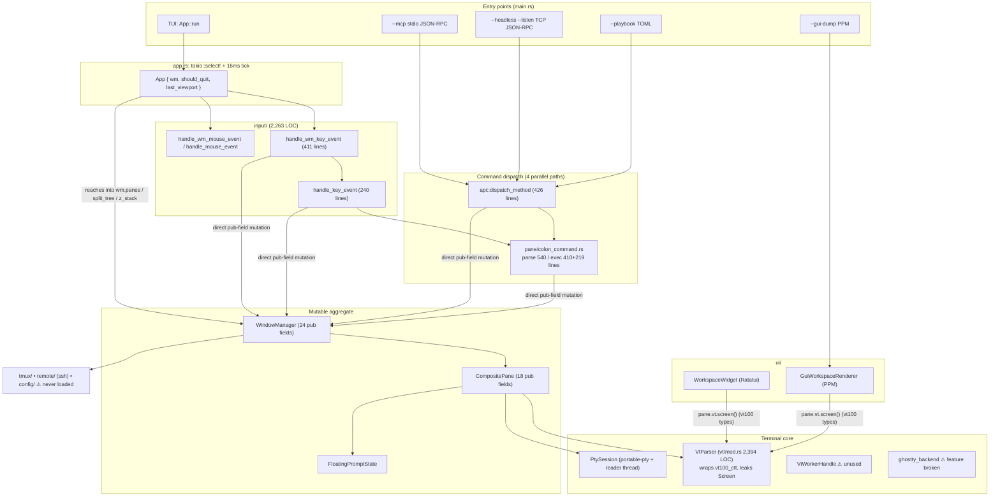
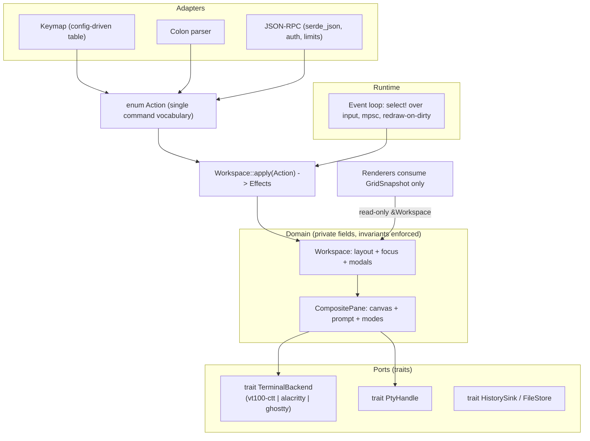
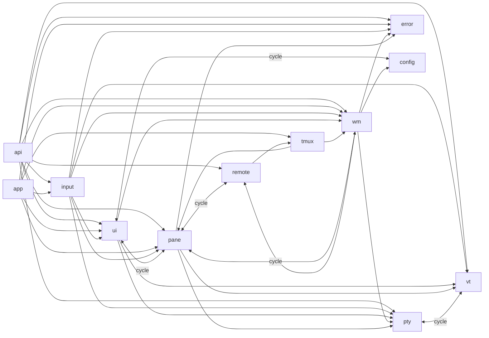

# Architecture & Code Review Improvement Plan: Bilterm

> **Repository:** `bilterm` (`/home/bill/src/ai/bilterm`)
> **Date:** `2026-10-22`
> **Commit reviewed:** `b480b9e` (v1.5.0, clean tree)
> **Review Scope:** Full repository, `src/` (19,239 LOC across 35 files) plus test layout
> **Reviewer:** Claude Opus 5.5 / `code-architecture-review` skill (graphify structural graph: 945 nodes, 2,457 edges)
> **Architecture Health Score:** `C+` (Score: `68/100`)

**Baseline evidence (fresh, at this commit):**

| Check | Result |
|---|---|
| `cargo clippy --all-targets -- -D warnings` | ✅ clean |
| `cargo test` | ✅ 99 passed, 0 failed |
| `cargo check --features gui` | ✅ compiles |
| `cargo check --features ghostty-vt` | ❌ **fails** (`unresolved import libghostty_vt`, duplicate `GridSnapshot`, E0277) |
| Headless daemon + client connection reset | ❌ **daemon exits** (`Connection reset by peer`, `src/main.rs:76`) |
| Headless daemon + `[` × 200,000 | ❌ **process aborts** (`thread 'main' has overflowed its stack`) |

---

## 1. Code Architecture

### 1.1 Executive Architectural Summary

Bilterm is a **single-crate modular monolith**: a Rust 2024 library (`src/lib.rs`, 12 top-level modules) with a thin binary (`src/main.rs`). The runtime is **one `tokio::select!` loop** (`src/app.rs`) that redraws every iteration, polls every PTY on a 16 ms tick, and routes crossterm events through free functions in `input/`. State lives in **one mutable aggregate**, `WindowManager`, which owns every `CompositePane` (VT parser + PTY + prompt editor + six per-pane modes). Rendering is immediate-mode Ratatui (`ui/`), plus a second software "GUI" renderer that writes PPM files.

The core design (prompt overlaid on a full-PTY canvas, BSP split tree + z-stack, three-signal line discipline) is sound and well documented in ADR-001…005. Most of the debt is accidental. Features were added by version tag (`v0.6.0`, `ECO-04`, `v1.4.0`…) as new `pub` fields on the two god structs and new arms in four 400–540-line `match` functions. The result is that one concept, "a command", is dispatched through **four parallel paths** (key handler, leader handler, colon commands, JSON-RPC) that don't share a command type.

Several advertised subsystems are **scaffolding with no production caller**:
- the `VtWorkerHandle` threaded pipeline (ARCH-02)
- `TmuxControlSubprocess` (tmux Mode B)
- the `ghostty-vt` feature, which doesn't compile
- **`BiltermConfig::load_or_default`, which nothing calls**, so `~/.config/bilterm/config.toml` is never read

### 1.2 Current System Topology Diagram



### 1.3 Target Architecture Blueprint



The key moves:
1. **One `Action` enum** that every input surface lowers into.
2. **Private fields plus methods** on `WindowManager` and `CompositePane`, so invariants such as "close pane ⇒ update tree, z-stack and zoom" live in exactly one place.
3. **A `TerminalBackend` trait** so `vt100_ctt` types stop leaking into `ui/` and `pane/`.
4. **An event-driven PTY path** with no byte dropping.

### 1.4 Architectural Debt & Trade-off Analysis

- **Intentional trade-offs**
  - `vt100-ctt` was chosen over `alacritty_terminal` for speed of delivery, as `AGENTS.md` sanctions for Phase 1.
  - A hand-rolled `JsonValue` avoids a `serde_json` dependency.
  - A 16 ms polling tick replaces per-PTY async wakeups.
  - Headless panes make the WM testable without a PTY (`new_headless`). This one is good.
- **Accidental complexity**
  - God structs: `WindowManager` (24 `pub` fields), `CompositePane` (18 `pub` fields) and `VtParser` (83 graph edges each for `VtParser`/`CompositePane`).
  - Mega-functions: 13 functions over 150 lines; the top four are 410–541 lines.
  - Five module cycles (§3.2).
  - Duplicated state: `leader_pending` exists on both `WindowManager` and `CompositePane`.
  - A magic sentinel: `PaneId 0` means "quick terminal".
  - Dead seams: the worker, tmux `-CC` and the ghostty FFI.
- **Scalability bottlenecks**
  - An unconditional full redraw plus `resize_all` on every loop iteration.
  - Every frame runs `detect_visible_urls()` and `search_canvas()` for each trigger.
  - `TmuxEnv::detect()` (an env read) runs every frame inside `flush_osc52_to_host`.
  - PTY output is **truncated, not throttled** (P0.1).

---

## 2. Code Module & Component Review (Intra-Module)

### 2.1 Component Scorecard

| Component / Module | Responsibility / Role | LOC | Cohesion | Complexity | Test Coverage | Health Grade |
| :--- | :--- | ---: | :---: | :---: | :---: | :---: |
| `wm/split_tree`, `wm/z_stack`, `wm/quick_terminal` | BSP layout, z-order, drop-down terminal | 440 | High | Low | Medium | **A-** |
| `pty/` | PTY spawn, reader thread, termios line discipline | 732 | High | Low | Medium | **B** |
| `ui/theme`, `glyphs`, `chrome`, `occlusion` | Palettes, box glyphs, window chrome | 744 | High | Low | Medium | **B+** |
| `pane/history_store`, `fuzzy_history`, `highlight`, `completion` | Prompt services | 1,066 | High | Medium | Medium | **B** |
| `config/` | TOML config schema | 375 | High | Low | Low | **C** (never loaded at runtime) |
| `tmux/`, `remote/` | tmux env/DCS/layout parsing, SSH profiles | 742 | Medium | Medium | Low | **C+** (Mode B unwired) |
| `vt/mod.rs` | VT parser wrapper, OSC/DCS/sixel/kitty, URL/hint detection, base64, recording | 2,394 | **Low** | **High** | Medium | **C-** |
| `vt/worker.rs`, `vt/ghostty_backend.rs` | Threaded VT pipeline, Ghostty FFI | 934 | Medium | Medium | Tests only | **D** (unused / broken / unsound) |
| `pane/mod.rs` | CompositePane + prompt editor + copy/hints/search modes | 1,639 | **Low** | High | Medium | **C** |
| `pane/colon_command.rs` | `:command` parse + execute | 1,375 | Medium | **Very high** | Medium | **C-** |
| `input/mod.rs` | All key/mouse/paste routing + key encoding | 2,263 | **Low** | **Very high** | Medium | **D+** |
| `ui/mod.rs`, `ui/cursor.rs`, `ui/renderer.rs` | Ratatui compositor, modals, cursor shaders, PPM renderer | 3,317 | Low | High | Snapshot-tested | **C** |
| `api/mod.rs` | JSON parser, JSON-RPC, MCP, playbooks, TCP server | 1,541 | **Low** | High | Medium | **D** (security/robustness) |
| `app.rs` | Event loop | 164 | Medium | Low | Low | **C+** |

### 2.2 Component Deep Dive & Findings

#### Component: `pane/` — `CompositePane`
- **SRP:** One struct owns the VT emulator, the PTY, the editor, history persistence, line discipline, search, copy mode, hints mode, read-only lock, the leader state, the remote badge, the paste modal, the status message and OSC 52 output. Every feature adds a field and both constructors must be edited: `new_headless` and `spawn` repeat an 18-field literal (`src/pane/mod.rs:909-971`).
- **Encapsulation:** All fields are `pub`. `api::dispatch_method` (`src/api/mod.rs:743-753`) re-implements "submit a command": it pushes history, records to the store, sets `running_command`, calls `record_command_submission` and writes to the PTY. The prompt's own submit path does the same, so the two can drift apart.
- **Error handling:** `let _ = pty.write_all(&resp)` (`src/pane/mod.rs:1366`) and `let _ = history_store.record_command(..)` silently drop I/O errors. There are 68 `let _ =` sites crate-wide.
- **Hotspots:**
  - `src/pane/mod.rs:1335` `poll_pty_events`: **drops output** (P0.1).
  - `src/pane/mod.rs:57-715` `FloatingPromptState`: a ~650-line editor that is a self-contained component and could become its own module.

#### Component: `vt/`
- **SRP:** `vt/mod.rs` mixes several unrelated jobs:
  - escape scanning (`scan_control_sequences`, **541 lines**)
  - sixel and kitty image decoding (`decode_sixel_placement`, 167 lines)
  - base64 and hex codecs
  - JSON string escaping
  - URL, IP, path and git-SHA tokenizers
  - XTGETTCAP tables
  - asciicast recording
  - Ratatui style conversion (`cell_to_ratatui_style`), which couples `vt` to `ratatui`
- **Abstraction leak:** `VtParser::screen() -> &vt100_ctt::Screen` is called 64 times outside `vt/`. That blocks the `TerminalBackend` swap the stack doc requires ("Wrap the terminal emulator behind an internal `TerminalBackend` trait").
- **Unsoundness:** see P0.3.
- **API smell:** `is_mouse_SGR_or_tracking` duplicates `is_mouse_sgr_or_tracking` (`src/vt/mod.rs:468,476`).

#### Component: `input/`
- **SRP:** One file holds modal routing (help, inspector, palette, menubar, paste, copy, hints, leader…), mouse hit-testing, macOS Option normalization and the full xterm/Kitty key encoder.
- **Complexity:**
  - `handle_wm_key_event` is 411 lines: a cascade of `if wm.<modal>_visible { match … return }` blocks followed by hard-coded chords.
  - `config.keybindings` is consulted only as a pre-filter (`src/input/mod.rs:1291`), and the defaults are not data.
- **Testability:** Unit tests exist inline, but the encoder (`encode_key_to_pty_bytes_full`, 136 lines) is pure and deserves its own module plus table tests.

#### Component: `api/`
- **SRP:** Five components share one file:
  - a hand-rolled JSON parser and serializer
  - a JSON-RPC router
  - an MCP adapter
  - a playbook engine
  - a TCP server
- **Robustness (verified live):**
  - The accept loop handles one client at a time, and any `?` inside the per-connection loop ends the daemon: a client reset was enough to make it exit (`src/api/mod.rs:1527-1540`).
  - The recursive `parse_json_value` has no depth limit: nesting depth 200,000 aborts the process with a stack overflow.
- **Security:** see §5 (no auth, arbitrary-path file write via `workspace.snapshot.ppm_path`).
- **Contract strictness:** Methods are matched on strings, and parameters are pulled ad hoc with `params.get(..).and_then(..)`. No typed request structs exist.

#### Component: `app.rs`
- `poll_all_ptys` removes exited panes by mutating `wm.panes`, `wm.split_tree` and `wm.z_stack` directly (`src/app.rs:92-97`). That duplicates `WindowManager::close_focused_pane` (`src/wm/mod.rs:696`) and skips its `zoomed_pane` cleanup. It's harmless today only because `compute_workspace_rects` re-checks `contains_key`.
- `refresh_line_discipline()` runs twice per tick for any pane that produced output: once inside `poll_pty_events`, then again in `poll_all_ptys`. Each call does `tcgetattr` and `tcgetpgrp` syscalls.
- The loop has no dirty tracking: it redraws and calls `resize_all` every 16 ms even when idle.
- `PtySession::output_rx_mut` exists "for consuming `PtyEvent`s in `tokio::select!`", but the loop polls instead.

---

## 3. Code Inter-Module Review (Cross-Component)

### 3.1 Inter-Module Dependency Matrix

Derived from `use crate::…` edges in `src/` (arrows = "imports from"):



### 3.2 Coupling & Cohesion Assessment
- **Afferent coupling (most depended on):** `pane` (7 importers), `wm` (6), `vt` (5), `error` (7). `pane` should be a leaf-ish domain module, but it imports `wm`, `ui` and `remote`, which inverts the direction.
- **Efferent coupling:** `api` (8 modules), `input` (6) and `app` (6) are the "everything" modules. That is acceptable for adapters but not for `ui` (5) or `pane` (5).
- **Circular dependencies (module level):**
  1. `pane ↔ wm`: `colon_command.rs` lives under `pane/` but executes WM-level commands (`execute_wm_colon_command`).
  2. `pane ↔ ui`: pane imports UI types (theme or rect helpers) while UI renders the pane.
  3. `pane ↔ remote`
  4. `pty ↔ vt`: `vt/worker.rs` spawns PTYs itself instead of composing `PtySession`.
  5. `ui ↔ config`

  Rust allows intra-crate cycles, but these block extracting crates such as a `bilterm-core` for a future GUI front end, and they show the layering isn't enforced.

### 3.3 Interface & Boundary Integrity
- **Contract strictness:** Commands cross boundaries as strings (colon text, JSON method names, keybinding strings). The `ColonCommand` enum (68 variants) is the closest thing to a typed command vocabulary, but key handlers and the RPC layer bypass it for many operations.
- **Leaky abstractions:**
  - `vt100_ctt::Screen` leaks into `ui/` and `pane/`.
  - `WindowManager.panes` (a `BTreeMap`) is mutated directly by `app`, `api` and `input`.
  - `PaneId 0` is overloaded as "quick terminal" (`src/wm/mod.rs:635`, `:816`).
- **Cross-cutting concerns:**
  - Errors use one `BiltermError` with `thiserror` (good), but they're often discarded.
  - Logging with `tracing` is configured, but call sites are sparse.
  - Terminal restore uses `TerminalRestoreGuard` (good).

---

## 4. Recommended Improvements (Prioritized Roadmap)

### Phase P0: Critical Stability & Correctness Fixes

- [ ] **P0.1: Stop discarding PTY output under load**
  - **Location:** `src/pane/mod.rs:1352-1358`, `src/pty/mod.rs:248-259`
  - **Problem:** `drain_events` pulls up to 32 × 8 KB = 256 KB per tick. `poll_pty_events` then keeps only the **last 32 KB** and throws the rest away. Cutting the byte stream at an arbitrary offset splits escape sequences and loses mode changes (DECSET 1049, 2004, cursor moves, OSC 133 markers). The VT state then diverges from the child: alt-screen detection breaks, the prompt shows during `vim`, and command blocks are lost. The bounded `mpsc::channel(32)` plus `blocking_send` already provides backpressure, so the truncation isn't needed for safety.
  - **Proposed solution:** Process every byte. Bound *work per frame* by leaving events in the channel, not by dropping them.
  - **Effort:** Small
```rust
// ❌ BEFORE
if coalesced.len() > MAX_BYTES_PER_FRAME && !self.vt.is_alternate_screen() {
    let start = coalesced.len() - MAX_BYTES_PER_FRAME;
    self.vt.process(&coalesced[start..]);   // silently drops `start` bytes
}
// ✅ AFTER: drain_events already caps chunk count; feed everything, in order
self.vt.process(&coalesced);
```
  - **Test:** Feed `"\x1b[?1049h" + 300 KB of filler` into a headless pane via the channel path, then assert `is_alternate_screen()`.

- [ ] **P0.2: Actually load `~/.config/bilterm/config.toml`**
  - **Location:** `src/wm/mod.rs:125`, `src/main.rs`, `src/config/mod.rs:142`
  - **Problem:** `BiltermConfig::load_or_default` has no caller. `WindowManager` always uses `BiltermConfig::default()`, so themes, `leader_key`, `[keybindings]`, `[remotes.*]` and history settings documented in `docs/running.md` don't take effect.
  - **Proposed solution:** Resolve the path in `main` (`$XDG_CONFIG_HOME/bilterm/config.toml`), pass the config into `App::spawn_default` and `WindowManager::spawn_default`, and show parse errors in the OIA status bar instead of silently falling back.
  - **Effort:** Small

- [ ] **P0.3: Remove the unsound `GhosttyCAbiTerminal` safe API**
  - **Location:** `src/vt/ghostty_backend.rs:86-123`
  - **Problem:** `with_vtable` is `pub` and safe and accepts any vtable. `snapshot()` and `take_query_responses()` then cast `raw_handle` to `*mut VtParser` regardless of which vtable produced it. Any non-fallback vtable (which is the point of the type) makes safe code dereference a foreign pointer as a Rust struct: undefined behaviour. Separately, `--features ghostty-vt` doesn't compile.
  - **Proposed solution:** Either delete the FFI scaffold until a real `libghostty-vt` dependency exists, or add `snapshot` and `take_query_responses` to the vtable and mark `with_vtable` as `unsafe fn` with a documented contract. Gate the feature in CI (`cargo check --features ghostty-vt`) or remove it from `Cargo.toml`.
  - **Effort:** Small (delete) / Medium (complete)

- [ ] **P0.4: Harden the headless JSON-RPC daemon**
  - **Location:** `src/api/mod.rs:140-325` (parser), `:1521-1541` (server)
  - **Problem (both reproduced):** (a) one client's I/O error ends the whole daemon; (b) nesting depth 200,000 stack-overflows and aborts. Also: it serves one client at a time with no line-length limit, so a newline-free stream grows memory without bound.
  - **Proposed solution:** Handle each connection in its own task with errors logged rather than propagated, and share the `AutomationControlPlane` through an `Arc<Mutex<_>>` or an actor channel. Cap the line length (`take(1 MiB)`). Replace the hand-rolled parser with `serde_json`, which has a recursion limit and typed `#[derive(Deserialize)]` params, or add a depth counter.
  - **Effort:** Medium
```rust
// ✅ AFTER (sketch)
loop {
    let (stream, peer) = listener.accept().await?;
    let plane = plane.clone();                       // Arc<Mutex<AutomationControlPlane>>
    tokio::spawn(async move {
        if let Err(e) = serve_conn(stream, plane).await {
            tracing::warn!(%peer, error = %e, "rpc connection closed");
        }
    });
}
```

### Phase P1: High-Impact Modular Refactoring

- [ ] **P1.1: Introduce a single `Action` command vocabulary**
  - **Location:** `src/input/mod.rs` (`handle_wm_key_event`, `handle_key_event`, leader handlers), `src/pane/colon_command.rs`, `src/api/mod.rs::dispatch_method`
  - **Problem:** Four dispatch paths implement the same operations (split, zoom, prompt mode, exec, theme…), and each new feature must be added in up to four places.
  - **Proposed solution:** Promote `ColonCommand` to `crate::action::Action`. Key chords map to `Action` through a data table seeded from defaults and overridden by `[keybindings]`. Colon text and JSON-RPC both parse into `Action`. One `fn apply(&mut WindowManager, Action) -> Effects` executes it.
  - **Effort:** Large (do it incrementally, one action family per PR)
```rust
// ❌ BEFORE: chord hard-coded in a 411-line function, same op duplicated in colon + RPC
if key.modifiers.contains(KeyModifiers::ALT) && key.code == KeyCode::Char('z') {
    wm.toggle_zoom(); return Ok(AppAction::Handled);
}
// …and again in execute_wm_colon_command, and again in dispatch_method

// ✅ AFTER
pub enum Action { ToggleZoom, Split(SplitDirection), Exec { pane: Option<PaneId>, cmd: String }, /* … */ }

static DEFAULT_KEYMAP: &[(&str, Action)] = &[("Alt+Z", Action::ToggleZoom), ("F5", Action::ToggleZoom), /* … */];

fn handle_wm_key_event(wm: &mut WindowManager, key: KeyEvent) -> Result<AppAction> {
    if let Some(modal) = wm.active_modal_mut() { return modal.handle_key(key); }   // help/inspector/palette/menubar
    match wm.keymap.lookup(key) {
        Some(action) => wm.apply(action.clone()),
        None => route_to_active_pane(wm, key),
    }
}
```

- [ ] **P1.2: Encapsulate `WindowManager` and `CompositePane` invariants**
  - **Location:** `src/wm/mod.rs:61-97`, `src/pane/mod.rs:876-905`, `src/app.rs:85-101`
  - **Problem:** `pub` fields let `app`, `api` and `input` bypass invariants. Exited-pane reaping duplicates `close_focused_pane` and skips `zoomed_pane` cleanup. Command submission is duplicated in `api` (`src/api/mod.rs:743-753`). `leader_pending` is duplicated on both structs.
  - **Proposed solution:**
    - Make the fields private.
    - Add `WindowManager::remove_pane(id)`, used by close, reap and fleet.
    - Add `CompositePane::submit_command(&str) -> Result<()>`, used by the prompt and RPC.
    - Group modal flags into `enum Modal { None, Help { scroll }, Inspector { scroll }, Palette { query, selected }, Menubar { category, item } }`, which also makes "two modals open" impossible.
    - Replace the `PaneId 0` sentinel with `enum Focus { Quick, Pane(PaneId) }`.
  - **Effort:** Medium

- [ ] **P1.3: Put the VT emulator behind `trait TerminalBackend`**
  - **Location:** `src/vt/mod.rs`, plus the 64 `vt.screen()` call sites in `ui/` and `pane/`
  - **Problem:** `vt100_ctt` types leak across the crate, which blocks the planned `alacritty_terminal` or Ghostty migration (stack doc §3) and the reflow-on-resize work.
  - **Proposed solution:** Renderers consume `GridSnapshot` (which already exists in `vt/snapshot.rs`) or a `CellView` iterator. `VtParser` becomes `Vt100Backend: TerminalBackend`. Move `cell_to_ratatui_style` into `ui/`.
  - **Effort:** Medium–Large

- [ ] **P1.4: Split the mega-modules along existing seams**
  - `vt/mod.rs` → `vt/scan.rs` (control-sequence scanner), `vt/graphics.rs` (sixel/kitty), `vt/detect.rs` (URL/hint/path/SHA), `vt/codec.rs` (base64/hex), `vt/recording.rs`.
  - `pane/mod.rs` → `pane/prompt_editor.rs` (`FloatingPromptState`), `pane/modes.rs` (copy/hints/search).
  - `input/mod.rs` → `input/encode.rs` (key → PTY bytes), `input/mouse.rs`, `input/modal.rs`, `input/keymap.rs`.
  - `api/mod.rs` → `api/json.rs` (or delete for `serde_json`), `api/rpc.rs`, `api/mcp.rs`, `api/playbook.rs`, `api/server.rs`.
  - Move `colon_command.rs` out of `pane/` (it's WM-level), which breaks the `pane ↔ wm` cycle.
  - **Effort:** Medium (mechanical, behaviour-preserving; do it before P1.1 to shrink diffs)

- [ ] **P1.5: Decide the fate of unwired subsystems**
  - **Location:** `src/vt/worker.rs` (`VtWorkerHandle`, ARCH-02), `src/tmux/mod.rs:356` (`TmuxControlSubprocess`), the `gui` feature (an empty feature flag; the renderer compiles unconditionally)
  - **Problem:** About 1,000 LOC is exercised only by tests. `vt/worker.rs` spawns its own PTY instead of composing `PtySession` (that's the `pty ↔ vt` cycle). Docs and `CHANGELOG` describe these as shipped.
  - **Proposed solution:** Either wire `VtWorkerHandle` in as the real pane backend, which also fixes P0.1 and enables per-PTY wakeups, or mark these modules `#[doc(hidden)]` / experimental and correct the docs.
  - **Effort:** Decision: Small; wiring: Large

### Phase P2: Maintainability, Performance & Testability

- [ ] **P2.1: Redraw on dirty only.** Have the PTY readers send `(PaneId, PtyEvent)` into one shared `mpsc` that `select!` awaits directly, and drop the 16 ms polling. Track a `dirty` flag. Call `resize_all` only on `Event::Resize` or layout changes, not inside `terminal.draw`.
- [ ] **P2.2: Cache per-frame scans.** Memoize `detect_visible_urls()` and `search_canvas()` results on `(vt generation, query)`. Detect `TmuxEnv` once at startup.
- [ ] **P2.3: Remove the double `refresh_line_discipline()`** per tick (`src/app.rs:89` vs `src/pane/mod.rs:1369`).
- [ ] **P2.4: Audit the 68 `let _ =` sites.** Keep the deliberate ones with a comment. Surface the rest (PTY write failures, history persistence) through `status_message` or `tracing::warn!`.
- [ ] **P2.5: Deduplicate `CompositePane` constructors** through a private `fn base(id, rows, cols, vt, pty, history)`.
- [ ] **P2.6: Remove `is_mouse_SGR_or_tracking`**, the duplicate of `is_mouse_sgr_or_tracking`.
- [ ] **P2.7: Add a CI feature matrix:** `cargo hack check --each-feature` would have caught the broken `ghostty-vt` feature.
- [ ] **P2.8: Add regression tests** for P0.1 (large output with mode changes), P0.4 (deep JSON, client reset) and exited-pane reaping while zoomed.

### Phase P3: Future-Proofing & Extensibility

- [ ] **P3.1: Extract a `bilterm-core` crate** (domain plus `TerminalBackend`) once the cycles are gone, so a native GUI front end can reuse it.
- [ ] **P3.2: Migrate to `alacritty_terminal`** behind `TerminalBackend` for reflow on resize and damage tracking, per the stack doc's recommended primary.
- [ ] **P3.3: Wire tmux Mode B** (`-CC`) through the `Action` and backend seams. Route `%output %pane_id` into per-pane backends.
- [ ] **P3.4: Expand `tracing` spans** around the event loop, PTY throughput and RPC calls so `tokio-console` and log analysis become useful.

---

## 5. Security & Robustness Recommendations

### 5.1 Attack Surface & Input Validation Audit
- **Unauthenticated network control plane:** `--headless --listen <ADDR>` binds any address the user supplies, including `0.0.0.0`, with no token and no peer check (`src/api/mod.rs:1521`).
  - Through it, **`workspace.snapshot` writes a PPM to any client-chosen `ppm_path`** (`src/api/mod.rs:713-718`): a remote arbitrary file overwrite with the daemon user's permissions.
  - In today's headless mode, panes have no PTY, so `pane.exec` doesn't run commands. If headless mode ever gains real PTYs, this becomes remote code execution.
  - **Recommend:**
    - Default to a Unix socket at `$XDG_RUNTIME_DIR/bilterm.sock` with mode `0600`. The `--help` text already claims Unix socket support, but only TCP is implemented.
    - Refuse non-loopback TCP without `--allow-remote`.
    - Require a bearer token from a `0600` file.
    - Confine `ppm_path` to a designated output directory.
- **Predictable shared-temp shell rc files:** `prepare_shell_integration` writes `--rcfile`, `ZDOTDIR/.zshrc` and fish `vendor_conf.d` scripts under `/tmp/bilterm-shell-integration-<pid>/` using `create_dir_all` + `fs::write` (`src/pty/shell_integration.rs:127-174`). On a multi-user host, another local user can pre-create that directory (PIDs are guessable) and swap the script, and **the victim's shell sources it**.
  - **Recommend:** use `$XDG_RUNTIME_DIR`, or a `tempfile::Builder` directory created with mode `0700`. Verify ownership, and write files with `O_EXCL`.
- **Same pattern elsewhere:**
  - command-history exports to `/tmp/bilterm-commands-pane…` (`src/pane/history_store.rs:171`)
  - the `/tmp/bilterm-history` fallback
  - asciicast recordings (`src/pane/colon_command.rs:856`)
  - the SSH `ControlPath=/tmp/bilterm-ssh-%r@%h:%p` (`src/remote/mod.rs:72,95`); prefer `~/.ssh/` or `$XDG_RUNTIME_DIR`

  History can contain secrets.
- **SSH argument injection:** `build_ssh_args` pushes `destination` without a preceding `--` (`src/remote/mod.rs:82`). A destination such as `-oProxyCommand=…` coming from config, `:ssh` or the fleet API is interpreted as an option. **Recommend:** reject a leading `-`, and push `--` before the destination.
- **Positive controls already present:**
  - unsafe-paste confirmation (FND-01)
  - `sanitize_paste_bytes`, which blocks embedded `ESC[201~`
  - the `!ECHO` password-lock gate on `pane.exec`
  - the read-only pane lock
  - `TerminalRestoreGuard` on panic

### 5.2 Dependency & Supply Chain Integrity
- The dependency set is small and mainstream (ratatui, crossterm, portable-pty, vt100-ctt, tokio, serde/toml, nucleo-matcher). No `cargo audit` or `cargo deny` is configured. **Recommend** adding both to CI.
- The `ghostty-vt` feature names a crate (`libghostty_vt`) that isn't declared in `Cargo.toml`. Before adding it, pin it and review its `build.rs` (it needs a Zig toolchain).

### 5.3 Next Action: Recommended Security Auditing
> [!IMPORTANT]
> - Run `cargo audit` and `cargo deny check` (install them first: `cargo install cargo-audit cargo-deny`).
> - Run `/dependency-audit` for a CVE and licence sweep of `Cargo.lock`.
> - `/security-scan` targets JS/TS/Python. For this Rust codebase, use `/security-review` on a branch or `hardening-trust-boundaries` against the findings in §5.1.
