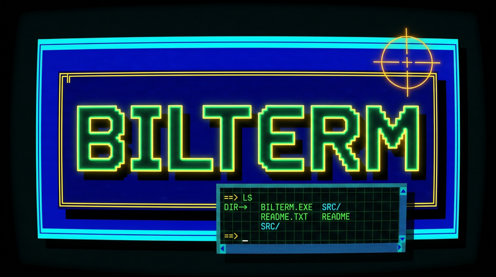
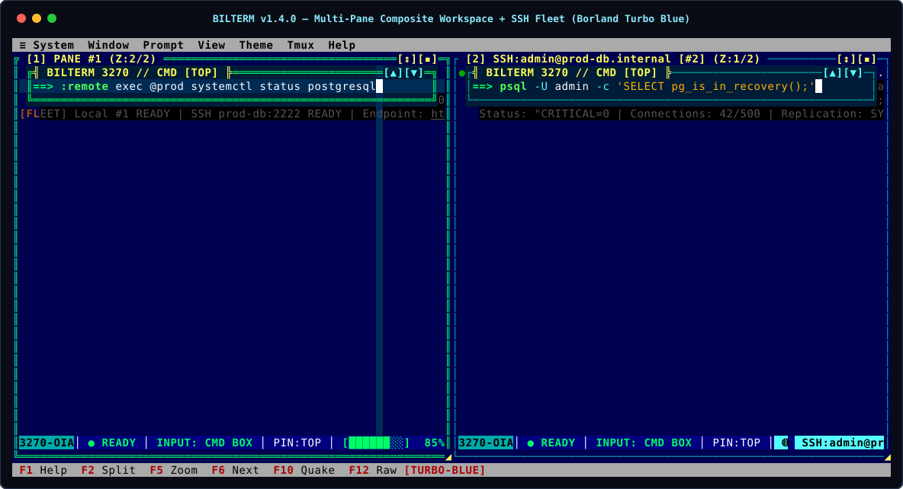

# Bilterm

<p align="center">
  
</p>

<p align="center">
  
  
  
  
  
</p>

## About

**Bilterm** is a retro-futuristic terminal multiplexer, native desktop GUI terminal (`--gui`), composite-pane shell wrapper, remote SSH/`tmux` fleet manager, and AI-automatable terminal emulator written in Rust with [Ratatui](https://ratatui.rs/). Inspired by **IBM 3270 Mainframe Terminals**, **DOS Borland Turbo Vision**, and **TRON's Master Control Program (`MCP`)**, Bilterm treats a **movable/resizable floating command prompt + underlying scrolling PTY output canvas + 3270 Operator Information Area (OIA) status bar as a single composite terminal pane**.

| Property | Details |
|----------|---------|
| **Category** | Terminal Multiplexer · Native Desktop GUI Terminal (`--gui`) · Shell Wrapper · SSH Fleet & AI Agent Control Plane |
| **Core Innovation** | Composite Terminal Panes (`FloatingCommandPrompt` + `OutputCanvas` + `3270-OIA Bar`) with zero `SIGWINCH` geometry thrashing |
| **Windowing & Persistence** | Binary H/V splits, Borland Z-order cascade deck, 4-edge Slide-Out Drawer, full-layout `:detach` / `:attach`, and hierarchical `SessionTree` |
| **Automation & AI** | Native MCP (`bilterm --mcp`), JSON-RPC 2.0 (`bilterm ctl`), TRON `:mcp` Root Console, and declarative TOML playbooks (`bilterm run`) |
| **Platforms & Stack** | Linux, macOS, Windows · Rust `1.88+` (Edition 2024), `ratatui 0.30`, `crossterm`, `portable-pty`, `tokio` · License: `Apache-2.0` |

<p align="center">
  
</p>

<p align="center">
  <em>See the <strong><a href="docs/VISUAL_GALLERY.md">Full Visual Gallery (5 SVG Workspace Renders)</a></strong> for Per-Pane Font Scaling, Multi-Agent AI Swarms, IBM 3278 Phosphor Green, and IBM 3279 Amber CRT screenshots.</em>
</p>

---

## Key Capabilities

- **Composite Terminal Panes & Mainframe Paging**: Pin the command prompt to **Top** (`Alt+T`), **Bottom** (`Alt+B`), **Free-Float** (`Alt+Up`/`Down`), or **Fixed Split** (`Alt+S`) over a 60 FPS flood-immune PTY canvas with `DECSET 1049` auto-hide (`vim`, `htop`, `nmon`), 3-signal `!ECHO LOCK` password protection, and Mainframe Block/Page-Hold (`MORE...` / `HOLDING`) or Smooth Kinetic scrolling (`:scroll`). → *[User Guide Ch. 2](docs/user-guide/02-floating-command-prompt.md)*
- **Full-Layout Detach/Re-Attach, Exit Guard & TRON `:mcp` Console (`v2.0`)**: Detach with `Ctrl+X D` or `:detach` while leaving the entire multi-pane `SplitTree`, `ZStack` window geometries, prompt state, and screen output intact; resume via `bilterm`, `bilterm attach [session]`, or `:attach`. Manage hierarchical `SessionTree` nodes and daemon state inside the floating or push-out **`:mcp` Root Console** (`:mcp status`, `:mcp tree`, `:mcp float`, `:mcp push`). → *[User Guide Ch. 3](docs/user-guide/03-window-manager-and-z-stack.md)*
- **Native Desktop `--gui`, Per-Pane Font Scaling & All-Border Mouse Resize**: Run standalone (`bilterm --gui --gui-font "JetBrains Mono" --gui-font-size 16`) on Linux (X11/Xft), macOS (Cocoa), or Windows (Win32 GDI). Scale each pane's font independently (`50%..300%` via `Ctrl++`/`Ctrl+-`/`Ctrl+Wheel`) and drag any border or corner to resize splits or floating windows. → *[User Guide Ch. 8](docs/user-guide/08-extended-cli-and-gui-examples.md)*
- **22 Open Color Themes, Interactive File Browser, Cursor Customization & High-Res Canvas Graphics**: 22 built-in presets (`turbo-blue`, `ibm-3278-green`, `ibm-3279-amber`, `tron-legacy`, `dracula`, `catppuccin-mocha`, `tokyo-night`, etc.) plus smart `.itermcolors`/TOML directory & glob import (`:theme import <file|dir|glob>`), interactive Text File & Theme Browser (`:browse`, `:files`, `:theme browse`), customizable cursors (`:cursor` popup, `block`/`hollow`/`underline`/`bar`/`custom <char>`, `blink`/`solid`/`rapid`, `#RRGGBB`/named colors), IBM 3270 cross-hairs (`Alt+X`), Focal Spotlight (`Alt+O`), Focal Zoom Lens (`Alt+Shift+O`), Tektronix 4010/4014 vector emulation, and Kitty/Sixel/iTerm2/Braille plotting (`bilterm plot`, `:canvas`). → *[User Guide Ch. 4](docs/user-guide/04-themes-glyphs-and-config.md)*
- **SSH Fleet Management, Robot Playbooks & Zero-Trust Security**: Connect panes via `:ssh` or `:ssh-tmux`, fan out commands by `@tag` (`:remote exec`), and drive workspaces via `bilterm --mcp`, `bilterm ctl`, or `bilterm run <playbook.toml>` under private `0700`/`0600` filesystem & `SO_PEERCRED` confinement. → *[Use Cases (Ch. 9)](docs/user-guide/09-use-cases-and-workflows.md) · [Security (Ch. 10)](docs/user-guide/10-security-and-best-practices.md)*

---

## Quick Start

```bash
# Install binary, manpage & completions (Linux / macOS)
./scripts/install.sh
# Or build & install from source
cargo build --release && install -m 0755 target/release/bilterm ~/.local/bin/bilterm

# Launch TUI multiplexer, detach (Ctrl+X D or :detach), and re-attach with full window layout intact
bilterm
bilterm attach                  # or: bilterm -a [session]

# Launch standalone native desktop GUI window with custom font & theme
bilterm --gui --gui-font "JetBrains Mono" --gui-font-size 16 --theme ibm-3278-green

# Run declarative robot playbook or query via JSON-RPC / MCP
bilterm run starter-packs/01-multi-agent-swarm/playbook.toml
bilterm --mcp
```

*(Full setup & CLI recipes: **[`docs/running.md`](docs/running.md)** and **[Chapter 8: Extended CLI & `--gui` Examples](docs/user-guide/08-extended-cli-and-gui-examples.md)**).*

---

## Essential Shortcuts & `:colon` Commands

> **Leader Prefix (`<L>` = `Ctrl+X` or `Ctrl+B`):** Press **`F1`** or run **`:help`** inside Bilterm to browse the full interactive command reference.

| Action | Shortcut | `:colon` Command |
|--------|----------|------------------|
| **Help / Command Palette / 3270 Inspector** | `F1` (`<L> ?`) / `Ctrl+P` / `F9` (`<L> i`) | `:help` / `:palette` / `:inspector` |
| **Detach & Preserve Window Layout / Re-Attach** | `Ctrl+X D` / Exit Guard `[d]` | `:detach [name]` / `:attach [name]` |
| **TRON MCP Console (Float vs. Push-Out)** | `m` (Float↔Push), `d` (Edge), `Esc` | `:mcp [status \| tree \| float \| push [edge] \| ...]` |
| **Split Horizontal / Split Vertical / Zoom** | `F2` (`<L> -`) / `Alt+V` (`<L> \|`) / `F5` (`<L> z`) | `:split h` / `:split v` / `:zoom` |
| **Tiled Splits vs. Z-Stack / Shuffle Deck** | `Alt+M` (`<L> M`) / `F6` (`<L> o`) / `Alt+1..9` | `:layout tile\|stack` / `:deck next\|prev` / `:focus <N>` |
| **Slide-Out Drawer / Guake Quick Terminal** | `F7` (`<L> d`) / `F10` (`Ctrl+\`) | `:drawer [toggle\|float\|push\|left\|right]` / `:quake` |
| **Cycle Floating / Fixed / Raw Terminal** | `F4` (`<L> e`) / `F12` (`Ctrl+G`) / Click OIA | `:mode [float \| fixed \| terminal \| cycle]` / `:raw` |
| **Per-Pane Font Zoom / Universal Theme** | `Ctrl++` / `Ctrl+-` / `Ctrl+0` / `Ctrl+Wheel` | `:fontsize [+ \| - \| reset]` / `:theme <preset\|list\|import>` |
| **File & Theme Browser / Cursor Customization** | — | `:browse [dir]` / `:cursor [block\|hollow\|underline\|bar\|custom <c>] [blink\|solid\|rapid] [color]` |
| **Mainframe Page-Hold (`MORE...`) & Vi Copy** | `<L> PgDn` / `PF8` / `F8` (`Alt+C`) / `F3` (`<L> f`) | `:scroll [page\|smooth\|instant]` / `:copy` / `:hints` |
| **Session Save / Restore / Tree / SSH Fleet** | — | `:session [save\|restore\|list\|tree]` / `:ssh` / `:remote` |

*(Exhaustive CLI, keyboard, mouse, and `:colon` tables: **[`docs/README.md`](docs/README.md)** and **[Chapter 6: Complete Reference](docs/user-guide/06-keyboard-mouse-and-command-reference.md)**).*

---

## Documentation & Starter Packs

- **[Documentation Hub (`docs/README.md`)](docs/README.md)** — Master index + complete CLI & `:colon` summary tables
  - **[Visual Gallery (`docs/VISUAL_GALLERY.md`)](docs/VISUAL_GALLERY.md)** — All 5 SVG workspace renders
  - **[10-Chapter User Guide (`docs/user-guide/README.md`)](docs/user-guide/README.md)** — End-to-end interactive manual
  - **[Starter Packs (`starter-packs/README.md`)](starter-packs/README.md)** — 5 ready-to-run configs & playbooks (Multi-Agent Swarm, Remote Fleet, Robot QA, Incident War Room, Retro CRT)
  - **[System Architecture (`docs/architecture.md`)](docs/architecture.md)** & **[Purpose / Threat Model (`docs/purpose.md`)](docs/purpose.md)**
  - **[Developer & AI Agent Guide (`docs/DEVELOPER_AND_AGENT_GUIDE.md`)](docs/DEVELOPER_AND_AGENT_GUIDE.md)** & **[Compounded Lessons Learned (`docs/LESSONS_LEARNED_COMPOUNDED.md`)](docs/LESSONS_LEARNED_COMPOUNDED.md)**
  - **[Test Coverage Report (`docs/TEST_COVERAGE.md`)](docs/TEST_COVERAGE.md)** & **[Changelog (`CHANGELOG.md`)](CHANGELOG.md)**
- **License**: [Apache License 2.0 (`LICENSE`)](LICENSE)
