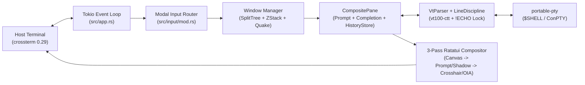

# Bilterm

<p align="center">
  
</p>

```text
╔══════════════════════════════════════════════════════════════════════════════╗
║ ▓▓▓▓▓▓▓  ▓▓▓▓  ▓▓       ▓▓▓▓▓▓▓▓ ▓▓▓▓▓▓▓  ▓▓▓▓▓▓▓  ▓▓▓    ▓▓▓  [1] Z:3/3 [▲] ║██
║ ██   ██   ██   ██          ██    ██       ██   ██  ████  ████  ╔═══════════╗ ║██
║ ███████   ██   ██          ██    █████    ███████  ██ ████ ██  ║ ==> _     ║ ║██
║ ██   ██   ██   ██          ██    ██       ██  ██   ██  ██  ██  ╚═══════════╝ ║██
║ ███████  ████  ███████     ██    ███████  ██   ██  ██      ██   ░░░░░░░░░░░░ ║██
╠══════════════════════════════════════════════════════════════════════════════╣██
║ 3270-OIA │ ● READY │ INPUT: CMD BOX │ PIN:TOP │ ≣ OUT:0L/0B │ ⌖ R:01 C:001   ║██
╚══════════════════════════════════════════════════════════════════════════════╝██
  ████████████████████████████████████████████████████████████████████████████████
     IBM 3270 MAINFRAME PROMPT  ×  BORLAND TURBO VISION TUI MULTIPLEXER
```


-orange)


**Bilterm** is a terminal user interface (TUI) multiplexer, shell wrapper, and terminal emulator written in Rust using [Ratatui](https://ratatui.rs/). Inspired by classic **IBM 3270 Mainframe Terminals** (where the command entry prompt sits at the top of the screen over a scrolling output canvas with an Operator Information Area status bar and full-screen cross-hair cursor) and **DOS Borland Turbo Vision (Turbo C / Turbo Pascal IDE)** windowing systems (`╔═╗` double-line borders, translucent/tinted character-cell drop shadows, Royal Blue / Cyan / 3278 Phosphor Green / 3279 Amber palettes, window number badges, and DOS Function-Key bars), Bilterm treats the **command prompt + underlying PTY output canvas as a single composite terminal pane**.

---

## Core Capabilities

- **Composite Window Pane (`OutputCanvas` + `FloatingCommandPrompt` + `OIA Status Bar`)**:
  - Full-height VT100 / VT220 / Xterm / 24-bit TrueColor PTY output canvas (`portable-pty` + `vt100-ctt`) that scrolls smoothly underneath an overlaid multi-line command prompt with **zero `SIGWINCH` geometry thrashing** when the prompt moves or hides.
  - Flood-immune streaming (`tail -f /dev/random` at 60 FPS via 64KB chunk batching + `VtParser::sanitize_stream_traps`), automatic `DECSET 47/1047/1049` alternate-screen auto-hide (`vim`, `nvim`, `htop`, `less`, `fzf`), and 3-signal line-discipline detection (`OSC 133` + `tcgetpgrp` + `termios !ECHO`) so `sudo`/`ssh` passwords trigger `♦ !ECHO LOCK` and are never echoed in cleartext.
- **Floating or Non-Overlapping Split Command Prompt**:
  - Pin to **Top** (`Alt+T`), **Bottom** (`Alt+B`), **Free-Float** (`Alt+Up`/`Down`, mouse drag), or partition into a **Non-Overlapping Split Command & Output Pane** (`Alt+S` / `:prompt split-top | split-bottom`).
  - **Resizable Width & Height + Scrollable Viewport**: Resize height (`Alt+Plus`/`Alt+Minus`, bottom border drag, `:prompt height <3..12>`) and width (`Alt+]`/`Alt+[`, left/right/corner `◢` border drag, `:prompt width <cols|full>`), with vertical/horizontal scrolling (`Shift+PageUp`/`Shift+PageDown`, mouse wheel, right-border `█`/`░` scrollbar) and a live **`⟳ RUNNING:` / `● LAST CMD:` banner** showing the active command after pressing `Enter`.
- **Context-Aware `<Tab>` Completion, History Pop-up & Session Persistence**:
  - Built-in `Tab` / `Shift+Tab` completion for `:colon` commands and arguments, shell builtins, `$PATH` executables, `$ENV` / `${ENV}` variables, and relative/`~/` filesystem paths resolved against the child shell's live working directory (`OSC 7` + `/proc/<pid>/cwd`).
  - Borland **Command History Pop-up Window** (`Alt+P` / `:history`), `Ctrl+R` fuzzy history search (`nucleo-matcher`), automatic per-session/per-pane history file persistence (`$XDG_STATE_HOME/bilterm/history/`) with rotation (`:history max-files <N>`, `:history on|off`), and temporary `.sh` script export (`:history save [path]`).
- **Multi-Pane Window Manager, Z-Order Deck & Guake Quick Terminal**:
  - Split any composite pane horizontally (`F2` / `Alt+H` / `:split h`) or vertically (`Alt+V` / `:split v`).
  - Stack composite panes in overlapping z-order (`Alt+M` / `:layout stack`), shuffle the deck top-to-bottom (`F6` / `Alt+Tab`) or bottom-to-top (`Alt+Shift+Tab`), and selectively raise any pane via `Alt+1..9` or mouse click.
  - Toggle a **persistent Guake/Quake-style drop-down quick terminal** (`F10` / `Alt+\`` / `Ctrl+Space` / `:quake`) and an interactive scrollable **`<F1>` Help Modal** (`F1` / `:help`).
- **Retro Mainframe & Borland Turbo Vision Aesthetics**:
  - 5 built-in themes (`turbo-blue`, `turbo-cyan`, `ibm-3278-green`, `ibm-3279-amber`, `ibm-mono`), 8 border outlines (`double`, `solid`, `rounded`, `thick`, `dotted`, `dashed`, `quadruple`, `ascii`), 4 DOS drop-shadow styles (`translucent`, `tinted`, `solid`, `none`), 4 glyph packs (`unicode`, `cp437`, `nerd-font`, `ascii`), and **Pane-Local or Full-Screen IBM 3270 Cross-Hair Cursors** (`Alt+X` / `:crosshair full | pane | off`).
- **First-Class `tmux` Integration**:
  - Outer `$TMUX` coexistence with `DCS tmux;` clipboard passthrough and `tmux -CC` Control Mode synchronization (`src/tmux/mod.rs`).

---

## Which Shell Does Bilterm Run & How Does `<Tab>` Completion Work?

### 1. Shell Resolution (`src/pty/mod.rs`)
Bilterm is completely **shell-agnostic** — it spawns your configured interactive system shell inside a pseudoterminal (`portable-pty`) for every Composite Pane and for the Guake drop-down overlay:
- **Linux & macOS**: Spawns **`$SHELL`** (supporting `zsh`, `bash`, `fish`, `nu`, `dash`, `ksh`, `sh`; falls back to `/bin/sh` if `$SHELL` is unset). You can override it per invocation via `SHELL=/bin/zsh ./target/release/bilterm`.
- **Windows**: Spawns **`%COMSPEC%`** (falling back to `powershell.exe`) via Windows `ConPTY`.

### 2. Dual-Mode `<Tab>` Command Completion (`src/pane/completion.rs`)
- **In Command Box Mode (`INPUT: CMD BOX`)**: Pressing **`Tab`** (or **`Shift+Tab`**) triggers Bilterm's built-in completion engine (`compute_completions`):
  1. **`:colon` Commands & Sub-Arguments**: Completes `:prompt`, `:outline`, `:shadows`, `:theme`, `:history`, `:crosshair`, etc., plus their valid arguments (`:prompt split-top`, `:outline rounded`, `:shadows tinted`).
  2. **Command Token (1st word or after `|` / `;` / `&&`)**: Completes shell builtins (`cd`, `export`, `source`, `jobs`, `kill`, etc.), scans all executable binaries in your **`$PATH`**, and completes explicit paths (`./`, `../`, `/`, `~/`).
  3. **Path Arguments (Subsequent words)**: Resolves relative paths against the child shell's **live current working directory** (tracked via `OSC 7` and `/proc/<pid>/cwd`) with `~/` expansion and trailing `/` directory traversal.
  4. **Environment Variables**: Completes `$VAR` and `${VAR}` against active environment variables.
  5. **LCP + Candidate Ribbon**: Expands the Longest Common Prefix and opens a bottom **`TAB: cand1  [cand2]  cand3`** ribbon inside the prompt box for `Tab` / `Shift+Tab` cycling (`Esc` to dismiss).
- **In Raw PTY Mode (`INPUT: RAW PTY`, toggled via `F12` / `Ctrl+G`)**: Pressing **`Tab`** forwards raw `0x09` (`\t`) directly to your underlying `$SHELL` (`zsh` `compsys`, `bash-completion`, `fish`, `fzf`).

---

## High-Level Architecture



*(See [`docs/architecture.md`](docs/architecture.md) and [`docs/diagrams/`](docs/diagrams/README.md) for full ASCII, Mermaid, and native draw.io XML diagrams).*

---

## Quick Start

```bash
# Build optimized release binary
cargo build --release

# Launch Bilterm
./target/release/bilterm
```

Run the full test, clippy, and coverage suite locally:

```bash
cargo test --all-targets
cargo clippy --all-targets -- -D warnings
```

---

## Keyboard, Mouse & `:command` Quick Reference

| Action | Shortcut | `:command` |
|--------|----------|------------|
| **Interactive Help Modal** | `F1` | `:help` / `:?` |
| **Split Pane Horizontally / Vertically** | `F2` (`Alt+H`) / `Alt+V` | `:split h` / `:split v` |
| **Zoom / Maximize Focused Pane** | `F5` / `Alt+Z` | `:zoom` |
| **Toggle Tiled vs. Z-Order Stack** | `Alt+M` | `:layout stack \| tile` |
| **Shuffle Z-Order Deck Next / Prev** | `F6` (`Alt+Tab`) / `Alt+Shift+Tab` | `:deck next \| prev` |
| **Selectively Raise Pane `#1..#9`** | `Alt+1` .. `Alt+9` / Mouse Click | `:focus <1..9>` |
| **Guake Drop-Down Quick Terminal** | `F10` / `Alt+\`` / `Ctrl+Space` | `:quake` |
| **Toggle `CMD BOX` vs. `RAW PTY`** | `F12` / `Ctrl+G` | `:raw` |
| **Pin Prompt Top / Bottom / Split** | `Alt+T` / `Alt+B` / `Alt+S` | `:prompt top \| bottom \| split-top \| split-bottom` |
| **Resize Prompt Height / Width** | `Alt+Plus`/`Minus` / `Alt+]`/`[` / Drag | `:prompt height <3..12>` / `:prompt width <cols\|full>` |
| **Scroll Multi-Line Prompt** | `Shift+PageUp` / `Shift+PageDown` / Wheel | — |
| **Tab Completion** | `Tab` / `Shift+Tab` | — |
| **Command History Pop-up / Save** | `Alt+P` (`s` to export `.sh`) | `:history` / `:history save [path]` / `:history on\|off` |
| **Cycle IBM 3270 Cross-Hairs** | `Alt+X` (Pane -> Full-Screen -> Off) | `:crosshair full \| pane \| off` |
| **Window & Prompt Border Outlines** | — | `:outline [window\|prompt] <double\|solid\|rounded\|thick\|dotted\|dashed\|quadruple\|ascii>` |
| **Themeable DOS Drop Shadows** | — | `:shadows <translucent\|tinted\|solid\|off>` |
| **Switch Retro Theme Palette** | — | `:theme turbo-blue \| turbo-cyan \| 3278 \| 3279 \| mono` |
| **Clean Quit** | `Ctrl+Q` | `:quit` / `:q` |

---

## Documentation Hub

- **[Documentation Hub (`docs/README.md`)](docs/README.md)** — Central index for all engineering and user documentation:
  - **[Purpose & Threat Model (`docs/purpose.md`)](docs/purpose.md)** — Motivation, IBM 3270 × Borland design, `!ECHO LOCK` password security, and `/dev/random` flood immunity.
  - **[System Architecture (`docs/architecture.md`)](docs/architecture.md)** — Subsystem internals, 3-pass Ratatui compositor, 3-signal line-discipline state machine, and storage layer.
  - **[Running, Shells & Tab Completions (`docs/running.md`)](docs/running.md)** — Shell resolution (`$SHELL`/`%COMSPEC%`), Tab completion internals, `config.toml` schema, environment variables, and exit codes.
  - **[Operational How-To & Recipes (`docs/how-to.md`)](docs/how-to.md)** — Step-by-step task recipes and troubleshooting matrix.
  - **[Visual Diagrams Catalog (`docs/diagrams/README.md`)](docs/diagrams/README.md)** — Terminal ASCII (`ascii_architecture.txt`), Mermaid (`.mmd`), and native draw.io XML (`.drawio`) diagrams.
- **[7-Chapter User Guide (`docs/user-guide/README.md`)](docs/user-guide/README.md)**:
  1. [Chapter 1: Getting Started & Core Concepts](docs/user-guide/01-getting-started.md)
  2. [Chapter 2: The Command Prompt, Tab Completion, History & Command Blocks](docs/user-guide/02-floating-command-prompt.md)
  3. [Chapter 3: Multi-Pane Window Manager, Z-Order Stacking & Guake Quick Terminal](docs/user-guide/03-window-manager-and-z-stack.md)
  4. [Chapter 4: Retro Mainframe & DOS Aesthetics, Outlines, Drop Shadows, Cross-Hairs & Config](docs/user-guide/04-themes-glyphs-and-config.md)
  5. [Chapter 5: First-Class `tmux` Integration](docs/user-guide/05-tmux-integration.md)
  6. [Chapter 6: Complete Keyboard, Mouse & `:command` Reference](docs/user-guide/06-keyboard-mouse-and-command-reference.md)
  7. [Chapter 7: Troubleshooting & FAQ](docs/user-guide/07-troubleshooting-and-faq.md)
- **[Test Coverage & Torture Suite Report (`docs/TEST_COVERAGE.md`)](docs/TEST_COVERAGE.md)** — `81.83%` line coverage report and stress/torture test matrix.
- **[Changelog (`CHANGELOG.md`)](CHANGELOG.md)** — Semantic versioning release history.
