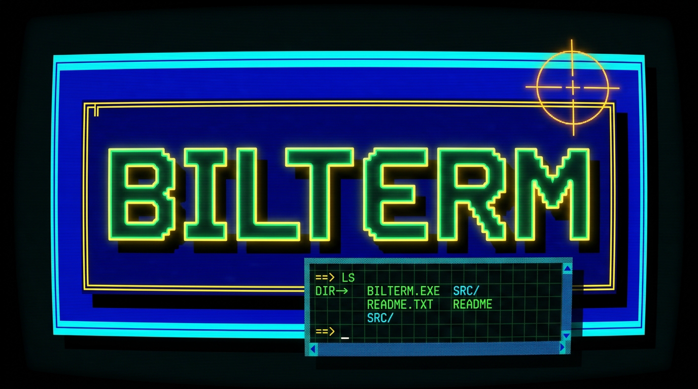
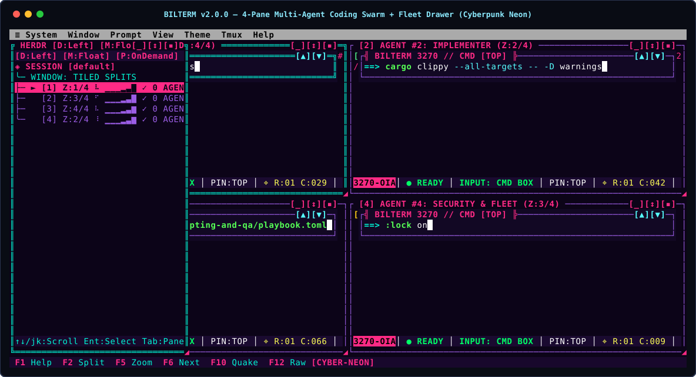

# Bilterm

<p align="center">
  
</p>

<p align="center">
  <a href="https://github.com/bsommers/bilterm/releases/tag/v3.0.4"></a>
  
  
  
  <a href="https://bsommers.github.io/bilterm/"></a>
  
</p>

## About

**Bilterm** is a retro-futuristic terminal multiplexer, native desktop GUI terminal (`--gui`), composite-pane shell wrapper, resilient remote SSH/`tmux` fleet manager, and autonomous AI agent control plane written in Rust with [Ratatui](https://ratatui.rs/). Inspired by **IBM 3270 Mainframe Terminals**, **DOS Borland Turbo Vision**, and **TRON's Master Control Program (`MCP`)**, Bilterm treats a **movable/resizable floating command prompt + underlying scrolling PTY output canvas + 3270 Operator Information Area (OIA) status bar as a single composite terminal pane**.

| Property | Details |
|----------|---------|
| **Category** | Terminal Multiplexer · Native Desktop GUI Terminal (`--gui`) · Shell Wrapper · Remote SSH/`tmux` Fleet & Autonomous AI Agent Swarm Workspace |
| **Core Innovation** | Composite Terminal Panes (`FloatingCommandPrompt` + `OutputCanvas` + `3270-OIA Bar`) with zero `SIGWINCH` geometry thrashing |
| **Windowing & Workspace** | Binary H/V splits, Borland Z-order cascade deck, Agent-Aware Navigator Sidebar (`F7`), Treemap Session Packing (`:sessions map`), full-layout `:detach` / `:attach`, and hierarchical `SessionTree` |
| **Agent Swarms & Messaging** | Inter-agent messaging (`:agent send|inbox|wait`), bounded mailboxes, `mailbox`/`nudge`/`file` delivery modes, Agent Traffic Bus packet stream, and Snoop View |
| **Design System & Modern UI** | 8 appearance profiles (`:appearance obsidian|legacy|midnight|arctic|liquid|amber|synthwave|solarized`), 3 display modes (`:mode standard|minimal|zen`), and First-Class Utility Windows (`:fonts`, `:commands`, `:script` / `:studio`) |
| **Automation & APIs** | Native MCP (`bilterm --mcp`, 11+ tools & dynamic resources), JSON-RPC 2.0 (`bilterm ctl`), REST / HTTP+SSE (`--http`), TRON `:mcp` Root Console, and declarative TOML playbooks (`bilterm run`) |
| **Platforms & Stack** | Linux, macOS, Windows · Rust `1.88+` (Edition 2024), `ratatui 0.30`, `crossterm`, `portable-pty`, `tokio` · License: `Apache-2.0` |

<p align="center">
  
</p>

<p align="center">
  <em>Live interactive site &amp; visual showcase: <strong><a href="https://bsommers.github.io/bilterm/">https://bsommers.github.io/bilterm/</a></strong> &bull; See <strong><a href="docs/VISUAL_GALLERY.md">Full Visual Gallery (5 SVG Workspace Renders)</a></strong> for Turbo Blue, Font Zoom, IBM 3278 Phosphor Green, and IBM 3279 Amber CRT screenshots.</em>
</p>

---

## What's New in Bilterm v3.0

- **Agent-Aware Workspace Navigator (`:drawer style navigator`, `F7`)**: An always-available slide-out/push-out left sidebar displaying workspace hierarchy, active sessions, and live agent status dots (`● Working`, `● Idle`, `● Blocked`, `● Done`, `● Errored`). Features attention badges, jump-to-next-blocked navigation (`Alt+]`), real-time packet telemetry on the Agent Traffic Bus, and Snoop View (`:agent snoop <id>`). → *[User Guide Ch. 11](docs/user-guide/11-navigator-sidebar-and-agent-traffic.md)*
- **Agent-to-Agent Messaging & Coordination (`:agent`)**: Direct inter-agent communication across terminal panes without knowing terminal internals. Features stable per-pane agent addressing (`:agent name`), bounded mailboxes (`MAX_INBOX_DEPTH = 64`), and 3 delivery modes: `mailbox` (queued), `nudge` (injected only when idle/waiting; suppressed during password locks or `ALT_SCREEN`), and `file` (0600 payload files for large transfers). Includes hop-count loop guards (`MAX_HOPS = 8`) and rate limits. → *[User Guide Ch. 11](docs/user-guide/11-navigator-sidebar-and-agent-traffic.md)*
- **Unified Registry & Fuzzy Finder (`:find`, `Ctrl+Alt+F`)**: Instant fuzzy search across agents, active and saved sessions, and command history (`:find agent|session|history <query>`). Features zero-trust secret masking and redaction to protect tokens and passwords in history logs. → *[User Guide Ch. 12](docs/user-guide/12-find-registry-and-history.md)*
- **UI Modernization & 8 Design Profiles (`:appearance`, `:mode`)**: Switch between 8 built-in visual profiles (`Obsidian` dark slate default, `Legacy` Borland Blue, `Midnight`, `Arctic`, `Liquid`, `Amber`, `Synthwave`, `Solarized`) and 3 display modes (`:mode standard|minimal|zen`), with custom profile saving, export, and import. → *[User Guide Ch. 4](docs/user-guide/04-themes-glyphs-and-config.md)*
- **Persistent SSH + Remote tmux Fleet (`:ssh-tmux`)**: Launch remote sessions via `:ssh-tmux <host> [session]` backed by remote `tmux -CC`. Resilient state machine automatically reconnects with exponential backoff on network drop, hydrates scrollback via `capture-pane`, and prevents accidental closure with exit hold banners. → *[User Guide Ch. 5](docs/user-guide/05-tmux-integration.md)*
- **First-Class Utility Windows (`:fonts`, `:commands`, `:script` / `:studio`)**: Dedicated floating, pinnable (`*`), and dockable workbench windows. Live typography preview in `:fonts`, command palette execution history in `:commands`, and full Script Studio in `:script` / `:studio` featuring a multi-line `.bt` editor, live action recorder (`[● Rec]`), and single-step debugger (`[F10/n Step]`).
- **Session Reorganization & Packing Viewer (`:sessions map`, `:window move`)**: Treemap-style container packing visualizer in Braille/UTF-8 box-drawing or native GUI vector rendering with mouse drag-and-drop. Migrate live windows across sessions (`:window move <session>`), perform multi-select bulk operations (`:window bulk move|close|tile|pin`), and safely revert topology with single-step undo (`:window undo`). → *[User Guide Ch. 3](docs/user-guide/03-window-manager-and-z-stack.md)*
- **Daemon Supervisor & Multi-Daemon Architecture (`:daemon`)**: Auto-spawned singleton background daemon with stale-lock recovery. Manage named daemons (`--daemon --name <n>`) with cross-daemon discovery, RPC/MCP bridging, and headless HTTP+SSE transport (`--http 127.0.0.1:PORT`).
- **Full Command Parity & Public APIs (`docs/API.md`)**: Strict RFC 8259 JSON-RPC 2.0 API, 11+ MCP tools (`bilterm_agent_mail`, `bilterm_find`, `bilterm_run_action`), dynamic MCP resources (`bilterm://state`, `bilterm://agent/<name>/inbox`), and dotted config get/set (`:get`, `:set`, `:config list|save`). → *[API Specification](docs/API.md)*

---

## Core Capabilities

- **Composite Terminal Panes & Mainframe Paging**: Pin the command prompt to **Top** (`Alt+T`), **Bottom** (`Alt+B`), **Free-Float** (`Alt+Up`/`Down`), or **Fixed Split** (`Alt+S`) over a 60 FPS flood-immune PTY canvas with `DECSET 1049` auto-hide (`vim`, `htop`, `nmon`), 3-signal `!ECHO LOCK` password protection, and Mainframe Block/Page-Hold (`MORE...` / `HOLDING`) or Smooth Kinetic scrolling (`:scroll`). → *[User Guide Ch. 2](docs/user-guide/02-floating-command-prompt.md)*
- **2D Rectangular Block Selection & Copy**: Drag-select 2D rectangular columns with `Alt+LeftDrag` or persistent `:rect mode` across terminal output, log columns, or tables. Pastes cleanly to system and OSC 52 clipboards (`Alt+R` / `r` in Copy Mode). → *[User Guide Ch. 6](docs/user-guide/06-keyboard-mouse-and-command-reference.md)*
- **Full Session Persistence & Exit Guard**: Detach with `Ctrl+X D` or `:detach` leaving split tree ratios, Z-order stack, prompt anchors, active shells, running commands, and per-pane CWD intact; resume via `bilterm attach [session]`. Protects root shell exits via interactive Borland Exit Guard modals. → *[User Guide Ch. 3](docs/user-guide/03-window-manager-and-z-stack.md)*
- **Native Desktop GUI (`--gui`) & Per-Pane Font Scaling**: Run standalone without a host terminal on Linux (X11), macOS (Cocoa), or Windows (GDI). Scale each pane's font independently (`50%..300%` via `Ctrl++`/`Ctrl+-`/`Ctrl+Wheel`), drag all borders to resize, and plot high-res Kitty/Sixel/Braille graphics (`bilterm plot`, `:canvas`). → *[User Guide Ch. 8](docs/user-guide/08-extended-cli-and-gui-examples.md)*
- **Zero-Trust Confinement**: All runtime sockets, session TOMLs, command history exports, and `.cast` recordings reside in `0700` directories with `0600` atomic file permissions. Unix sockets enforce `SO_PEERCRED` UID checks; HTTP transports require local loopback and bearer token authentication. → *[Security & Best Practices (Ch. 10)](docs/user-guide/10-security-and-best-practices.md)*

---

## Quick Start

```bash
# One-line installer (Linux / macOS) — binary, manpage & completions
curl -fsSL https://raw.githubusercontent.com/bsommers/bilterm/main/scripts/install.sh | bash

# Or build & install from source (Rust 1.88+, Edition 2024)
cargo build --release && install -m 0755 target/release/bilterm ~/.local/bin/bilterm

# Launch TUI multiplexer, detach (Ctrl+X D or :detach), and re-attach
bilterm
bilterm attach                  # or: bilterm -a [session]
bilterm new [session]           # start a new named session
bilterm blank [session]         # start a clean 1-pane blank session

# Launch standalone native desktop GUI window with custom font & modern profile
bilterm --gui --gui-font "JetBrains Mono" --gui-font-size 16 --appearance obsidian

# Connect to resilient remote SSH + tmux session
bilterm -- ssh-tmux devbox.lan main

# Run AI agent swarm or query via MCP / JSON-RPC
bilterm --mcp
bilterm ctl agent.send '{"to":"worker-1","body":"Run test suite","mode":"mailbox"}'
bilterm run starter-packs/01-multi-agent-swarm/playbook.toml
```

*(Full setup & CLI recipes: **[`docs/running.md`](docs/running.md)** and **[Chapter 8: Extended CLI & `--gui` Examples](docs/user-guide/08-extended-cli-and-gui-examples.md)**).*

---

## Essential Shortcuts & `:colon` Commands

> **Leader Prefix (`<L>` = `Ctrl+X` or `Ctrl+B`):** Press **`F1`** or run **`:help`** inside Bilterm to browse the complete interactive command reference. Every keybinding has a 1:1 `:colon` equivalent.

| Action / Capability | Keyboard Shortcut | `:colon` Command | Description |
|---------------------|-------------------|------------------|-------------|
| **Help / Palette / Inspector** | `F1` (`<L> ?`) / `Ctrl+P` / `F9` (`<L> i`) | `:help` / `:palette` / `:inspector` | Command catalog, search & 3270 state inspection |
| **Workspace Navigator Drawer** | `F7` (`<L> d`) / Click OIA | `:drawer [toggle \| navigator \| classic]` | Slide-out sidebar with agent state dots & hierarchy |
| **Global Fuzzy Finder** | `Ctrl+Alt+F` | `:find [agent \| session \| history] <q>` | Unified registry search with secret masking |
| **Agent Messaging & Swarms** | `Alt+]` (next blocked) | `:agent [name \| send \| inbox \| list \| snoop]` | Inter-agent messaging, mailboxes & packet telemetry |
| **Appearance & Display Modes** | `F11` / `F4` (`<L> e`) | `:appearance [obsidian \| legacy \| ...]` / `:mode [standard \| zen]` | 8 visual profiles & distraction-free Zen mode |
| **Detach & Re-Attach Workspace** | `Ctrl+X D` / Exit Guard `[d]` | `:detach [name]` / `:attach [name]` | Leaves shells running in background daemon |
| **Split Horizontal / Split Vertical / Zoom** | `F2` (`<L> -`) / `Alt+V` (`<L> \|`) / `F5` (`<L> z`) | `:split h` / `:split v` / `:zoom` | Binary space partitioning tiling |
| **Tiled Splits vs. Z-Stack / Shuffle Deck** | `Alt+M` (`<L> M`) / `F6` (`<L> o`) / `Alt+1..9` | `:layout tile\|stack` / `:deck next\|prev` | Overlapping Borland window cascade & switching |
| **Utility Windows (Fonts / Studio)** | `*` (pin) / `[` / `]` (scale) | `:fonts` / `:commands` / `:studio` | Workbench windows, live recorder & step debugger |
| **2D Rectangular Select & Copy** | `Alt+R` / `Alt+LeftDrag` | `:rect [mode \| copy \| cut \| clear]` | Drag-select & copy 2D block columns across canvas |
| **Persistent Remote SSH + tmux** | — | `:ssh-tmux <host> [session]` | Auto-reconnecting resilient remote sessions |
| **Session Map & Window Migration** | `m` (in Map) | `:sessions map` / `:window move <session>` | Treemap packing viewer, drag-and-drop & migration |
| **Undo Window Topology** | — | `:window undo` | Single-step session reorganization rollback |
| **Mainframe Page-Hold & Vi Copy** | `<L> PgDn` / `F8` (`Alt+C`) / `F3` (`<L> f`) | `:scroll [page\|smooth]` / `:copy` / `:hints` | `MORE...` page pauses, Vi copy & QuickSelect hints |

*(Exhaustive CLI, keyboard, mouse, and `:colon` tables: **[`docs/README.md`](docs/README.md)** and **[Chapter 6: Complete Reference](docs/user-guide/06-keyboard-mouse-and-command-reference.md)**).*

---

## Documentation & Ecosystem

- **[GitHub Pages Live Site](https://bsommers.github.io/bilterm/)** — Interactive landing page, screenshots & quick start
- **[Documentation Hub (`docs/README.md`)](docs/README.md)** — Master index + complete CLI & `:colon` summary tables
  - **[12-Chapter User Guide (`docs/user-guide/README.md`)](docs/user-guide/README.md)** — End-to-end interactive manual (including Navigator, Agent Traffic & Unified Find)
  - **[API & JSON-RPC 2.0 Specification (`docs/API.md`)](docs/API.md)** — Methods, parameters, error codes, HTTP SSE streaming & MCP contracts
  - **[MCP Use Cases & Agent Scenarios (`docs/mcp-usecases/`)](docs/mcp-usecases/)** — Automated test harnesses, AI code reviewers & swarm orchestration
  - **[Visual Gallery (`docs/VISUAL_GALLERY.md`)](docs/VISUAL_GALLERY.md)** — All 5 SVG workspace renders
  - **[Starter Packs (`starter-packs/README.md`)](starter-packs/README.md)** — 5 ready-to-run configs & playbooks (Multi-Agent Swarm, Remote Fleet, Robot QA, Incident War Room, Retro CRT)
  - **[System Architecture (`docs/architecture.md`)](docs/architecture.md)** & **[Threat Model (`docs/purpose.md`)](docs/purpose.md)**
  - **[Developer & AI Agent Guide (`docs/DEVELOPER_AND_AGENT_GUIDE.md`)](docs/DEVELOPER_AND_AGENT_GUIDE.md)** & **[Compounded Lessons Learned (`docs/LESSONS_LEARNED_COMPOUNDED.md`)](docs/LESSONS_LEARNED_COMPOUNDED.md)**
  - **[Test Coverage Report (`docs/TEST_COVERAGE.md`)](docs/TEST_COVERAGE.md)** & **[Changelog (`CHANGELOG.md`)](CHANGELOG.md)**
- **License**: [Apache License 2.0 (`LICENSE`)](LICENSE)
