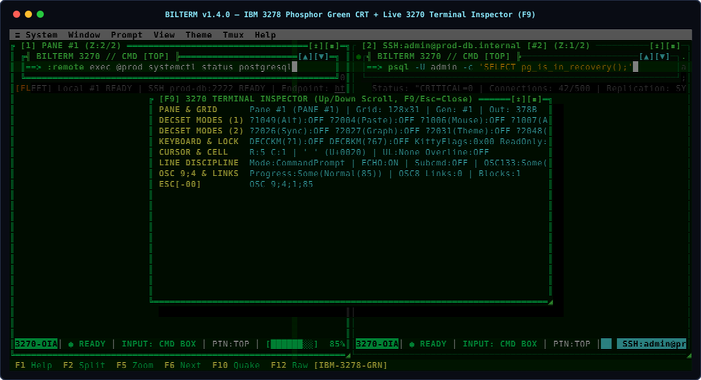
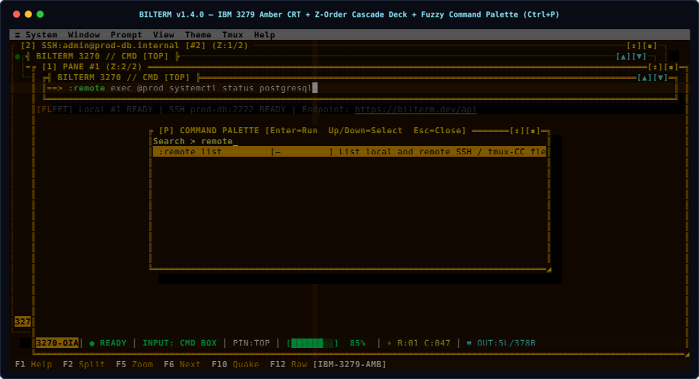

# Bilterm

<p align="center">
  
</p>

<p align="center">
  
  
  
  
  
</p>

**Bilterm** is a terminal user interface (TUI) multiplexer, shell wrapper, terminal emulator, and agent/fleet automation platform written in Rust using [Ratatui](https://ratatui.rs/). Fusing classic **IBM 3270 Mainframe Terminals** (top-pinned floating command prompt over a scrolling PTY output canvas, Operator Information Area status bar, and full-screen cross-hair cursor) with **DOS Borland Turbo Vision** windowing (`╔═╗` double-line borders, character-cell drop shadows, Z-order window cascade decks, and function-key bars), Bilterm treats the **floating command prompt + underlying PTY output canvas as a single composite terminal pane**.

---

## Screenshots

### 1. Multi-Pane Composite Workspace & SSH Fleet (`turbo-blue`)
<p align="center">
  
</p>

### 2. IBM 3278 Phosphor Green CRT & Live 3270 Terminal Inspector (`F9`) / IBM 3279 Amber CRT & Fuzzy Command Palette (`Ctrl+P`)
| IBM 3278 Phosphor Green + `F9` 3270 Inspector | IBM 3279 Amber + Z-Order Cascade + `Ctrl+P` Palette |
| :---: | :---: |
|  |  |

---

## Core Highlights

- **Composite Terminal Panes (`OutputCanvas` + `FloatingCommandPrompt` + `3270 OIA Bar`)**:
  - Pin the command prompt to **Top** (`Alt+T`), **Bottom** (`Alt+B`), **Free-Float** (`Alt+Up`/`Down` or mouse drag), or **Non-Overlapping Split** (`Alt+S` / `:prompt split-top | split-bottom`) with **zero `SIGWINCH` geometry thrashing**.
  - Flood-immune streaming (`tail -f /dev/random` at 60 FPS), `DECSET 1049` alternate-screen auto-hide (`vim`, `htop`), and 3-signal `!ECHO LOCK` password protection (`sudo`, `ssh`).
- **Multi-Pane Tiling, Z-Order Window Deck & Guake Overlay**:
  - Binary H/V splits (`F2`/`Alt+H`, `Alt+V`), overlapping Borland Z-order cascade (`Alt+M`, `F6`/`Alt+Tab`, `Alt+1..9`), and a persistent Guake drop-down terminal (`F10` / `Alt+\``).
- **Retro Mainframe & Borland Aesthetics + Focal Spotlight & Lens Shaders**:
  - 5 palettes (`turbo-blue`, `turbo-cyan`, `3278`, `3279`, `mono`), 8 border outlines, 4 drop-shadow styles, CRT scanlines (`:crt`), pane/full-screen IBM 3270 cross-hairs (`Alt+X`), **Focal Spotlight** (`Alt+O` / `:spotlight`) & **Focal Zoom Magnifying Lens** (`Alt+Shift+O` / `:focalzoom`) with smooth Hermite `smoothstep` or pixelated `2×1` character-block falloff, plus **Kitty (`APC G`)** and **DEC Sixel (`DCS q`)** graphics.
- **First-Class Local & Remote `tmux` + `herdr`-Style SSH Fleet Management (`v1.4.0`)**:
  - Spawn remote SSH composite panes (`:ssh <user@host> [port]`), attach to persistent remote `tmux -CC` sessions over SSH (`:ssh-tmux <user@host> [session]`), and centrally fan out commands across local and remote nodes by `@tag` (`:remote add|list|exec|disconnect`).
- **Full Robot / Agent Automation API, Native MCP Server & Playbooks (`v1.1.0`–`v1.4.0`)**:
  - Drive 100% of Bilterm via JSON-RPC 2.0 (`bilterm --headless --listen 127.0.0.1:7370`, `bilterm ctl`), Model Context Protocol (`bilterm --mcp` with 8 agent tools), or declarative TOML playbooks (`bilterm --playbook <file.toml>`).

---

## Quick Start

```bash
# Build & launch interactive TUI multiplexer
cargo build --release
./target/release/bilterm

# Run full verification & coverage suite locally
cargo test --all-targets
cargo clippy --all-targets -- -D warnings
```

### CLI & Automation Quick Reference

| Command | Description |
|---------|-------------|
| `bilterm` | Launch interactive IBM 3270 × Borland Turbo Vision TUI multiplexer |
| `bilterm --mcp` | Run native Model Context Protocol (MCP `2024-11-05`) server over `stdio` |
| `bilterm --headless --listen <addr>` | Run headless JSON-RPC 2.0 automation daemon on TCP or Unix socket |
| `bilterm ctl <addr> <method> [json]` | Send JSON-RPC 2.0 command (`workspace.status`, `pane.exec`, `fleet.exec`, etc.) |
| `bilterm --playbook <file.toml>` | Execute declarative multi-step TOML robot playbook with assertions |
| `bilterm --gui-dump <path.ppm>` | Render workspace via `GuiWorkspaceRenderer` to a Netpbm `.ppm` framebuffer |
| `bilterm --completions <bash\|zsh\|fish>` | Print shell completion script to `stdout` |
| `bilterm --man` | Print standalone `roff(7)` manual page (`docs/bilterm.1`) |

---

## Essential Shortcuts & `:colon` Commands

| Action | Shortcut | `:command` |
|--------|----------|------------|
| **Help / Command Palette / 3270 Inspector** | `F1` (`Ctrl+X ?`) / `Ctrl+P` (`Alt+Space`) / `F9` (`Ctrl+X i`) | `:help` / `:palette` / `:inspector` |
| **Split Horizontal / Split Vertical / Zoom** | `F2` (`Ctrl+X -` / `Alt+H`) / `Ctrl+X \|` (`Alt+V`) / `F5` (`Ctrl+X z` / `Alt+Z`) | `:split h` / `:split v` / `:zoom` |
| **Toggle Tiled vs. Z-Stack / Shuffle Deck** | `Ctrl+X m` (`Alt+M`) / `F6` (`Ctrl+X Tab`) / `Ctrl+X 1..9` (`Alt+1..9`) | `:layout stack\|tile` / `:deck next\|prev` / `:focus <N>` |
| **Guake Quick Terminal / Raw PTY Toggle** | `F10` (`Ctrl+\` / `Alt+\``) / `F12` (`Ctrl+G`) | `:quake` / `:raw` |
| **Cycle Floating / Fixed / Regular Terminal** | `F4` (`Ctrl+X e` / `Alt+E`) / Click OIA Bar | `:mode [float \| fixed \| terminal \| cycle]` |
| **Prompt Pin Top / Bottom / Non-Overlapping Split**| `Ctrl+X t` (`Alt+T`) / `Ctrl+X b` / `Ctrl+X s` (`Alt+S`) | `:prompt top \| bottom \| split-top \| split-bottom` |
| **3270 Field Hints / Vi Copy / Canvas Search** | `Ctrl+X f` / `Ctrl+X [` (`Alt+C`) / `Ctrl+X /` (`Alt+/`) | `:hints` / `:copy` / `:search <query>` |
| **Read-Only Lock / Multi-Pane Broadcast** | `Ctrl+X l` (`Alt+L`) / — | `:lock [on\|off]` / `:broadcast [on\|off]` |
| **Theme / Cross-Hairs / CRT Scanlines** | — / `Ctrl+X x` (`Alt+X`) / — | `:theme <name>` / `:crosshair full\|pane\|off` / `:crt` |
| **Focal Spotlight / Focal Zoom Lens / Resize** | `Alt+O` (`Ctrl+X L`) / `Alt+Shift+O` / `Alt+Shift+]` & `[` | `:spotlight [circle\|ellipse] [fuzzy\|pixel]` / `:focalzoom [1.25x..3x]` |
| **SSH Pane / Remote `tmux -CC` over SSH** | — | `:ssh <user@host> [port]` / `:ssh-tmux <user@host> [sess]` |
| **`herdr` Fleet Register / List / Tag Exec** | — | `:remote add <name> <host> [@tags]` / `:remote list` / `:remote exec <@tag\|all> <cmd>` |

*(See **[Chapter 6: Complete Keyboard, Mouse & `:command` Reference](docs/user-guide/06-keyboard-mouse-and-command-reference.md)** for the full table of shortcuts, mouse gestures, and commands).*

---

## Documentation Hub

All detailed engineering guides, user manual chapters, and architecture diagrams live in [`docs/`](docs/README.md):

- **[Documentation Index (`docs/README.md`)](docs/README.md)**
  - **[Purpose & Security Threat Model (`docs/purpose.md`)](docs/purpose.md)** — IBM 3270 × Borland design rationale, `!ECHO LOCK` password safety, `/dev/random` flood immunity, and paste-injection guards.
  - **[System Architecture & Internals (`docs/architecture.md`)](docs/architecture.md)** — 3-pass Ratatui compositor, `GridSnapshot` + `VtWorkerHandle` seam, 3-signal line-discipline detector, JSON-RPC/MCP control plane, and SSH/`tmux -CC` fleet bridge.
  - **[Running, Shells, Tab Completion & Config (`docs/running.md`)](docs/running.md)** — Shell resolution (`$SHELL` / `%COMSPEC%`), dual-mode `<Tab>` completion internals, `config.toml` & `[remotes.<name>]` schema, and CLI reference.
  - **[Operational How-To & Recipes (`docs/how-to.md`)](docs/how-to.md)** — Step-by-step recipes for split prompts, SSH/fleet fan-out, MCP agent integration, robot playbooks, and troubleshooting.
  - **[Visual Diagrams Catalog (`docs/diagrams/README.md`)](docs/diagrams/README.md)** — Terminal ASCII (`ascii_architecture.txt`), Mermaid (`.mmd`), and native draw.io XML (`.drawio`) diagrams.
  - **[Test Coverage & Battle Report Card (`docs/TEST_COVERAGE.md`)](docs/TEST_COVERAGE.md)** — `83.45%` instrumented line coverage across unit, API/MCP, integration, stress, performance, and `vttest`/`esctest` torture suites.
- **[7-Chapter User Guide (`docs/user-guide/README.md`)](docs/user-guide/README.md)**
  1. [Getting Started & Core Concepts](docs/user-guide/01-getting-started.md)
  2. [The Command Prompt, Tab Completion, History & Command Blocks](docs/user-guide/02-floating-command-prompt.md)
  3. [Multi-Pane Window Manager, Z-Order Stacking & Guake Quick Terminal](docs/user-guide/03-window-manager-and-z-stack.md)
  4. [Retro Mainframe & DOS Aesthetics, Outlines, Drop Shadows, Cross-Hairs & Config](docs/user-guide/04-themes-glyphs-and-config.md)
  5. [First-Class `tmux` Integration, SSH Domains & `herdr` Fleet Management](docs/user-guide/05-tmux-integration.md)
  6. [Complete Keyboard, Mouse & `:command` Reference](docs/user-guide/06-keyboard-mouse-and-command-reference.md)
  7. [Troubleshooting & FAQ](docs/user-guide/07-troubleshooting-and-faq.md)
- **[Changelog (`CHANGELOG.md`)](CHANGELOG.md)** — Full semantic versioning release history (`v0.1.0` – `v1.5.0`).
- **[License (`LICENSE`)](LICENSE)** — Licensed under the Apache License, Version 2.0 (`Apache-2.0`).
