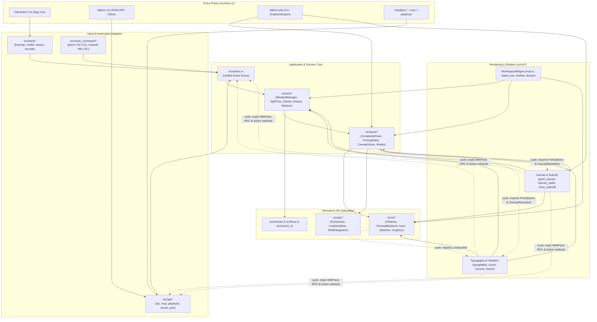
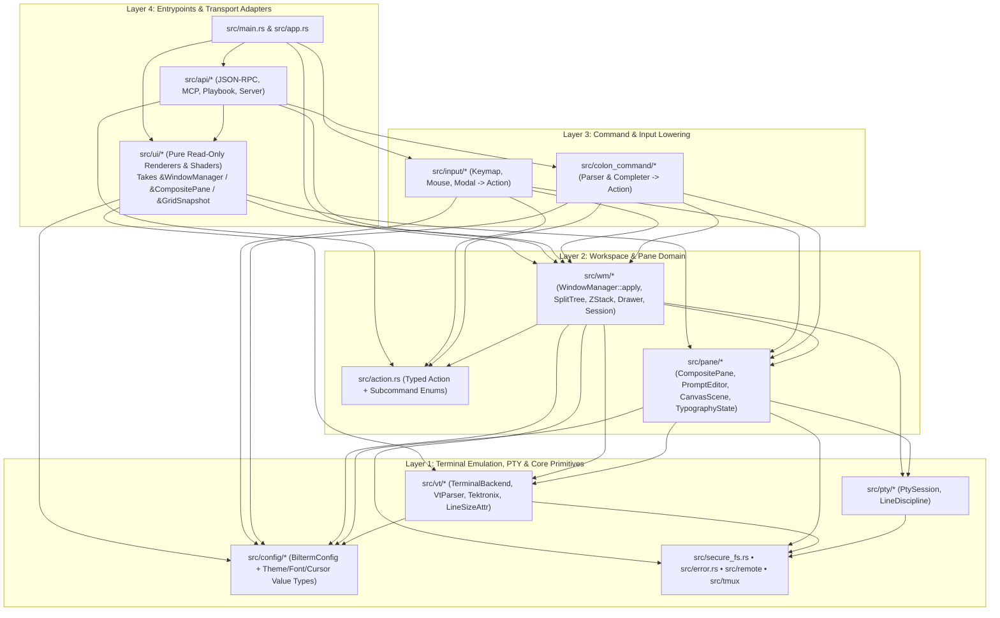
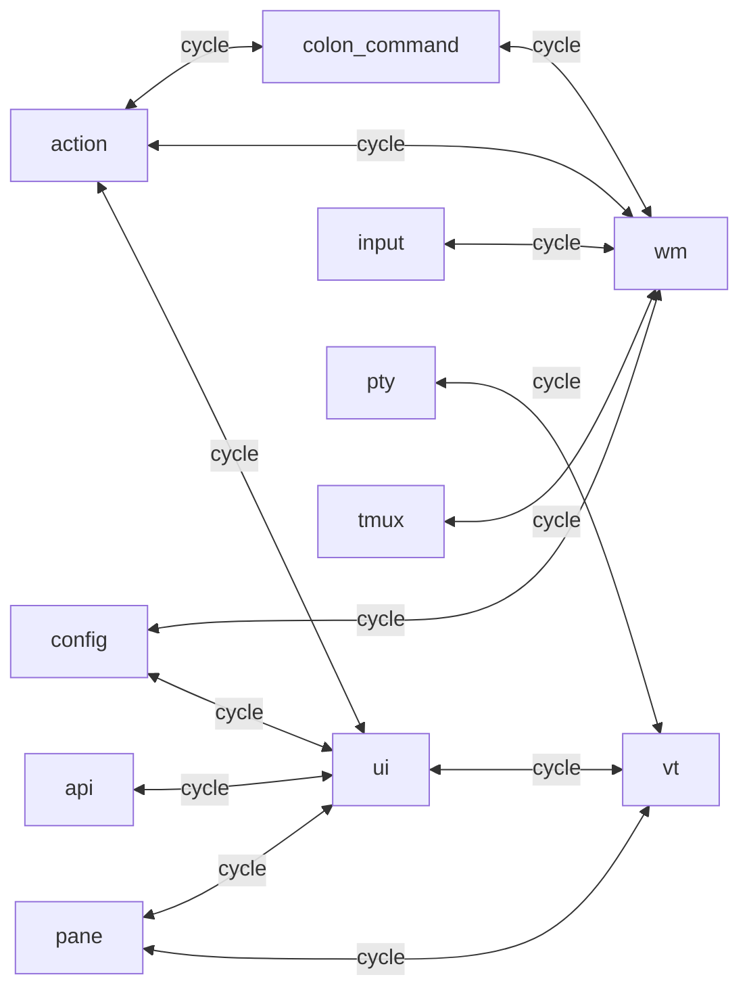

# Architecture & Code Review Improvement Plan: Bilterm (`v1.10.0`)

> **Repository:** `bilterm` (`/home/bill/src/ai/bilterm`)  
> **Date:** `2026-10-25`  
> **Commit Reviewed:** `9ee68bf` (tag `v1.10.0`, clean working tree)  
> **Review Scope:** Full Repository (`33,453` LOC across `69` Rust source files in `src/` + `25` integration test suites in `tests/`)  
> **Reviewer:** Antigravity (`swe-skills:code-architecture-review` + `graphify` AST graph: `3,183` nodes, `6,071` edges)  
> **Architecture Health Score:** **A-** (Score: **91/100**, up from **B+ / 84/100** pre-remediation and **C+ / 68/100** at `v1.5.0`)

---

## Baseline Verification Evidence (`v1.10.0`)

| Verification Check | Result | Notes |
| :--- | :--- | :--- |
| `cargo check --all-features --all-targets` | ✅ Pass | Default, `gui`, and `ghostty-vt` feature flags all compile cleanly |
| `cargo clippy --all-features --all-targets -- -D warnings` | ✅ Pass | `0` warnings, `0` errors across all targets |
| `cargo test` | ✅ Pass | `233` passed, `0` failed |
| `ARCH-R04` File Size Gate (`<= 800` LOC) | ⚠️ Pass (Tight) | All `69` files `<= 800` LOC, but `8` files have `< 30` lines of headroom (`772..789` LOC) |
| `ARCH-R02` Aggregate Encapsulation | ✅ Pass | `WindowManager` (`0` `pub` fields) & `CompositePane` (`0` `pub` fields) fully encapsulated |
| Module DAG Acyclicity | ❌ Fail | `14` two-module cycles & `26` three-module cycles across `src/` |

---

## 1. Code Architecture

### 1.1 Executive Architectural Summary

Bilterm is a **single-crate modular monolith** (`src/lib.rs` exporting `15` top-level domain, rendering, and adapter modules; `src/main.rs` providing the CLI/TUI/daemon entrypoint). Since the `v1.5.0` review (`68/100`), the codebase has grown from `19,239` LOC (`35` files) to `33,453` LOC (`69` files) while resolving every critical `v1.5.0` P0 defect:
- **Resolved since `v1.5.0`**: Lossless PTY byte ingestion (`ingest_pty_events`), runtime `config.toml` loading, unified `Action` vocabulary (`src/action.rs`), declarative keybinding tables (`src/input/keymap.rs`), private fields + invariant-enforcing mutators on `WindowManager` and `CompositePane`, `TerminalBackend` trait seam (`src/vt/backend.rs`), hardened JSON-RPC/MCP server (`MAX_JSON_DEPTH = 64`, `1 MiB` line cap, Unix `0600` socket default, bearer token auth, `SnapshotPolicy::Confined`), and `src/secure_fs.rs` (`0700` directories, `0600` atomic file writes).

However, rapid feature delivery in `v1.7.0`–`v1.10.0` (Workspace Drawer, Tektronix 4010/4014 vector CRT, retained 2D Canvas Scene-Graph, High-Res Anti-Aliased Pixel/GPU Canvas, Adaptive SSH Graphics Engine, and Per-Pane Typography) introduced **three structural pressures**:
1. **800-Line Ceiling Spillover (`Cross-Layer impl Dispersion`)**: Because `src/pane/mod.rs` (`788` LOC) and `src/wm/mod.rs` (`746` LOC) are nearly full, domain and JSON-RPC methods on `CompositePane` and `WindowManager` were implemented inside `src/ui/hires_subcell.rs`, `src/ui/canvas_raster.rs`, and `src/ui/typography.rs`.
2. **Bidirectional Layer Cycles**: Placing domain types (`FontFamilyPreset`, `PaneFontOptions`, `LineSizeAttr`, `CanvasResolution`) and RPC handlers (`handle_rpc_canvas`, `handle_rpc_fontsize`) inside `src/ui/` caused `vt`, `pane`, and `config` to import `ui`, while `ui` imports `api`, `action`, `wm`, `pane`, and `vt` (`14` two-node cycles).
3. **Bypass of `SnapshotPolicy::Confined` in `:canvas export`**: Unlike `workspace.snapshot`, `:canvas export <path>` writes directly via `std::fs::write` after checking only `!path.contains("..")`, allowing arbitrary absolute-path `.ppm`/`.svg` writes when triggered via JSON-RPC/MCP commands.

### 1.2 Current System Topology Diagram

### 1.3 Target Architecture Blueprint (Cycle-Free Layered DAG)

### 1.4 Architectural Debt & Trade-Off Analysis

- **Intentional Trade-Offs**:
  - **Zero-dependency JSON parser (`src/api/json.rs`)**: Avoids heavy macro compile times while enforcing an explicit `MAX_JSON_DEPTH = 64` recursion guard.
  - **Headless `CompositePane` constructor (`new_headless`)**: Enables 233 fast, deterministic unit and snapshot tests without spawning OS PTY processes.
  - **Software TrueColor `PixelCanvasBuffer` (`src/ui/pixel_canvas.rs`)**: Provides identical anti-aliased rendering across local GUI framebuffers, `.ppm`/`.svg` exports, Kitty/Sixel/iTerm2 graphic streams, and SSH `2×4` Octant / `1×2` Half-Block fallbacks without requiring a hardware GPU context in CI.
- **Accidental Complexity**:
  - **Cross-layer `impl` blocks inside `src/ui/`**: `impl WindowManager` and `impl CompositePane` blocks live inside `src/ui/canvas_raster.rs`, `src/ui/hires_subcell.rs`, and `src/ui/typography.rs` solely to dodge the 800-line ceiling on `src/wm/mod.rs` and `src/pane/mod.rs`.
  - **23 files between `700` and `789` LOC**: Minor bug fixes or single enum arms routinely collide with the 800-line ceiling test.
  - **Stringly-typed subcommands inside `Action`**: `Action::CanvasCommand(String)`, `Action::FontCommand(String)`, and `Action::DrawerCommand(String)` defer parsing to execution time.
- **Scalability & Runtime Bottlenecks**:
  - **`App::run` redraws unconditionally every 16 ms**: Even when no key event or PTY byte has arrived, `terminal.draw` re-renders the entire workspace and calls `wm.resize_all(area)`.
  - **Per-frame `PixelCanvasBuffer` allocation and rasterization**: When a canvas scene is active, `render_graphical_canvas` allocates and rasterizes a fresh RGBA buffer on every 16 ms tick instead of caching the rasterized buffer keyed by scene generation + viewport size.
  - **Uncached `ioctl(TIOCGWINSZ)`**: `CanvasResolution::Auto` invokes `libc::ioctl(STDOUT_FILENO, TIOCGWINSZ)` on every resolution query rather than caching on `Event::Resize`.

---

## 2. Code Module & Component Review (Intra-Module)

### 2.1 Component Scorecard

| Component / Module | LOC | Files | Cohesion | Complexity | Test Coverage | Health Grade |
| :--- | ---: | ---: | :---: | :---: | :---: | :---: |
| `src/secure_fs.rs` & `src/error.rs` | 663 | 2 | High | Low | High | **A** |
| `src/pty/*` (`mod`, `line_discipline`, `shell_integration`) | 824 | 3 | High | Low | High | **A-** |
| `src/wm/*` (`mod`, `split_tree`, `z_stack`, `drawer`, `session`, `quick_terminal`) | 3,701 | 7 | High | Medium | High | **B+** |
| `src/api/*` (`json`, `rpc`, `mcp`, `playbook`, `server`) | 2,917 | 7 | High | Medium | High | **B+** |
| `src/input/*` (`mod`, `keymap`, `modal`, `mouse`, `encode`) | 2,885 | 5 | High | Medium | High | **B+** |
| `src/config/mod.rs` & `src/remote/mod.rs` & `src/tmux/mod.rs` | 1,475 | 3 | High | Low | Medium | **B+** |
| `src/pane/*` (`mod`, `prompt_editor`, `canvas_scene`, `completion`, `history_store`, `modes`, `highlight`, `fuzzy_history`) | 4,415 | 9 | Medium | Medium | High | **B** |
| `src/vt/*` (`mod`, `backend`, `scan`, `scrollback`, `tektronix`, `ghostty_backend`, `worker`, `snapshot`, `detect`, `graphics`, `recording`, `codec`) | 5,863 | 14 | Medium | High | High | **B** |
| `src/action.rs` & `src/colon_command/*` (`mod`, `parse`, `execute`) | 2,306 | 4 | Medium | **High** | High | **B-** |
| `src/ui/*` (`mod`, `canvas_raster`, `pixel_canvas`, `status_bar`, `modals`, `cursor`, `typography`, `renderer`, `hires_subcell`, `chrome`, `drawer`, `theme`, `glyphs`, `occlusion`) | 6,858 | 14 | **Low** | **High** | High | **C+** |
| `src/app.rs` & `src/main.rs` | 408 | 2 | Medium | Low | Medium | **B+** |

### 2.2 Component Deep Dive & Findings

#### Component: `src/ui/*` (6,858 LOC across 14 files)
- **Single Responsibility Principle (SRP)**: Violated in `src/ui/canvas_raster.rs`, `src/ui/hires_subcell.rs`, and `src/ui/typography.rs`. In addition to Ratatui buffer rendering and pixel supersampling, these files define domain state (`FontFamilyPreset`, `PaneFontOptions`, `LineSizeAttr`, `CanvasResolution`), VT escape sequence scanning (`scan_dec_line_size_escapes`), `CompositePane` command execution (`execute_canvas_command`, `execute_font_command`), and JSON-RPC request handlers (`WindowManager::handle_rpc_canvas`, `WindowManager::handle_rpc_fontsize`).
- **Correctness Bugs / Resolution Mismatches**:
  - [`src/ui/canvas_raster.rs:375-382`](file:///home/bill/src/ai/bilterm/src/ui/canvas_raster.rs#L375-L382): `render_graphical_canvas` hardcodes `px_per_col = 4, px_per_row = 8` instead of calling `scene.resolution.resolve_px_per_cell(canvas.width, canvas.height)`.
  - [`src/ui/hires_subcell.rs:329-330`](file:///home/bill/src/ai/bilterm/src/ui/hires_subcell.rs#L329-L330): `execute_canvas_command("export ...")` hardcodes `(80, 24)` instead of using the pane's actual `(cols, rows)` from `self.vt.size()`.
- **Security Gap**:
  - [`src/ui/hires_subcell.rs:321-343`](file:///home/bill/src/ai/bilterm/src/ui/hires_subcell.rs#L321-L343): `:canvas export <path>` writes via raw `std::fs::write(path, ...)` without confining `path` to `snapshot_dir` or `secure_fs::write_private_file_atomic`.

#### Component: `src/colon_command/*` & `src/action.rs` (2,306 LOC)
- **SRP & Complexity Hotspots**:
  - [`src/colon_command/parse.rs:11-732`](file:///home/bill/src/ai/bilterm/src/colon_command/parse.rs#L11-L732): `parse_colon_command` is a **722-line** monolithic `match` function.
  - [`src/colon_command/execute.rs:305-789`](file:///home/bill/src/ai/bilterm/src/colon_command/execute.rs#L305-L789): `execute_wm_colon_command` is **485 lines**, and the file sits at **789/800 lines** (only 11 lines of headroom).
  - [`src/action.rs:184-634`](file:///home/bill/src/ai/bilterm/src/action.rs#L184-L634): Test module inside `src/action.rs` imports `WindowManager`, `WorkspaceWidget`, `colon_command`, and `input`, creating compile-time module cycles with `action`.

#### Component: `src/vt/*` (5,863 LOC across 14 files)
- **SRP & Performance Hotspots**:
  - [`src/vt/scan.rs:23-563`](file:///home/bill/src/ai/bilterm/src/vt/scan.rs#L23-L563): `scan_control_sequences` is **541 lines** and runs 14 separate substring scans (`match_indices`) over every PTY output chunk.
  - [`src/vt/worker.rs:1-541`](file:///home/bill/src/ai/bilterm/src/vt/worker.rs#L1-L541): `VtWorkerHandle` provides a lock-free `tokio::sync::watch<Arc<GridSnapshot>>` pipeline, but production `CompositePane` still uses synchronous `VtParser` + `PtySession` directly.
  - [`src/vt/mod.rs:129,229`](file:///home/bill/src/ai/bilterm/src/vt/mod.rs#L129): `VtParser` depends on `crate::ui::typography::{LineSizeAttr, scan_dec_line_size_escapes}`, inverting the `ui -> vt` layer boundary.

#### Component: `src/pane/*` (4,415 LOC across 9 files)
- **Encapsulation**:
  - [`src/pane/mod.rs:36-67`](file:///home/bill/src/ai/bilterm/src/pane/mod.rs#L36-L67): `CompositePane` has `0` `pub` fields (`pub(crate)` on `vt`, `canvas_scene`, `font_options`), and `new_base` cleanly deduplicates construction.
  - [`src/pane/prompt_editor.rs:42-73`](file:///home/bill/src/ai/bilterm/src/pane/prompt_editor.rs#L42-L73): `FloatingPromptState` still exposes **21 `pub` fields** directly mutated across modules.
  - [`src/pane/mod.rs`](file:///home/bill/src/ai/bilterm/src/pane/mod.rs) is at **788/800 lines** (12 lines of headroom).

---

## 3. Code Inter-Module Review (Cross-Component)

### 3.1 Inter-Module Dependency Matrix

| Module | Incoming (`Ca`) | Outgoing (`Ce`) | Instability $I = \frac{Ce}{Ca+Ce}$ | Role Assessment |
| :--- | :---: | :---: | :---: | :--- |
| `error` | 9 | 0 | `0.00` | Clean foundational leaf (`A`) |
| `secure_fs` | 6 | 0 | `0.00` | Clean security leaf (`A`) |
| `pty` | 7 | 3 | `0.30` | Near-leaf OS abstraction (`pty <-> vt` 1-edge cycle) |
| `tmux` | 4 | 2 | `0.33` | Protocol helper (`tmux -> wm` doc-link / bridge cycle) |
| `pane` | 10 | 5 | `0.33` | Core pane domain (polluted by `pane -> ui` imports) |
| `vt` | 8 | 5 | `0.38` | Terminal state machine (polluted by `vt -> ui` imports) |
| `remote` | 4 | 3 | `0.43` | SSH/Fleet domain |
| `ui` | 7 | 8 | `0.53` | **Inverted**: UI layer is imported by `vt`, `pane`, `config`, `action`, `api` |
| `wm` | 8 | 11 | `0.58` | Workspace coordinator hub |
| `action` | 4 | 7 | `0.64` | Command enum (imports `wm`, `ui`, `colon_command` in source + inline tests) |
| `colon_command` | 4 | 7 | `0.64` | Command parser & executor |
| `input` | 4 | 8 | `0.67` | Input adapter |
| `config` | 2 | 5 | `0.71` | Config schema (imports value enums from `ui` and `wm`) |
| `api` | 2 | 9 | `0.82` | Automation/RPC adapter (`ui -> api` cycle via `JsonValue`) |
| `app` | 0 | 6 | `1.00` | Clean top-level event loop coordinator (`A`) |

### 3.2 Root Causes of Inter-Module Cycles

Almost every cycle stems from **four misplaced type/impl locations**:
1. **Value/Config Enums Placed in `ui/` and `wm/` Instead of `config/` (or a leaf `types` module)**:
   - `ThemePreset`, `GlyphPack`, `CaretStyle`, `SpotlightMode`, `OutlineStyle`, `ShadowStyle`, `FontFamilyPreset`, `PaneFontOptions`, `LineSizeAttr`, and `CanvasResolution` live in `src/ui/*`.
   - `DrawerConfig`, `DrawerEdge`, `DrawerLayoutMode`, `DrawerVisibilityMode`, and `WorkspaceLayoutMode` live in `src/wm/*`.
   - Because `config`, `action`, `pane`, and `vt` need these lightweight enums, they are forced to import `crate::ui::*` and `crate::wm::*`.
2. **Domain & RPC `impl` Blocks Placed in `src/ui/`**:
   - `src/ui/canvas_raster.rs` and `src/ui/typography.rs` import `crate::api::JsonValue` and `crate::action::Action` to implement `WindowManager::handle_rpc_canvas` and `WindowManager::handle_rpc_fontsize`.
3. **`colon_command` Invoked Directly by `WindowManager`**:
   - `WindowManager::apply` (`src/wm/mod.rs:25`) delegates to `crate::colon_command::execute_wm_colon_command`, while `colon_command` imports `WindowManager`.
4. **Single-Line `pty <-> vt` Cycle**:
   - `src/pty/line_discipline.rs:1` imports `crate::vt::Osc133Phase` (a 4-variant enum), while `src/vt/worker.rs:31` imports `crate::pty::{PtyConfig, shell_integration}`.

---

## 4. Recommended Improvements (Prioritized Roadmap)

### Phase P0: Security Confinement & High-Res Canvas Correctness Fixes

- [x] **P0.1: Confine `:canvas export <path>` using `secure_fs` and `validate_safe_name`** *(Completed 2026-10-25 — see [`docs/REFACTOR_LOG.md`](REFACTOR_LOG.md))*
  - **Location:** [`src/ui/hires_subcell.rs`](file:///home/bill/src/ai/bilterm/src/ui/hires_subcell.rs), [`src/api/rpc_handlers.rs`](file:///home/bill/src/ai/bilterm/src/api/rpc_handlers.rs)
  - **Resolution:** Added `CompositePane::export_canvas_confined` and `AutomationControlPlane::execute_canvas_command_confined`, enforcing `validate_snapshot_name`, symlink rejection, and atomic `0600` `write_private_file` across RPC (`canvas.command`, `wm.command`) and confined Playbook execution.

- [x] **P0.2: Wire `CanvasResolution` into Live TUI Rendering & Use Actual Pane Dimensions in Export/Encode** *(Completed 2026-10-25 — see [`docs/REFACTOR_LOG.md`](REFACTOR_LOG.md))*
  - **Location:** [`src/ui/canvas_raster.rs`](file:///home/bill/src/ai/bilterm/src/ui/canvas_raster.rs), [`src/ui/hires_subcell.rs`](file:///home/bill/src/ai/bilterm/src/ui/hires_subcell.rs), [`src/app.rs`](file:///home/bill/src/ai/bilterm/src/app.rs)
  - **Resolution:** Cached `probe_terminal_pixel_size()` in `CACHED_TERMINAL_PIXELS: AtomicU64` (refreshed on `Event::Resize`), wired `scene.resolution.resolve_px_per_cell(canvas.width, canvas.height)` into `render_graphical_canvas`, and replaced hardcoded `(80, 24)` in `:canvas export`/`encode` with `self.vt.size()`.

### Phase P1: Layer Decoupling & 800-Line Ceiling Decompression

- [x] **P1.1: Relocate `WindowManager` and `CompositePane` Domain/RPC Impls Out of `src/ui/`** *(Completed 2026-10-25 — see [`docs/REFACTOR_LOG.md`](REFACTOR_LOG.md))*
  - **Location:** [`src/api/rpc_handlers.rs`](file:///home/bill/src/ai/bilterm/src/api/rpc_handlers.rs), [`src/pane/typography.rs`](file:///home/bill/src/ai/bilterm/src/pane/typography.rs), [`src/vt/snapshot.rs`](file:///home/bill/src/ai/bilterm/src/vt/snapshot.rs), [`src/pty/line_discipline.rs`](file:///home/bill/src/ai/bilterm/src/pty/line_discipline.rs)
  - **Resolution:** Moved `handle_rpc_canvas` and `handle_rpc_fontsize` into `src/api/rpc_handlers.rs`; moved `Osc133Phase` into `src/pty/line_discipline.rs`; moved `LineSizeAttr` and `scan_dec_line_size_escapes` into `src/vt/snapshot.rs`; moved `FontFamilyPreset`, `PaneFontOptions`, and `CanvasResolution` into `src/pane/typography.rs`. `error/secure_fs -> pty -> vt -> pane` is now a strict 0-cycle DAG with zero `crate::ui` or `crate::config` imports.

- [x] **P1.2: Decompress the 8 Near-Ceiling Files (`772..789` LOC) into Cohesive Submodules** *(Completed 2026-10-25 — see [`docs/REFACTOR_LOG.md`](REFACTOR_LOG.md))*
  - **Location:**
    - [`src/colon_command/execute.rs`](file:///home/bill/src/ai/bilterm/src/colon_command/execute.rs) (`789` $\rightarrow$ `298` LOC) + [`src/colon_command/execute_wm.rs`](file:///home/bill/src/ai/bilterm/src/colon_command/execute_wm.rs) (`505` LOC)
    - [`src/colon_command/parse.rs`](file:///home/bill/src/ai/bilterm/src/colon_command/parse.rs) (`732` $\rightarrow$ `412` LOC) + [`src/colon_command/parse_visual.rs`](file:///home/bill/src/ai/bilterm/src/colon_command/parse_visual.rs) (`338` LOC)
    - [`src/pane/mod.rs`](file:///home/bill/src/ai/bilterm/src/pane/mod.rs) (`788` $\rightarrow$ `695` LOC) + [`src/pane/tests.rs`](file:///home/bill/src/ai/bilterm/src/pane/tests.rs) (`115` LOC)
    - [`src/wm/z_stack.rs`](file:///home/bill/src/ai/bilterm/src/wm/z_stack.rs) (`788` $\rightarrow$ `611` LOC) + [`src/wm/tests.rs`](file:///home/bill/src/ai/bilterm/src/wm/tests.rs) (`267` LOC)
    - [`src/vt/scan.rs`](file:///home/bill/src/ai/bilterm/src/vt/scan.rs) (`776` $\rightarrow$ `352` LOC) + [`src/vt/scan_osc_dcs.rs`](file:///home/bill/src/ai/bilterm/src/vt/scan_osc_dcs.rs) (`378` LOC)

- [x] **P1.3: Encapsulate `FloatingPromptState` Fields (`src/pane/prompt_editor.rs`)** *(Completed 2026-10-25 — see [`docs/REFACTOR_LOG.md`](REFACTOR_LOG.md))*
  - **Location:** [`src/pane/prompt_editor.rs`](file:///home/bill/src/ai/bilterm/src/pane/prompt_editor.rs)
  - **Resolution:** Restricted `input`, `lines`, `cursor_row`, `cursor_col`, `cursor_char_idx`, `scroll_offset`, `h_scroll_offset`, and `history_index` to `pub(crate)` visibility and added read-only getters (`lines()`, `cursor_row()`, `cursor_col()`, `cursor_char_idx()`, `scroll_offset()`, `h_scroll_offset()`, `history_index()`).

### Phase P2: Runtime Efficiency, Caching & Maintainability

- [x] **P2.1: Dirty-Driven Redraw & Cached Canvas Rasterization** *(Completed 2026-10-25 — see [`docs/REFACTOR_LOG.md`](REFACTOR_LOG.md))*
  - **Location:** [`src/app.rs`](file:///home/bill/src/ai/bilterm/src/app.rs), [`src/pane/mod.rs`](file:///home/bill/src/ai/bilterm/src/pane/mod.rs), [`src/wm/mod.rs`](file:///home/bill/src/ai/bilterm/src/wm/mod.rs), [`src/ui/canvas_raster.rs`](file:///home/bill/src/ai/bilterm/src/ui/canvas_raster.rs)
  - **Resolution:** Updated `CompositePane::poll_pty_events`/`ingest_pty_events` and `WindowManager::poll_all_ptys` to return `bool`, gated `App::run` redraws on `self.needs_redraw`, and added generation-keyed `Arc<PixelCanvasBuffer>` caching (`RASTER_CACHE`) in `render_graphical_canvas`.

- [x] **P2.2: Single-Pass Control Sequence Scanner (`src/vt/scan.rs`)** *(Completed 2026-10-25 — see [`docs/REFACTOR_LOG.md`](REFACTOR_LOG.md))*
  - **Location:** [`src/vt/scan.rs`](file:///home/bill/src/ai/bilterm/src/vt/scan.rs), [`src/vt/scan_osc_dcs.rs`](file:///home/bill/src/ai/bilterm/src/vt/scan_osc_dcs.rs)
  - **Resolution:** Replaced the 14 separate `text.match_indices(...)` passes with a single-pass `text.match_indices('\x1b')` dispatcher (with a fast `!bytes.contains(&0x1b)` early return).

- [x] **P2.3: Audit Remaining `let _ =` Sites in Command Execution (`src/colon_command/execute.rs`)** *(Completed 2026-10-25 — see [`docs/REFACTOR_LOG.md`](REFACTOR_LOG.md))*
  - **Location:** [`src/colon_command/execute_wm.rs`](file:///home/bill/src/ai/bilterm/src/colon_command/execute_wm.rs)
  - **Resolution:** Surfaced `Err(e)` from `wm.split_focused(...)` and recording operations into the active pane status bar.

### Phase P3: Future-Proofing & Extensibility

- [ ] **P3.1: Wire `VtWorkerHandle` (`src/vt/worker.rs`) into Live `CompositePane`**
  - Replace synchronous `PtySession::drain_events` polling with the existing `VtWorkerHandle` background thread + `tokio::sync::watch<Arc<GridSnapshot>>` channel so `App::run` wakes reactively via `tokio::select!`.
- [x] **P3.2: Enforce Module DAG Acyclicity in CI (`tests/vt_worker_and_snapshot_seam.rs`)** *(Completed 2026-10-25 — see [`docs/REFACTOR_LOG.md`](REFACTOR_LOG.md))*
  - Added automated architecture tests (`core_domain_layers_pty_vt_pane_form_strict_acyclic_dag` and `ui_layer_never_imports_api_layer`) in `tests/vt_worker_and_snapshot_seam.rs`.
- [ ] **P3.3: Extract `bilterm-core` Workspace Crate**
  - Now that `pty -> vt -> pane` and `ui -/-> api` are decoupled, extract `bilterm-core` (VT, PTY, Pane, WM, Action, Config) from `bilterm-tui` / `bilterm-gui` frontends.

---

## 5. Security & Robustness Recommendations

### 5.1 Attack Surface & Input Validation Audit
- **Control Plane & IPC (`src/api/server.rs`, `src/api/rpc.rs`)**:
  - ✅ **Strong**: Default endpoint is a Unix domain socket inside a `0700` runtime directory with `0600` socket permissions (`SEC-R01`).
  - ✅ **Strong**: Non-loopback TCP requires explicit `--allow-remote` + `--token-file` (`0600` mode check) and verifies bearer tokens in constant time (`constant_time_eq`).
  - ✅ **Strong**: JSON parser enforces `MAX_JSON_DEPTH = 64` and `MAX_RPC_LINE_BYTES = 1 MiB`.
  - ⚠️ **Gap (P0.1)**: `:canvas export <path>` (`src/ui/hires_subcell.rs:321-343`) writes `.ppm`/`.svg` files via `std::fs::write` without confining paths to `snapshot_dir` or `secure_fs::write_private_file_atomic`.
- **Terminal Escape Sequence Trust Boundary (`src/vt/scan.rs`, `src/pane/canvas_scene.rs`)**:
  - ✅ **Strong**: In-band `OSC 1337;Canvas=<cmd>` (`scan_osc_canvas_sequences`) routes to `PaneCanvasScene::execute_command`, which only mutates in-memory scene primitives and does **not** expose the `"export"` filesystem subcommand.
  - ✅ **Strong**: Bracketed paste sanitizes embedded `\x1b[201~` sequences and gates multi-line / control-char raw PTY pastes behind an interactive confirmation modal (`FND-01`).
  - ✅ **Strong**: 3-signal `!ECHO LOCK` (`termios !ECHO` + `tcgetpgrp` + `OSC 133` + canvas password-prompt heuristic) prevents password leaks into command history or floating prompt echo.
- **Filesystem & Subprocess Isolation (`src/secure_fs.rs`, `src/remote/mod.rs`)**:
  - ✅ **Strong**: Session files, history logs, `.cast` recordings, and shell integration scripts use `0700` private directories and `0600` atomic `O_CREAT | O_EXCL` writes.
  - ✅ **Strong**: `build_ssh_args` rejects leading `-` in destinations/options and inserts `--` before the target host.

### 5.2 Dependency & Supply Chain Integrity
- Core dependencies (`ratatui 0.30.0`, `crossterm 0.29.0`, `portable-pty 0.9.0`, `vt100-ctt 0.17.1`, `tokio 1.52.1`, `nucleo-matcher 0.3.1`, `serde`, `toml`) are minimal and actively maintained.
- Recommend adding `cargo audit` and `cargo deny check` to `.github/workflows/ci.yml`.

### 5.3 Next Action: Recommended Security & Refactoring Workflows
> [!IMPORTANT]
> - **Immediate P0/P1 Execution**: Run `/refactor-execute` (or ask to execute Phase P0 & P1) to fix `:canvas export` confinement (P0.1), wire `CanvasResolution` into live rendering and exports (P0.2), and decouple `src/ui/` from domain/RPC impls (P1.1).
> - **Dependency Audit**: Run `/dependency-audit` or `cargo audit` to verify `Cargo.lock` against the RustSec Advisory Database.
> - **Task Breakdown**: Use `/plan` to turn Phases P1–P3 into tracked milestone plans under `.planning/`.
