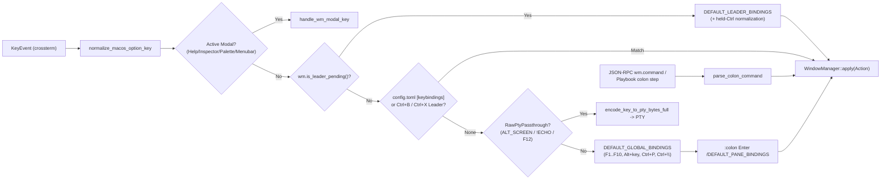

# Developer, Maintainer & AI Agent Engineering Guide

[← Back to Documentation Hub](README.md) | [← Back to Project README](../README.md) | [Lessons Learned (`v0.1` → `v2.0`)](LESSONS_LEARNED.md)

This guide is the authoritative technical reference for human developers, maintainers, and autonomous AI coding agents working on **Bilterm**. It documents the complete crate dependency stack, the 48-file modular source tree, core architectural invariants (`ARCH-R01..04`, `SEC-R01..04`, `REC-02`), runtime inspectability and debugging tools, and step-by-step extension workflows.

---

## Table of Contents

1. [Crate & Library Dependency Stack (`Cargo.toml`)](#1-crate--library-dependency-stack-cargotoml)
2. [Complete Source Tree & Module Boundaries (`<= 800` Lines Gate)](#2-complete-source-tree--module-boundaries--800-lines-gate)
3. [Core Architectural Invariants (`Phases 19–22`)](#3-core-architectural-invariants-phases-1922)
4. [End-to-End `Action` & Input Dispatch Pipeline](#4-end-to-end-action--input-dispatch-pipeline)
5. [Inspectability, Observability & Live Debugging Playbook](#5-inspectability-observability--live-debugging-playbook)
6. [How to Add a New Command, Keybinding, or Feature](#6-how-to-add-a-new-command-keybinding-or-feature)
7. [Verification & CI Conservation Gates](#7-verification--ci-conservation-gates)

---

## 1. Crate & Library Dependency Stack (`Cargo.toml`)

Bilterm targets **Rust 2024 Edition** (`rust-version = "1.88"`). Every dependency is selected for cross-platform portability (Linux primary, macOS secondary, Windows third) and sub-millisecond immediate-mode cell compositing:

| Crate | Version | Role in Bilterm | Primary Modules |
|-------|---------|-----------------|-----------------|
| **`ratatui`** | `0.30.0` | Immediate-mode 2D `Buffer` (`Cell` grid) compositor and `Widget` / `TestBackend` rendering engine | `src/ui/*`, `src/vt/recording.rs` |
| **`crossterm`** | `0.29.0` (`event-stream`) | Cross-platform raw mode, alternate screen, SGR 1006 mouse capture, bracketed paste, and async `EventStream` | `src/app.rs`, `src/error.rs`, `src/input/*` |
| **`portable-pty`** | `0.9.0` | Cross-platform PTY allocation (`openpty`/`forkpty` on POSIX, `ConPTY` on Windows) and child process management | `src/pty/mod.rs` |
| **`vt100-ctt`** | `0.17.1` | Virtual terminal screen state machine backing `VtParser` (wrapped by `GridSnapshot` and custom CSI/OSC/DCS interceptors) | `src/vt/*` |
| **`libghostty-vt`** | `0.2.2` *(optional, `ghostty-vt` feature)* | Experimental Zig/C-ABI vtable terminal backend (`cargo +1.90 test --features ghostty-vt`) | `src/vt/ghostty_backend.rs` |
| **`tokio`** | `1.44.0` (`full`) | Async `tokio::select!` event loop, `spawn_blocking` 64KB PTY reader threads, and JSON-RPC 2.0 Unix/TCP server | `src/app.rs`, `src/pty/mod.rs`, `src/api/server.rs` |
| **`nucleo-matcher`** | `0.3.1` | High-speed fuzzy matching (from Helix) for `Ctrl+R` reverse command history and `Ctrl+P` Fuzzy Command Palette | `src/pane/fuzzy_history.rs`, `src/wm/session.rs` |
| **`unicode-width`** | `0.2.0` | East Asian / CJK / Emoji 2-column cell width calculation for `occlude_rect` boundary sanitization | `src/ui/occlusion.rs`, `src/vt/*` |
| **`serde`** + **`toml`** | `1.0.219` / `0.8.20` | Serialization for `~/.config/bilterm/config.toml`, saved workspace sessions (`:session`), and `--playbook` files | `src/config/mod.rs`, `src/wm/session.rs`, `src/api/playbook.rs` |
| **`libc`** | `0.2.170` | POSIX `tcgetattr` / `tcgetpgrp` termios inspection (`!ECHO`, `ICANON`) and `SO_PEERCRED` / `LOCAL_PEERCRED` socket UID verification | `src/pty/line_discipline.rs`, `src/secure_fs.rs`, `src/api/server.rs` |
| **`tracing`** + **`tracing-subscriber`** + **`tracing-appender`** | `0.1` / `0.3` / `0.2` | Non-blocking background file logging (`bilterm.log`) so diagnostics never corrupt the alternate screen | `src/main.rs` |
| **`color-eyre`** + **`thiserror`** | `0.6.3` / `2.0.12` | Structured error types (`BiltermError`) and panic hooks that restore terminal state before printing backtraces | `src/error.rs` |
| **`insta`** + **`tempfile`** *(dev)* | `1.42.2` / `3.19.1` | Deterministic ASCII/ANSI `TestBackend` snapshot testing and isolated temporary directories | `tests/*`, `src/**/tests.rs` |

---

## 2. Complete Source Tree & Module Boundaries (`<= 800` Lines Gate)

Every file under `src/**/*.rs` is enforced to stay **`<= 800` lines** (`ARCH-R04`). There are **no circular dependencies** between `pane` and `wm` (`wm` depends on `pane`; `colon_command` and `action` sit above or alongside cleanly).

```text
src/
├── lib.rs                      # Crate root exporting public modules
├── main.rs                     # Binary entrypoint, CLI dispatch, tracing init, panic guard
├── app.rs                      # Async tokio::select! 60 FPS event & render loop
├── launcher.rs                 # OS desktop launcher integration (.desktop / .plist / .lnk) & GUI-launch terminal auto-relaunch
├── cli.rs                      # CLI flag parser (--headless, --mcp, --playbook, ctl, --man, --completions)
├── error.rs                    # BiltermError enum & idempotent TerminalRestoreGuard (RAII)
├── secure_fs.rs                # 0700 private runtime dir, 0600 O_EXCL/O_NOFOLLOW files, constant_time_eq
├── action.rs                   # Unified Action enum (all key chords, :commands, playbooks & RPC lower here)
├── colon_command/
│   ├── mod.rs                  # Re-exports Action as ColonCommand alias, parse & execute entrypoints
│   ├── parse.rs                # Parses pane/WM ":..." strings into Result<Action, String>
│   ├── parse_visual.rs         # Parses visual/theme/font/drawer/canvas ":..." strings into Result<Action, String>
│   ├── execute.rs              # Executes ColonCommand against the active CompositePane
│   └── execute_wm.rs           # Executes Action against WindowManager (WindowManager::apply)
├── config/
│   └── mod.rs                  # BiltermConfig (config.toml + .ini theme loader + Spotlight/FocalZoom state)
├── input/
│   ├── mod.rs                  # Top-level handle_wm_key_event (<= 80 lines), handle_key_event, handle_paste_event
│   ├── keymap.rs               # Declarative DEFAULT_LEADER_BINDINGS, DEFAULT_GLOBAL_BINDINGS, DEFAULT_PANE_BINDINGS
│   ├── modal.rs                # Modal key handlers (Help, Inspector, Palette, Menubar, Copy, Hints, Fuzzy, History)
│   ├── mouse.rs                # SGR 1006 mouse drag/resize/click/wheel routing across WM and CompositePane
│   └── encode.rs               # VT100/Xterm/DECCKM/Kitty CSI-u keystroke & alternate-scroll byte encoders
├── pane/
│   ├── mod.rs                  # Encapsulated CompositePane (private fields, submit_command, effective_routing_mode)
│   ├── prompt_editor.rs        # FloatingPromptState (encapsulated buffer/cursor, undo/redo, PromptAnchor, PromptMode)
│   ├── typography.rs           # Domain FontFamilyPreset, PaneFontOptions, CanvasResolution & cached TIOCGWINSZ
│   ├── canvas_scene.rs         # Retained PaneCanvasScene (vectors, 2D sprites, plots, images) & CanvasRenderBackend
│   ├── modes.rs                # Vi CopyModeState, QuickSelect HintsModeState, CanvasSearchState, accessors
│   ├── completion.rs           # Interactive Tab / Shift+Tab completion (:commands, $PATH, CWD files, $ENV)
│   ├── fuzzy_history.rs        # nucleo-matcher Ctrl+R fuzzy history search state
│   ├── highlight.rs            # Live shell lexical tokenizer & syntax highlighter
│   ├── history_store.rs        # Per-session 0600 command history persistence, pruning, and .sh export
│   ├── history_store_tests.rs  # Unit tests for HistoryStore
│   └── tests.rs                # Unit tests for CompositePane
├── pty/
│   ├── mod.rs                  # PtySession (portable-pty spawn, 64KB blocking reader thread, SIGWINCH dedup)
│   ├── line_discipline.rs      # 3-signal detector (Osc133Phase + tcgetpgrp + termios !ECHO/ICANON)
│   └── shell_integration.rs    # Automatic bash/zsh/fish OSC 133 + OSC 7 rc/hook injection in 0700 dir
├── vt/
│   ├── mod.rs                  # VtParser state machine, CommandBlock tracking, scrollback & size management
│   ├── backend.rs              # TerminalBackend port trait, MockTerminalBackend, and conformance suite (ARCH-R03)
│   ├── scan.rs                 # Single-pass ESC (\x1b) stream pre-scanner (DECSET traps, CSI DECRPM/DA1/DSR)
│   ├── scan_osc_dcs.rs         # OSC 7/8/9/52/133/777/1337, DCS XTGETTCAP/Sixel & APC Kitty scanners
│   ├── graphics.rs             # Kitty Graphics (APC G) & DEC Sixel (DCS q) decoders and placements
│   ├── tektronix.rs            # Tektronix 4010/4014 10-bit/12-bit vector storage-tube state machine & phosphor decay
│   ├── detect.rs               # Auto-detection of URLs and QuickSelect 3270 Field Hints (URLs, paths, IPs, SHAs)
│   ├── codec.rs                # OSC 52 base64 clipboard encoder and paste control-byte sanitizer
│   ├── recording.rs            # WorkspaceRecorder (whole-workspace Buffer->ANSI .cast) & single-pane .cast recorder
│   ├── scrollback.rs           # Dynamic RAM-aware ScrollbackGovernor and ring-buffer line reflow
│   ├── snapshot.rs             # Renderer-agnostic GridSnapshot, CellSnapshot & DEC LineSizeAttr
│   ├── worker.rs               # Dedicated background VtWorkerHandle thread seam
│   ├── ghostty_backend.rs      # Optional libghostty-vt C-ABI vtable integration
│   ├── tests.rs                # VtParser unit tests
│   └── scrollback_tests.rs     # ScrollbackGovernor unit tests
├── wm/
│   ├── mod.rs                  # Encapsulated WindowManager (private fields, apply(Action), remove_pane, Modal, Focus)
│   ├── v2_runtime.rs           # v2.1 runtime handlers (:detach, :attach, :mcp interactive actions, :exit-guard, :scroll)
│   ├── session.rs              # Workspace session save/restore/list (SplitTree + ZStack + prompts + lines), SSH/fleet helpers
│   ├── split_tree.rs           # Recursive H/V binary space partitioning (SplitTree, SplitDirection)
│   ├── z_stack.rs              # Overlapping Borland Turbo Vision z-order window deck (ZStack)
│   ├── drawer.rs               # herdr-style slide-out Sessions/Windows/Panes drawer & telemetry builder (DRW-01..02)
│   ├── quick_terminal.rs       # Persistent Guake/Quake-style F10 drop-down terminal (QuickTerminal) & frame helpers
│   └── tests.rs                # Unit tests for WindowManager & ZStack
├── daemon/
│   ├── mod.rs                  # Background Multiplexer Daemon exports, DaemonAction & DaemonHandshake
│   ├── process.rs              # Live OS process daemonization (daemon-<session>.sock, stale cleanup, session discovery)
│   ├── journal.rs              # Atomic WorkspaceJournal & crash-safe checkpoint rotation
│   └── session_tree.rs         # Hierarchical SessionTree (root -> branch -> leaf, graft, freeze/thaw, derez)
├── mcp_console/
│   └── mod.rs                  # Master Control Program (:mcp) state, McpDisplayMode (Float/Push), McpRowAction & parser
├── ui/
│   ├── mod.rs                  # 3-pass Ratatui compositor (WorkspaceWidget, CompositePaneWidget) + cell_to_ratatui_style
│   ├── mcp_ui.rs               # Interactive :mcp Floating/Push-Out Console & Exit Guard banner renderer
│   ├── help_catalog.rs         # Complete <F1>/:help reference lines & Ctrl+P/:palette command catalog
│   ├── gui_window.rs           # Standalone native OS GUI window runner (bilterm --gui / -G, Win32 GDI + Unix fallback)
│   ├── bitmap_font.rs          # IBM VGA / CP437 5x7 fallback bitmap font & exact box-drawing/block rasterizer
│   ├── gui_font/
│   │   ├── mod.rs              # Native ClearType TrueType/OpenType GUI font subsystem exports
│   │   ├── geometric.rs        # Pixel-perfect geometric box-drawing, block elements, Braille & Sextant renderer
│   │   └── win32_gdi.rs        # Win32 ClearType HFONT engine, custom .ttf/.otf loader & 1:1 CreateDIBSection BitBlt
│   ├── canvas_raster.rs        # SubcellBuffer (Braille/Sextant/Quadrant) & GUI SVG/PPM canvas rasterizer (CANV-01)
│   ├── pixel_canvas.rs         # Anti-aliased RGBA PixelCanvasBuffer, HalfBlock TrueColor blitter & SSH Kitty/Sixel/iTerm2 encoders
│   ├── typography.rs           # Dynamic font scaling (50%..=300%), DEC DECDWL/DECDHL & host OSC 50 passthrough (FONT-01)
│   ├── drawer.rs               # 4-edge slide-out drawer TUI/GUI renderer (Overlay drop shadow + Push reflow)
│   ├── chrome.rs               # Borland borders (8 OutlineStyles), 4 DOS ShadowStyles, Top Menu Bar
│   ├── cursor.rs               # IBM 3270 cross-hairs, software carets, Focal Spotlight & Focal Zoom lens shaders
│   ├── glyphs.rs               # Unicode, CP437, Nerd Font, and ASCII glyph packs
│   ├── modals.rs               # Renderers for Help, 3270 Inspector, Command Palette, History Popup, Unsafe Paste
│   ├── occlusion.rs            # occlude_rect 2-column wide CJK/Emoji boundary sanitizer
│   ├── renderer.rs             # WorkspaceFrameRenderer trait, RatatuiWorkspaceRenderer, GuiWorkspaceRenderer (SVG/PPM)
│   ├── status_bar.rs           # IBM 3270 OIA status bar & Borland DOS F1..F10 Function-Key bar
│   └── theme.rs                # 5 built-in retro ThemePresets (Borland Blue/Cyan, IBM 3278/3279, Mono)
├── tmux/
│   └── mod.rs                  # TmuxEnv ($TMUX detection), DCS passthrough, TmuxControlBridge (tmux -CC)
├── remote/
│   └── mod.rs                  # Validated SSH argv builders, RemoteHostProfile, FleetRegistry & FleetSelector
└── api/
    ├── mod.rs                  # Public automation API exports & ListenConfig/ListenEndpoint policy
    ├── json.rs                 # Zero-dependency recursive-descent JSON parser/serializer (depth-guarded <= 64)
    ├── rpc.rs                  # AutomationControlPlane JSON-RPC 2.0 method dispatcher & confined PPM snapshots
    ├── rpc_handlers.rs         # JSON-RPC 2.0 workspace/pane/session.save/session.restore/fleet handlers
    ├── mcp.rs                  # Model Context Protocol (MCP 2024-11-05) stdio server (11 agent tools)
    ├── playbook.rs             # AutomationEvent bus & declarative TOML Playbook runner
    ├── server.rs               # Async Unix domain socket (0600 + peer UID) & TCP bearer-token RPC server/client
    └── tests.rs                # Security & RPC unit tests
```

---

## 3. Core Architectural Invariants (`Phases 19–22`)

### 3.1 Encapsulated `WindowManager` and `CompositePane` Invariants (`ARCH-R02`)
- **Private struct fields**: All fields on [`WindowManager`](../src/wm/mod.rs) and [`CompositePane`](../src/pane/mod.rs) are private. External modules (`app`, `api`, `input`, `ui`, `colon_command`) interact strictly through methods.
- **Single pane removal path (`WindowManager::remove_pane`)**: Closing the focused pane (`:close` / `Alt+W`), reaping exited child shells (`reap_exited_panes`), and disconnecting remote fleet nodes (`disconnect_fleet_node`) all call [`WindowManager::remove_pane`](../src/wm/mod.rs). This guarantees `zoomed_pane`, `split_tree`, `z_stack`, and `scrollback` stay synchronized even when a zoomed pane exits.
- **Single command submission path (`CompositePane::submit_command`)**: Pressing `Enter` in the floating prompt (`submit_prompt`), broadcasting commands (`broadcast_command`), and JSON-RPC `pane.exec` all route through [`CompositePane::submit_command`](../src/pane/mod.rs), enforcing read-only lock checks (`🔒 PROT`), `running_command` banner updates, scrollback reset, `VtParser` command block recording, and `HistoryStore` persistence in one place.
- **Exclusive `Modal` & `Focus` enums**:
  - [`Modal`](../src/wm/mod.rs) (`None`, `Help { scroll }`, `Inspector { scroll }`, `Palette { query, selected }`, `Menubar { category, item }`) makes simultaneous conflicting workspace modals unrepresentable.
  - [`Focus`](../src/wm/mod.rs) (`Quick` vs `Pane(PaneId)`) eliminates the `PaneId 0` sentinel collision in mouse hit-testing.

### 3.2 Unified `Action` Command Vocabulary & Declarative Keymap (`ARCH-R01`)
- [`crate::action::Action`](../src/action.rs) is the single typed command enum across the entire application.
- [`WindowManager::apply(&mut self, action: Action) -> Result<AppAction>`](../src/wm/mod.rs) is the single executor.
- [`src/input/keymap.rs`](../src/input/keymap.rs) defines declarative tables:
  - [`DEFAULT_LEADER_BINDINGS`](../src/input/keymap.rs): Maps post-leader keys (`"`, `-`, `h`, `F2`, `%`, `|`, `\`, `v`, `z`, `F5`, `o`, `n`, `Tab`, `F6`, `p`, `BackTab`, `1..9`, `w`, `M`, `q`, `Space`, `:`, `?`, `i`, `x`, `L`, `}`, `{`, `t`, `b`, `s`, `e`, `g`, `c`, `[`, `f`, `l`, `/`, `N`, `P`, `H`, `R`, `Up`, `Down`, `+`, `]`, `PageUp`, `PageDown`) to `Action`.
  - [`DEFAULT_GLOBAL_BINDINGS`](../src/input/keymap.rs): Maps global workspace shortcuts (`F1`..`F10`, `Alt+<key>`, `Ctrl+P`, `Ctrl+\`, `Ctrl+Space`) to `Action`.
  - [`DEFAULT_PANE_BINDINGS`](../src/input/keymap.rs): Maps intra-pane `F3` and `Alt+<key>` shortcuts to `Action`.
- **Dual-Prefix Leader (`Ctrl+B` + `Ctrl+X`) with `$TMUX` Auto-Fallback**:
  - [`is_leader_key_with_tmux`](../src/input/keymap.rs) accepts **both `Ctrl+B`** (`tmux`/`herdr` muscle memory) **and `Ctrl+X`** (classic DOS/Borland) when running standalone (`!inside_tmux`).
  - When `$TMUX` is detected (`inside_tmux == true`), `Ctrl+B` is not intercepted so it passes straight through to the outer `tmux` server, while `Ctrl+X` remains active for Bilterm.
- **Held-`Ctrl` Leader Normalization & `asciinema` Harmony (`REC-02`)**:
  - Holding `Ctrl` across a leader sequence (`Ctrl+X Ctrl+V`, `Ctrl+B Ctrl+Z`, `Ctrl+X Ctrl+E`, `Ctrl+B Ctrl+N`, `Ctrl+B Ctrl+P`) strips `KeyModifiers::CONTROL` on the follow-up key and dispatches the matching leader `Action` (while double-tapping `Ctrl+X Ctrl+X` or `Ctrl+B Ctrl+B` in raw mode still sends literal `0x18` / `0x02` to the PTY).
  - When a PTY wrapper like `asciinema rec` or `script` disables `ECHO` on its outer pseudo-terminal without entering `DECSET 1049` `ALT_SCREEN` or displaying a password prompt, pressing any prompt-mode toggle (`F4`, `Alt+E`, `F12`, `Ctrl+G`, `Ctrl+X e/t/b/s`, `:mode float/fixed`) sets `FloatingPromptState::force_command_prompt = true`, restoring the floating command prompt while [`CompositePane::is_active_canvas_password_prompt`](../src/pane/mod.rs) continues to lock out the prompt whenever `[sudo] password` or `Password:` appears on the canvas.

### 3.3 Whole-Workspace Asciicast v2 (`.cast`) Compositor Frame Recorder (`REC-02`)
- [`WorkspaceRecorder`](../src/vt/recording.rs) records the entire composited `ratatui::buffer::Buffer` produced by [`WorkspaceWidget::render`](../src/ui/mod.rs) on every frame.
- Each frame is diffed cell-by-cell against the previous `Buffer` (skipping wide-char continuation cells and emitting minimal `CUP` `\x1b[row;colH` + 24-bit/256/ANSI SGR transitions) and appended as standard `[elapsed_secs, "o", "..."]` JSON lines under `{"version":2,"width":W,"height":H,...}`.
- Commands:
  - `:record start [path]` / `:record workspace [path]` / `Ctrl+X R` — Records the entire multi-pane workspace (splits, z-order stacks, floating prompts, Borland menus, 3270 cross-hairs, modals).
  - `:record pane [path]` — Records only the active pane's raw PTY output stream.
  - `:record stop` — Finalizes and flushes the `.cast` file (defaulting to a `0600` file inside the per-user `0700` runtime directory).

### 3.4 Security Boundaries (`SEC-R01..04`)
- **Private runtime directory (`src/secure_fs.rs`)**: All temporary files (shell integration rc scripts, history exports, default `.cast` recordings, SSH `ControlPath` sockets, default headless Unix socket) live inside a verified `0700` UID-owned directory (`$XDG_RUNTIME_DIR/bilterm` or `/tmp/bilterm-<uid>`) and are created with `O_CREAT | O_EXCL | O_NOFOLLOW` mode `0600`.
- **Authenticated RPC & Snapshot Confinement (`src/api/`)**: `--headless` defaults to a `0600` Unix socket with kernel peer-UID verification; non-loopback TCP requires `--allow-remote` + `--token-file <0600-path>` verified via constant-time `auth.login`. RPC/MCP `workspace.snapshot` `ppm_path` is confined to `$XDG_STATE_HOME/bilterm/snapshots` (or `--snapshot-dir`), rejecting path traversal and symlinks.
- **SSH Option-Injection Guard (`src/remote/mod.rs`)**: `validate_destination` rejects leading `-`, whitespace, and control characters, and `build_ssh_args` / `build_ssh_tmux_cc_args` always place `--` before the destination.

---

## 4. End-to-End `Action` & Input Dispatch Pipeline



---

## 5. Inspectability, Observability & Live Debugging Playbook

### 5.1 Live In-App `<F9>` 3270 Terminal Inspector Modal
Press **`F9`**, **`Ctrl+X i`**, **`Ctrl+B i`**, or run **`:inspector`** inside any Bilterm session to open the live **3270 Terminal Inspector** overlay, which displays:
- Pane ID, dimensions `(rows, cols)`, scrollback usage (`used / capacity` lines & bytes), and global `ScrollbackGovernor` memory budget.
- Line-discipline telemetry (`effective_routing_mode`, `echo_enabled`, `canonical_mode`, `foreground_pgid`, `shell_pgid`, `osc133_phase`, `force_command_prompt`, `manual_raw_override`).
- Active DECSET modes (`?1` DECCKM, `?47/?1047/?1049` ALT_SCREEN, `?1000..1007` Mouse, `?2004` Bracketed Paste, `?2026` Sync Output, `?2031` Color Scheme, `?2048` In-Band Resize) and Kitty keyboard protocol flags.
- Current cursor cell inspection (Unicode codepoint `U+XXXX`, UTF-8 bytes, display width, fg/bg colors, SGR modifiers).

### 5.2 Structured File Logging (`bilterm.log`)
Because TUI rendering owns `stdout`/`stderr`, Bilterm writes structured `tracing` logs to `$XDG_STATE_HOME/bilterm/bilterm.log` (or `/tmp/bilterm-<uid>/bilterm.log`):
```bash
RUST_LOG=bilterm=debug cargo run
# In a second terminal:
tail -f "${XDG_STATE_HOME:-$HOME/.local/state}/bilterm/bilterm.log"
```

### 5.3 Live External Introspection via `bilterm ctl` (JSON-RPC 2.0)
You can inspect or drive a headless or live daemon from another terminal or script:
```bash
# Start headless daemon on private 0600 Unix socket ($XDG_RUNTIME_DIR/bilterm/ctl.sock)
cargo run -- --headless &

# Query full workspace topology, pane states, modes, and z-order
cargo run -- ctl workspace.status

# Read active pane screen lines, cursor coordinates, OSC 133 command blocks, and 3270 hints
cargo run -- ctl pane.read '{"pane_id":1}'

# Execute any Action via :colon syntax
cargo run -- ctl wm.command '{"command":":split v"}'

# Query or scale workspace font size dynamically (Phase 25 FONT-01)
cargo run -- ctl workspace.fontsize '{"action":"150%"}'

# Drive the Tektronix 4010/4014 & modern graphical canvas (Phase 26 TEK-01, CANV-01)
cargo run -- ctl canvas.command '{"command":"line 0 0 120 60"}'
cargo run -- ctl canvas.status
```

### 5.4 Deterministic Headless Reproduction in Rust Tests
Every component has a zero-PTY deterministic constructor for fast unit/reproduction tests:
- `CompositePane::new_headless(id, rows, cols)` — Full VT100 + `FloatingPromptState` without spawning a child OS process.
- `WindowManager::new_headless(rows, cols)` — Multi-pane split tree + z-stack + modals in headless mode.
- `AutomationControlPlane::new_headless(rows, cols)` — Full JSON-RPC 2.0 + MCP + Playbook harness in memory.

---

## 6. How to Add a New Command, Keybinding, or Feature

Because of the Phase 22 unified `Action` architecture, adding a new workspace or pane operation requires touching only **4 places** (enforced at compile time by exhaustive `match` statements):

1. **Add variant to [`Action`](../src/action.rs)** in `src/action.rs`.
2. **Parse `:colon` syntax in [`parse_colon_command`](../src/colon_command/parse.rs)** in `src/colon_command/parse.rs` (if the action has a `:command` form).
3. **Implement execution in [`execute_wm_colon_command`](../src/colon_command/execute_wm.rs) or [`execute_colon_command`](../src/colon_command/execute.rs)** in `src/colon_command/execute_wm.rs` / `execute.rs` (called by `WindowManager::apply`).
4. **Bind default key chord (optional)** in [`DEFAULT_LEADER_BINDINGS`](../src/input/keymap.rs), [`DEFAULT_GLOBAL_BINDINGS`](../src/input/keymap.rs), or [`DEFAULT_PANE_BINDINGS`](../src/input/keymap.rs) in `src/input/keymap.rs`, and add the variant to `every_action_is_reachable_from_keymap_colon_or_rpc` in `src/action.rs`.

---

## 7. Verification & CI Conservation Gates

Always run these 4 checks locally before committing or pushing:

```bash
# 1. Full unit, integration, snapshot, and security test suite
cargo test

# 2. Zero-warning Clippy lint gate across all targets
cargo clippy --all-targets -- -D warnings

# 3. Handle_wm_key_event <= 80 lines gate
test $(awk '/^pub fn handle_wm_key_event/,/^}/' src/input/mod.rs | wc -l) -le 80

# 4. Global <= 800 lines per source file gate
awk 'ENDFILE{if(FNR>800){print FILENAME,FNR; e=1}} END{exit e}' $(find src -name '*.rs')
```
