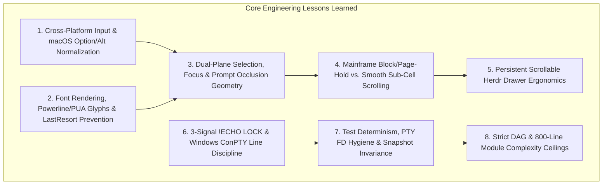

# Bilterm Engineering & Architecture Lessons Learned (`v0.1` → `v2.0`)

> **Scope:** A living engineering retrospective distilled from building **Bilterm** across 29 phases (`v0.1.0` through `v2.0` Phase 29) and live interactive debugging sessions on macOS, Linux, and Windows. See also **[`docs/LESSONS_LEARNED_COMPOUNDED.md`](LESSONS_LEARNED_COMPOUNDED.md)** for the unified synthesis across all platforms and **[`docs/LESSONS_LEARNED_LINUX.md`](LESSONS_LEARNED_LINUX.md)** sourced from the Linux X11/Xft & POSIX session.

---

## Executive Summary

Bilterm combines three paradigms that rarely coexist in a single terminal codebase:
1. **Composite Terminal Panes**: A movable/resizable **Floating Command Prompt** (`tui-textarea` / `PromptEditor`) layered directly over a full-PTY **OutputCanvas** (`VtParser` + `VtWorkerHandle`) with an **IBM 3270 Operator Information Area (OIA)** bottom status bar.
2. **Dual-Engine Rendering**: Immediate-mode terminal cell compositing (**Ratatui + Crossterm**) alongside zero-dependency native OS desktop GUI windows (**macOS Cocoa/CoreText Retina**, **Linux X11**, and **Windows Win32 GDI/ClearType**) and sub-cell vector/pixel canvases (**Tektronix 4010/4014** + **Braille/Sextant/Octant**).
3. **Hybrid Mainframe / Timeshare / Modern UX**: Smooth kinetic sub-cell scrolling (`PaneScrollMode::Smooth`) side-by-side with authentic IBM 3270 / VM/CMS block/page-hold scrolling (`PaneScrollMode::BlockPage`, `MORE...` / `HOLDING`), plus a persistent `herdr`-style slide-out Sessions/Terminals drawer.

Building and hardening these layers surfaced critical lessons across **platform input normalization**, **font fallback & PUA glyph rendering**, **composite occlusion & dual-plane selection**, **PTY/termios line discipline**, **test suite determinism**, and **modular complexity budgets**.



---

## 1. Cross-Platform Keyboard & Leader-Key Ergonomics (macOS `Option`, `$TMUX`, & `F`-Keys)

### What Happened
- On macOS, pressing `Option+<key>` in Terminal.app, iTerm2, or native AppKit windows emits **macOS Roman / Unicode dead-key characters** (e.g., `Option+V` → `√`, `Option+H` → `˙`, `Option+X` → `≈`, `Option+C` → `ç`, `Option+B` → `∫`, `Option+F` → `ƒ`, `Option+/` → `÷`) with `KeyModifiers::NONE` instead of `KeyModifiers::ALT`.
- Function keys `F9`–`F12` are intercepted by macOS Mission Control / Exposé by default, and `Alt+Space` / `Alt+\`` conflict with Spotlight or window switchers on several desktops.
- When running inside `tmux`, `Ctrl+B` is consumed by the outer `tmux` server unless doubled; when users press leader chords quickly (`Ctrl+X Ctrl+S` instead of `Ctrl+X s`), the `CONTROL` modifier remains held on the second keystroke.

### Root Cause
Relying solely on `KeyModifiers::ALT` or `F1`–`F12` breaks keyboard navigation on stock macOS configurations where "Use Option as Meta key" is disabled.

### The Fix & Architectural Pattern ([`src/input/normalize.rs`](file:///Users/bill/src/tools/bilterm/src/input/normalize.rs), [`src/input/keymap.rs`](file:///Users/bill/src/tools/bilterm/src/input/keymap.rs))
1. **Reverse-Map macOS `Option` Unicode Characters**: `normalize_key_event` translates macOS `Option` characters (`√`, `≈`, `ç`, `∫`, `ƒ`, `÷`, `«`, `»`, `–`, `—`, etc.) back into canonical `KeyEvent::new(KeyCode::Char(ascii), KeyModifiers::ALT)` before keymap lookup.
2. **Held-`Ctrl` Leader Chord Normalization**: When `wm.is_leader_pending()` is true, `Ctrl+X Ctrl+<char>` is normalized to match the same leader binding as `Ctrl+X <char>`.
3. **Dual Leader + Multi-Path Reachability**: `Ctrl+X` serves as the universal primary leader prefix (working identically in `FloatingCommandPrompt`, `RawPassthrough`, and inside `$TMUX`), while every `Action` is reachable via **4 paths**: Leader chord (`Ctrl+X <key>`), Direct hotkey (`F-key` / `Alt+<key>`), `:colon` command, and the `Ctrl+P` Fuzzy Command Palette (enforced by `src/action.rs::tests::every_action_is_reachable_from_keymap_colon_or_rpc`).

---

## 2. Font Rendering, Powerline / Nerd-Font PUA Glyphs & macOS `LastResort` `[?]` Boxes

### What Happened
Prompts containing Powerline or Nerd Font Private Use Area (PUA) glyphs — such as `" bill@bigmac  ~ "` (`U+E0B0` ``, `U+E0A0` ``) — rendered as **boxed question marks (`[?]`)** on macOS native GUI mode and degraded into `°` (`0xB0`) or `?` in the software bitmap fallback.

### Root Cause
1. **CoreText `.LastResort` Fallback**: When the primary monospace font (e.g., `Menlo` or `Monaco`) does not contain a glyph for `U+E0B0`, calling `CTFontCreateForString` on macOS returns Apple's internal `.LastResort` font, whose glyphs are literal boxed `[?]` symbols.
2. **Single-Byte Cast Truncation**: In an early bitmap fallback path, casting `char as u8` truncated `U+E0B0` (`0xE0B0`) to `0xB0` (`°`).

### The Fix & Architectural Pattern ([`src/ui/gui_macos.rs`](file:///Users/bill/src/tools/bilterm/src/ui/gui_macos.rs), [`src/ui/bitmap_font.rs`](file:///Users/bill/src/tools/bilterm/src/ui/bitmap_font.rs))
1. **Geometric Vector Synthesis First**: Before consulting OS fonts for cell-filling symbols, intercept Powerline triangles/chevrons (`U+E0A0..U+E0D7`), Box-Drawing (`U+2500..U+257F`), Block Elements (`U+2580..U+259F`), and Braille (`U+2800..U+28FF`) and draw them **geometrically** to exact cell pixel boundaries (`try_draw_powerline_or_custom_glyph` in `src/ui/gui_macos.rs` and `rasterize_glyph_cell` in `src/ui/bitmap_font.rs`). This guarantees pixel-perfect seam alignment at every font scale without seam gaps.
2. **Explicit `LastResort` Rejection + Nerd Font Fallback Cascade**: In CoreText fallback resolution, inspect the PostScript/family name of any fallback `CTFontRef`; if it contains `LastResort`, reject it and probe installed Nerd Fonts (`Symbols Nerd Font Mono`, `JetBrainsMono Nerd Font`, `MesloLGS NF`, `3270 Nerd Font`) before falling back to geometric vector rendering.
3. **Never Cast `char as u8`**: Always match full `u32` Unicode scalar values (`ch as u32`).

---

## 3. Dual-Plane Text Selection, Cut/Copy/Paste & Prompt Occlusion Geometry

### What Happened
- Users expected standard mouse drag and keyboard selection (`Shift+Arrows`, `Ctrl+C`, `Ctrl+V`, `Ctrl+X`) inside the floating command prompt **and** a fast way to move a visible cursor onto the underlying `OutputCanvas` to select/yank command output using the keyboard.
- In addition, when writing tests or hit-testing mouse clicks on a `CompositePane`, rows `0..prompt_height` of the `OutputCanvas` are visually occluded when `PromptAnchor::Top` (floating mode) is active.

### Root Cause
A composite terminal pane has **two distinct text coordinate systems**:
1. The **Command Prompt Plane** (`PromptEditor` multi-line buffer with Readline/Emacs word motions and selection anchor).
2. The **Terminal Output Canvas Plane** (`VtParser` viewport + scrollback ring buffer).

### The Fix & Architectural Pattern ([`src/pane/prompt_editor.rs`](file:///Users/bill/src/tools/bilterm/src/pane/prompt_editor.rs), [`src/pane/selection.rs`](file:///Users/bill/src/tools/bilterm/src/pane/selection.rs), [`src/input/mouse.rs`](file:///Users/bill/src/tools/bilterm/src/input/mouse.rs))
1. **Visual Selection in `PromptEditor`**: Added `selection_anchor: Option<(usize, usize)>` to `PromptEditor` so `Shift+Left/Right/Up/Down/Home/End` highlights selected prompt text in reverse video, `Ctrl+C` copies to OS clipboard + OSC 52, `Ctrl+X` / `Shift+Delete` cuts, and typing or `Ctrl+V` replaces the active selection.
2. **One-Key Canvas Cursor Mode (`F8` / `Alt+C` / `Ctrl+Up` / `:copy` / Canvas Click)**: Switches intra-pane focus from `FloatingCommandPrompt` to `OutputCanvas` (`CopyMode`), rendering a high-contrast cursor on the canvas that moves with arrow keys/`hjkl`/`w`/`b`/`0`/`$`, selects streams (`v` or `Shift+Arrows`) or rectangular blocks (`b` / `Alt+LeftDrag`), yanks directly into the command prompt (`x`) or clipboard (`Enter`/`y`/`Ctrl+C`), and returns to the prompt on `Tab`/`Esc`/`F8`.
3. **Occlusion-Aware Hit-Testing & Rendering Assertions**:
   - Mouse clicks check `pane.is_prompt_visible() && rect_contains(prompt_rect, col, row)` *before* routing to the underlying `OutputCanvas`.
   - Integration tests asserting on rendered `CompositePaneWidget` buffers must account for the 3-row floating prompt at the top of the canvas (`MAINFRAME-ROW-04` is the first unoccluded row under a 3-row top floating prompt, whereas `pane.vt().viewport_line_text(0)` inspects the unoccluded VT grid directly).

---

## 4. Smooth Sub-Cell / Kinetic Scrolling vs. Mainframe Block/Page-Hold (`MORE...` / `HOLDING`)

### What Happened
Modern desktop users expect smooth, inertia-damped pixel scrolling (`PaneScrollMode::Smooth`), while power users running high-output diagnostics (`find /`, compiler logs, `git log`, LLM streams) often want classic IBM 3270 / VM/CMS / timeshare **Block/Page-Mode** (`PaneScrollMode::BlockPage`) where output pauses automatically after filling one viewport page (`MORE...`) instead of flying past.

### Root Cause & Design Insights ([`src/vt/scrollback.rs`](file:///Users/bill/src/tools/bilterm/src/vt/scrollback.rs), [`src/pane/scroll.rs`](file:///Users/bill/src/tools/bilterm/src/pane/scroll.rs), [`src/ui/oia.rs`](file:///Users/bill/src/tools/bilterm/src/ui/oia.rs))
1. **Zero-Drop Background Buffering**: Mainframe page-hold must **never** block the child PTY fd or drop bytes. Instead, `VtParser` (and `VtWorkerHandle` on its background thread) continues ingesting all PTY output into the scrollback ring buffer while locking `scrollback_offset` so the top of the viewport stays anchored at `page_anchor_global_row`.
2. **Authentic IBM 3270 OIA Telemetry**:
   - When output fills the page and pauses at the anchor, the OIA status bar displays **`MORE...`** (and `+NL` pending line count).
   - Pressing `PF8` (`F8`), `PA2` (`Alt+PageDown`), `Space`, `Enter`, or `PageDown` advances by exactly one viewport page (`canvas.height` rows), returning to live tail (`READY`) once caught up.
   - Pressing `PF7` (`F7`), `b`, or `PageUp` steps backward by one full page and transitions the OIA indicator to **`HOLDING`**.
3. **OIA Badge Priority in 80-Column Viewports**: In `src/ui/oia.rs`, high-signal mode badges (`SCRL:PAGE`, `MORE...`, `HOLDING`, `🔒 PROT`) must be positioned *before* verbose coordinate/byte-count strings (`R01 C01 | Out: 1234B`) so they are never clipped on standard 80-column terminals.

---

## 5. Persistent & Scrollable `herdr`-Style Workspace Drawer (`DRW-01`, `DRW-02`)

### What Happened
Initially, the `herdr`-style Sessions / Windows / Panes drawer (`F7` / `Ctrl+X d` / `:drawer`) behaved like a transient popup menu that closed automatically as soon as the user clicked a pane or pressed `Enter`. Furthermore, workspaces with many panes or fleet nodes could overflow the drawer height without a scrollbar.

### The Fix & Architectural Pattern ([`src/wm/drawer.rs`](file:///Users/bill/src/tools/bilterm/src/wm/drawer.rs))
- **Persistent by Default**: Clicking a session/pane row or pressing `Enter` in the drawer switches focus and raises the selected pane (`focus_and_raise`) while **keeping the drawer open in-place**.
- **Explicit Dismissal Only**: The drawer only closes when the user clicks the `[×]` close button in the drawer header, clicks the `F7=Drawer` hotkey pill, or presses `F7` / `Ctrl+X d` / `Esc`.
- **Viewport Clamping & Scroll Indicators**: Added `scroll_offset` and `ensure_selected_visible(viewport_rows)` with `▲`/`▼` scroll indicators and mouse-wheel / `Up` / `Down` / `PageUp` / `PageDown` / `Home` / `End` navigation.

---

## 6. Native Desktop App Bundles (`Bilterm.app`) & Non-TTY Launch Detection

### What Happened
Double-clicking `Bilterm.app` in macOS Finder or Dock launched the binary with no controlling TTY (`stdin` is `/dev/null` or launchd pipe, sometimes passing a legacy Finder `-psn_0_...` Process Serial Number argument). Because the CLI defaulted to TUI mode (`crossterm::terminal::enable_raw_mode()`), launching from Finder immediately exited with `Device not configured (os error 6)`.

### The Fix & Architectural Pattern ([`src/main.rs`](file:///Users/bill/src/tools/bilterm/src/main.rs), [`src/launcher/mod.rs`](file:///Users/bill/src/tools/bilterm/src/launcher/mod.rs))
1. **Launcher Manifest Explicit `--gui`**: `Bilterm.app/Contents/MacOS/bilterm-launch` and desktop `.desktop` / `.lnk` manifests pass `--gui` explicitly.
2. **Automatic Non-TTY & `-psn_` Detection**: `src/main.rs` strips macOS `-psn_*` arguments and automatically promotes no-arg invocations to `--gui` when `!std::io::stdin().is_terminal() || !std::io::stdout().is_terminal()` (or when `BILTERM_APP_BUNDLE=1` is set).
3. **True Native Windowing Across All 3 OS Targets**: Implemented native macOS Cocoa/AppKit + CoreGraphics/CoreText (`src/ui/gui_macos.rs`), Linux X11 (`src/ui/gui_linux.rs`), and Windows Win32 GDI/ClearType (`src/ui/gui_window.rs`) so `--gui` opens an interactive hardware/native window on every platform.

---

## 7. 3-Signal `!ECHO LOCK`, `asciinema`, & Windows ConPTY Line Discipline

### What Happened
- Running `sudo`, `ssh`, or `gpg` prompts for a password on the PTY. If the user types their password into the Floating Command Prompt while `ECHO` is still visually enabled in the prompt widget, the password would be echoed in cleartext and saved to command history.
- Conversely, shells like `zsh` (ZLE), `bash` (Readline), and `fish` disable `termios.c_lflag & ECHO` while waiting for normal interactive line input, and tools like `asciinema rec` interpose a proxy PTY whose foreground process group is `asciinema` rather than the inner shell.
- On Windows ConPTY, submitting a command with `\n` (LF) instead of `\r` (CR) caused `cmd.exe` and `powershell.exe` to ignore or double-space submitted commands.

### The Fix & Architectural Pattern ([`src/pane/mod.rs`](file:///Users/bill/src/tools/bilterm/src/pane/mod.rs), [`src/pty/line_discipline.rs`](file:///Users/bill/src/tools/bilterm/src/pty/line_discipline.rs))
1. **3-Signal `!ECHO LOCK` Invariant**: A pane enters password lock (`!ECHO LOCK`) **only** when:
   - Signal 1: PTY `termios` has `!ECHO` (`ICANON && !ECHO`), **AND**
   - Signal 2 & 3: Either a foreground subcommand is running (`tcgetpgrp != shell_pid`) **or** the last visible VT line matches a password prompt pattern (`password:`, `passphrase`, `sudo`, `pin:`, `verification code`).
   - This prevents false-positive password locks during normal `zsh`/`bash`/`fish` Readline editing while immediately locking and masking input during `sudo`/`ssh`.
2. **`force_command_prompt` Override (`Ctrl+G` / `F12`)**: Allows users inside `asciinema` or nested PTY wrappers to force the Floating Command Prompt open even when a wrapper process owns the PTY foreground group.
3. **Platform Line-Ending Discipline**: Submit `\r\n` / `\r` appropriately on Windows ConPTY (`cfg!(windows)`) and use a non-blocking ConPTY background reaper thread so closing a pane never hangs the UI thread.

---

## 8. Test Suite Determinism, Subprocess FD Hygiene & Snapshot Compatibility

### What Happened
1. **Hanging Subprocess Tests**: Running `Command::new(env!("CARGO_BIN_EXE_bilterm")).output()` in integration tests without `stdin(Stdio::null())` hung when the binary checked terminal state or spawned child processes that inherited open pipe file descriptors.
2. **Slow / Flaky Login Shell Spawns**: Spawning 50+ default user login shells (`$SHELL`) in parallel integration tests triggered slow `~/.zshrc` plugin initialization and contended on `/dev/ptmx` on macOS.
3. **Snapshot Churn on Default Status Badges**: Adding new OIA status bar indicators (such as `v1.12.0` version badges or `SCRL:SMOOTH` scroll mode badges) broke 13 existing `insta` ASCII snapshots in `tests/snapshots/*.snap` if enabled unconditionally in `CompositePane::new_headless`.

### The Fix & Architectural Pattern
| Problem Class | Prevention Rule |
|---|---|
| **Subprocess CLI Tests** | Always pass `.stdin(Stdio::null())` and bounded timeouts when invoking `CARGO_BIN_EXE_bilterm` in integration tests. |
| **PTY Integration Tests** | Prefer `WindowManager::new_headless` for deterministic UI/VT/WM state tests; when testing live PTYs, spawn `/bin/sh -c "..."` (POSIX) or `cmd.exe /C` (Windows) with explicit 5-second poll deadlines. |
| **Snapshot Compatibility** | Keep `CompositePane::new_headless` default badges minimal (`show_version_badge = false`, `set_scroll_mode_from_config` with `explicit_badge = false`), while enabling badges in live spawned panes or when explicitly toggled via `:version` or `:scroll`. |

---

## 9. Enforced Complexity Budgets & Acyclic Module DAG (`ARCH-R01..04`)

### What Happened
As Bilterm grew past 25,000 lines of Rust across 65+ source files, monolithic files (`src/ui/status_bar.rs`, `src/pane/prompt_editor.rs`, `src/wm/mod.rs`) approached the 800-line ceiling, and placing shared enums like `PaneScrollMode` in `src/pane` caused reverse dependency cycles when `src/vt/worker.rs` needed them.

### The Fix & Architectural Pattern
1. **Strict Acyclic Module DAG**:
   ```text
   error / secure_fs  ──►  pty  ──►  vt  ──►  pane  ──►  config  ──►  remote / tmux  ──►  wm  ──►  action  ──►  colon_command  ──►  input  ──►  ui  ──►  api / app / launcher
   ```
   Shared types needed by both `vt` and `pane` (such as `PaneScrollMode` in `src/vt/scrollback.rs`) are defined in the lower layer (`vt`) and re-exported by `pane`.
2. **Hard Line-Count Ceilings**:
   - Every `src/**/*.rs` file **must** remain **`<= 800` lines** (`ARCH-R04`). When `src/ui/status_bar.rs` reached 796 lines during Phase 29, the 3270 OIA status bar renderer was cleanly extracted into [`src/ui/oia.rs`](file:///Users/bill/src/tools/bilterm/src/ui/oia.rs).
   - [`src/input/mod.rs::handle_wm_key_event`](file:///Users/bill/src/tools/bilterm/src/input/mod.rs) **must** remain **`<= 80` lines** (`ARCH-R01`), delegating all shortcuts to declarative `KeyBinding` tables in [`src/input/keymap.rs`](file:///Users/bill/src/tools/bilterm/src/input/keymap.rs).
   - Both ceilings are continuously enforced by automated tests in [`tests/session_lessons_and_regression_suite.rs`](file:///Users/bill/src/tools/bilterm/tests/session_lessons_and_regression_suite.rs).

---

## 10. Filesystem Atomicity, Unix Socket Probing & Build/Test Operational Gotchas

| Gotcha / Failure Mode | Root Cause | Enforced Practice |
|---|---|---|
| **`ENOENT` race in `write_private_file`** | Calling `remove_file(path)` followed by `create_private_file(path)` in-place on shared runtime files (e.g., `shell-integration-<pid>`) creates a window where concurrent panes/threads observe `ENOENT`. | Always write to a sibling `.tmp-<pid>-<seq>` file with `0600` permissions and atomically `fs::rename` over the destination ([`src/secure_fs.rs`](file:///Users/bill/src/tools/bilterm/src/secure_fs.rs)). |
| **Unlinking live Unix RPC sockets on `PermissionDenied`** | Treating *any* `connect()` error on an existing Unix domain socket as a "stale socket" and unlinking it destroys active sockets when `PermissionDenied` occurs. | Only treat `ErrorKind::ConnectionRefused` or `ErrorKind::NotFound` as a stale socket safe to unlink. |
| **Pinned `rust-toolchain.toml` (`1.90`) vs. offline local `stable`** | When running in sandboxed or offline environments where only `stable` is installed locally, bare `cargo` attempts to download `1.90`. | Invoke `cargo +stable build -q`, `cargo +stable clippy -q --all-targets -- -D warnings`, and `cargo +stable test -q`. |
| **App Icon Transparency (`Bilterm.icns` / `.ico` / `.png`)** | Edge flood-fill background removal leaves opaque dark corners if a glow touches the outer border. | Compute alpha mask by distance from the rounded squircle boundary so exterior corners are guaranteed `alpha = 0` (`100%` transparent). |

