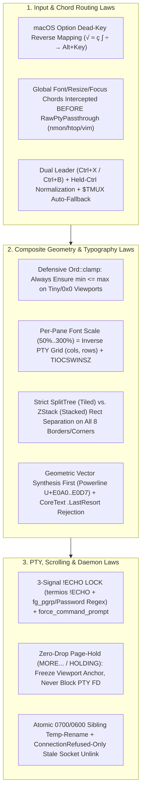

# Bilterm Compounded Engineering & Architecture Lessons Learned (`v0.1` → `v2.0`)

> **Provenance & Synthesis:**
> This document compounds the engineering, debugging, UI/UX, typography, window-management, security, and testing lessons captured independently across:
> - **[`docs/LESSONS_LEARNED.md`](LESSONS_LEARNED.md)** *(Sourced from macOS `aarch64-apple-darwin` — Cocoa/CoreText Retina GUI, `Bilterm.app`, `Option`-key normalization, and Phase 29 Smooth/Mainframe `BlockPage` scrolling)*
> - **[`docs/LESSONS_LEARNED_LINUX.md`](LESSONS_LEARNED_LINUX.md)** *(Sourced from Linux `x86_64-unknown-linux-gnu` — POSIX PTY, X11/Xft/Fontconfig `dlopen` GUI, per-pane font scaling + `TIOCSWINSZ`, `nmon`/`htop` `RawPtyPassthrough` chord routing, and all-border/corner mouse resizing)*
> - **Milestone `v2.0` Forward Synthesis** *(Directly feeding architectural guardrails into Phases 30–34 in [`.planning/ROADMAP.md`](../.planning/ROADMAP.md))*

[← Back to Documentation Hub](README.md) | [← Back to Project README](../README.md)

---

## 1. The Compounded Synthesis Matrix (macOS × Linux × Windows)

When findings from the macOS and Linux engineering sessions are combined, 10 cross-cutting architectural laws emerge:

| Domain | Sourced from macOS (`LESSONS_LEARNED.md`) | Sourced from Linux (`LESSONS_LEARNED_LINUX.md`) | Compounded Architectural Invariant |
|--------|-------------------------------------------|-------------------------------------------------|------------------------------------|
| **1. Typography & PUA Glyphs** | CoreText `.LastResort` font returns `[?]` boxes for `U+E0B0`; never cast `char as u8`. | `XftDrawStringUtf8` & bitmap renderers leave 1px seam gaps unless Powerline/PUA glyphs are drawn geometrically to exact `cell_w × cell_h`. | **Geometric-First + `LastResort` Rejection**: Rasterize `U+E0A0..=U+E0D7`, `U+2500..=U+259F`, `U+2800..=U+28FF`, and `U+1FB00..=U+1FB3B` procedurally before OS font fallback; reject `.LastResort` in CoreText and use `dlopen` Xft/Fontconfig on Linux. |
| **2. Per-Pane Font Zoom & Grid Sizing** | Dynamic font scaling (`FONT-01`) across GUI and DEC `DECDWL`/`DECDHL` TUI lines. | Per-pane `Ctrl++`/`Ctrl+-`/`Ctrl+0`/`Ctrl+Wheel` must scale each pane independently and inversely resize its PTY `(cols, rows)` via `TIOCSWINSZ`. | **Inverse Cell-Grid Law**: Each pane owns `PaneFontOptions`. Scaling a pane's font by `S` scales its PTY grid by `1/S` (`pane_scaled_inner_rect`) and projects local mouse coordinates accordingly. |
| **3. Clamp & Viewport Safety** | OIA status bar badges (`MORE...`, `HOLDING`, `SCRL:PAGE`) must prioritize high-signal badges on narrow 80-col viewports. | `self.height.clamp(3, canvas_height.max(1))` panics (`min <= max`) when repeated `Ctrl+-` or multi-way splits shrink `canvas_height` to `1..2`. | **Zero-Panic Clamp Law**: Every `.clamp(min, max)` on viewport/prompt/window dimensions must guarantee `max >= min` (`val.clamp(min, max.max(min)).min(max)`) and is tested down to `0×0` viewports. |
| **4. Keyboard Routing & `RawPtyPassthrough`** | Reverse-map macOS `Option` dead-key characters (`√`, `≈`, `ç`, `∫`) to `Alt+<key>`; normalize `Ctrl+X Ctrl+<key>`. | Interactive TUIs (`nmon`, `htop`, `vim`) enter `RawPtyPassthrough` and swallowed `Ctrl++`/`Ctrl+-` because global bindings ran *after* passthrough. | **Pre-Passthrough WM Escape Hatch**: Normalize OS key quirks first, then intercept WM-level font-zoom, pane-focus, and pane-resize bindings *before* `InputRoutingMode::RawPtyPassthrough`. |
| **5. Mouse Selection, Occlusion & Frame Dragging** | Dual-plane selection (`PromptEditor` reverse-video + `F8` Canvas Copy Mode) and prompt occlusion hit-testing (`rows 0..prompt_h`). | Dragging top borders in `Tiled` mode triggered `MoveWindow` (swapping panes), and outer-border drags wrote into `ZStack` rects, corrupting `SplitTree`. | **Plane & Layout Mode Isolation**: Hit-test floating prompt before canvas; in `Tiled` mode, all 4 borders (`Top`, `Bottom`, `Left`, `Right`) and all 4 corners resize `SplitTree` via `set_split_ratio_for_border` and never mutate `ZStack`. |
| **6. Scrolling, Paging & Flow Control** | Smooth sub-cell scrolling (`PaneScrollMode::Smooth`) + IBM 3270 `BlockPage` (`MORE...` / `HOLDING`) that freezes viewport anchor without blocking the PTY FD. | `/dev/random` escape-trap sanitization (`sanitize_stream_traps`) and non-blocking background PTY reaping (`bilterm-pty-reaper`). | **Non-Blocking PTY Pipeline**: Never stall child PTY reads or drop output bytes during `MORE...` page-hold, flood bursts, or pane teardown. |
| **7. Security, Sockets & Filesystem** | Atomic sibling `.tmp-<pid>-<seq>` `0600` rename prevents `ENOENT` races; only unlink Unix sockets on `ConnectionRefused`/`NotFound`. | `0700` private dir confinement, Unix `SO_PEERCRED` UID verification, `--token-file` (`0600`), and test-verified starter pack playbooks. | **Race-Free Confinement Law**: All state/journal/socket/snapshot I/O goes through `src/secure_fs.rs` with atomic temp-rename and `ConnectionRefused`-only stale socket recovery. |
| **8. Complexity & Verification Gates** | Acyclic 12-layer module DAG, `<= 800` lines per file (`src/ui/oia.rs` split), `.stdin(Stdio::null())` subprocess tests, and snapshot-safe default badges. | Automated `awk` 800-line gate, `<= 80`-line `handle_wm_key_event`, SVG timestamp checkout after screenshot tests, and `flash` subagent test loops. | **Automated Structural Invariants**: Enforce DAG acyclicity, `<= 800` line ceilings, 4-path `Action` reachability, and playbook execution in `cargo test`. |

---

## 2. How Compounded Lessons Shape Milestone `v2.0` (`Phases 30–34`)

Reviewing the upcoming `v2.0` roadmap against these compounded lessons surfaced five concrete architectural requirements that have been folded into [`.planning/ROADMAP.md`](../.planning/ROADMAP.md):

### 1. Phase 30 (`SAFE-01`, `SAFE-02` — Explicit Exit Guard & Root/Final Session Protection)
- **Lesson Applied (`RawPtyPassthrough` + `3-Signal !ECHO LOCK` + Non-Blocking Reaper)**:
  - `Ctrl+D` interception on a final/root pane must distinguish between:
    1. An empty `FloatingCommandPrompt` or canonical shell EOF (triggers the **Borland/3270 Exit Guard Modal**),
    2. `DECSET 1049` (`ALT_SCREEN` programs like `vim`, `less`, `nmon`) or `!ECHO LOCK` (`sudo` password prompt), where `Ctrl+D` must pass through to the foreground program without false-positive Exit Guard popups.
  - When a final/root shell exits and is respawned (`(r)espawn shell`), Bilterm must reset `TerminalBackend` mode flags (`ALT_SCREEN`, `BlockPage` `MORE...` anchor, mouse reporting) and reap the old child on the background `bilterm-pty-reaper` thread so the UI never freezes.

### 2. Phase 31 (`THM-01`, `THM-02` — Universal Open Color Scheme & Font Engine)
- **Lesson Applied (Geometric PUA Priority + `.LastResort` Rejection + Per-Pane Inverse Grid Scaling)**:
  - Importing `.itermcolors` or Alacritty/WezTerm/Ghostty/Base16 themes with custom font profiles must preserve the geometric rasterizer priority for Powerline (`U+E0A0..=U+E0D7`) and box-drawing glyphs, reject macOS `.LastResort`, and recalculate per-pane `pane_scaled_inner_rect` (`TIOCSWINSZ`) whenever a theme changes base font metrics.
  - Automatic Borland/3270 chrome synthesis must guarantee readable contrast for OIA `MORE...` / `HOLDING` / `!ECHO LOCK` badges and cyan selection highlights.

### 3. Phase 32 (`DAEM-01`, `DAEM-02` — Persistent Background Multiplexer Daemon)
- **Lesson Applied (`ConnectionRefused`-Only Socket Recovery + Multi-Client Viewport/Font-Scale Negotiation)**:
  - `bilterm daemon` binding `~/.local/state/bilterm/daemon.sock` must use the exact stale-socket rule from Lesson 7 (`ErrorKind::ConnectionRefused` or `NotFound` only — never unlink on `PermissionDenied`) plus `SO_PEERCRED` peer UID verification.
  - Because a user may attach a Retina/X11 `--gui` client (with per-pane font scaling) and an 80×24 SSH TUI client simultaneously, the daemon's session viewport coordinator must clamp all client rects with `min <= max` guards (`Ord::clamp` safety) and isolate per-client pixel/cell metrics from shared PTY `(cols, rows)`.

### 4. Phase 33 (`TREE-01..02`, `PERS-01..02` — Hierarchical Session Trees & Crash-Safe Layout Journaling)
- **Lesson Applied (Atomic Sibling Temp-Rename + `SplitTree` vs. `ZStack` Separation + Per-Pane State Fidelity)**:
  - `src/wm/journal.rs` must write crash-recovery checkpoints via `secure_fs::write_private_file` (sibling `.tmp-<pid>-<seq>` `0600` + atomic `fs::rename`) so a crash mid-checkpoint never corrupts the previous valid journal or causes `ENOENT` races.
  - Journal snapshots must persist `SplitTree` ratios and `ZStack` rects as distinct fields (never applying `ZStack` rects when restoring `WorkspaceLayoutMode::Tiled`), alongside per-pane `PaneFontOptions` (`scale_pct`), `PaneScrollMode` (`Smooth` vs. `BlockPage`), and `Herdr` Drawer state.

### 5. Phase 34 (`MCP-01`, `MCP-02` — TRON-Inspired Master Control Program `MCP` Root Terminal)
- **Lesson Applied (Zero-Drop `VtWorkerHandle` Freeze/Thaw + `ARCH-R01`/`ARCH-R04` Budgets)**:
  - `mcp freeze <target>` and `mcp thaw <target>` should reuse Phase 29's zero-drop `VtWorkerHandle` snapshot page-lock mechanism (`HOLDING`), freezing visual updates and input on target sessions/subtrees while continuing to buffer background PTY output without deadlocking child processes.
  - All `MCP` root console commands lower into `crate::action::Action` and keep every file in `src/mcp_console/` `<= 800` lines (`ARCH-R04`).
