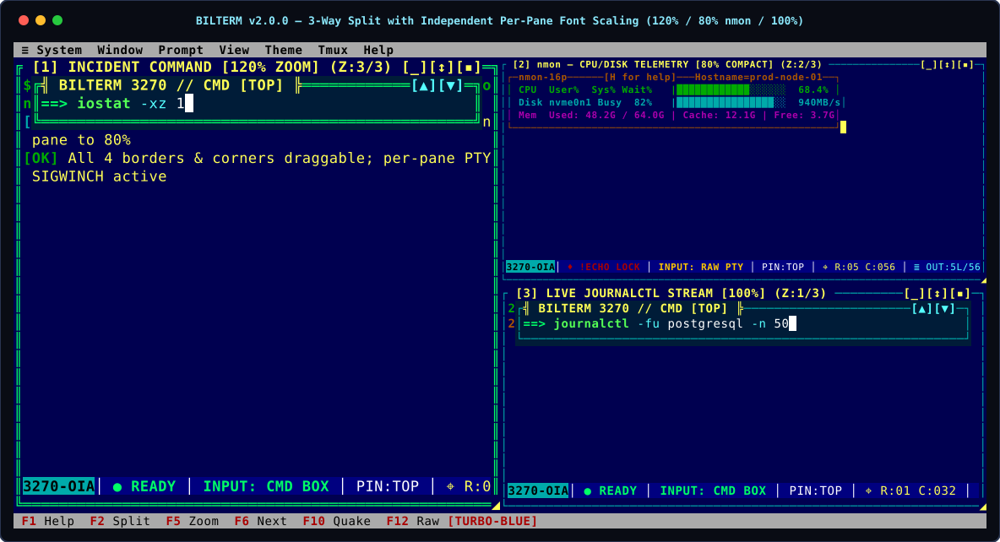
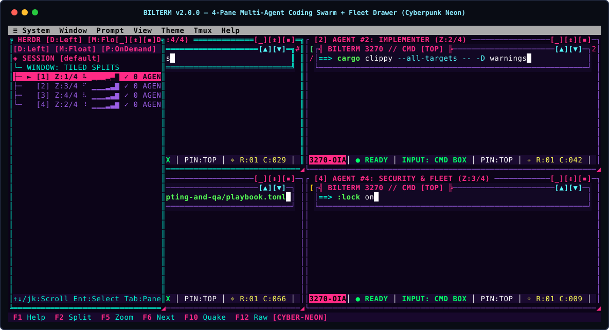
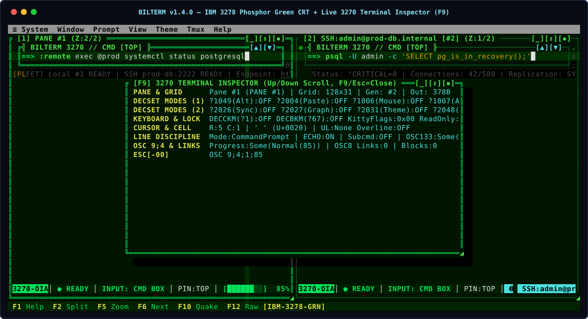
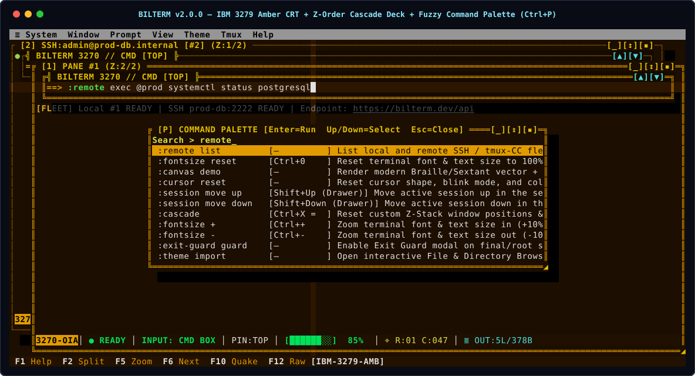

# Bilterm Visual Gallery & Workspace Screen Renders (`v2.1.0`)

[← Back to Project README](../README.md) | [Documentation Hub (`docs/README.md`)](README.md)

Deterministic SVG framebuffer renders generated directly from Bilterm's `GuiWorkspaceRenderer` and `AutomationControlPlane`.

---

## 1. Multi-Pane Composite Workspace & SSH Fleet (`turbo-blue`)

  

---

## 2. Per-Pane Independent Font Scaling (`120%` / `80%` `nmon` / `100%`) & 3-Way Split

  

---

## 3. Multi-Agent AI Coding Swarm & Slide-Out Fleet Drawer (`cyberpunk-neon`)

  

---

## 4. IBM 3278 Phosphor Green CRT (`F9` Inspector) & IBM 3279 Amber CRT (`Ctrl+P` Command Palette)

| IBM 3278 Phosphor Green + `F9` 3270 Inspector | IBM 3279 Amber + Z-Order Cascade + `Ctrl+P` Palette |
| :---: | :---: |
|  |  |
