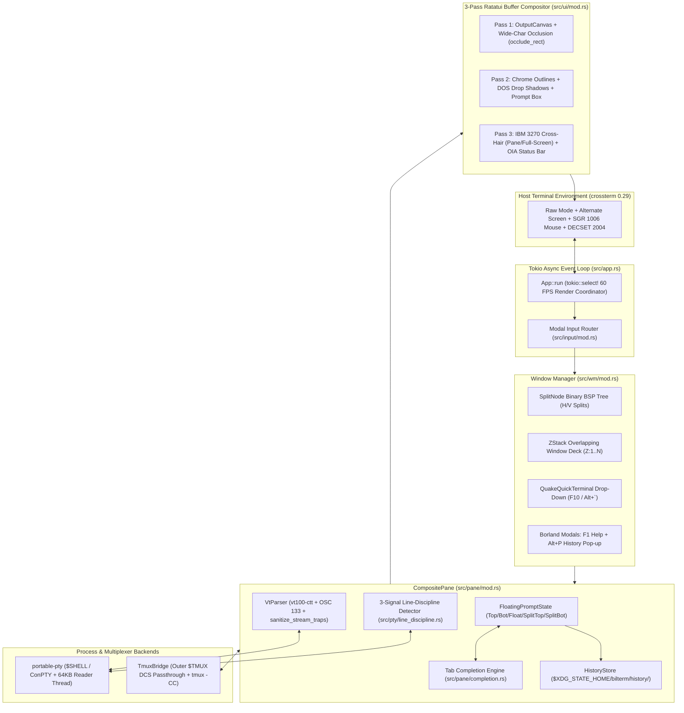
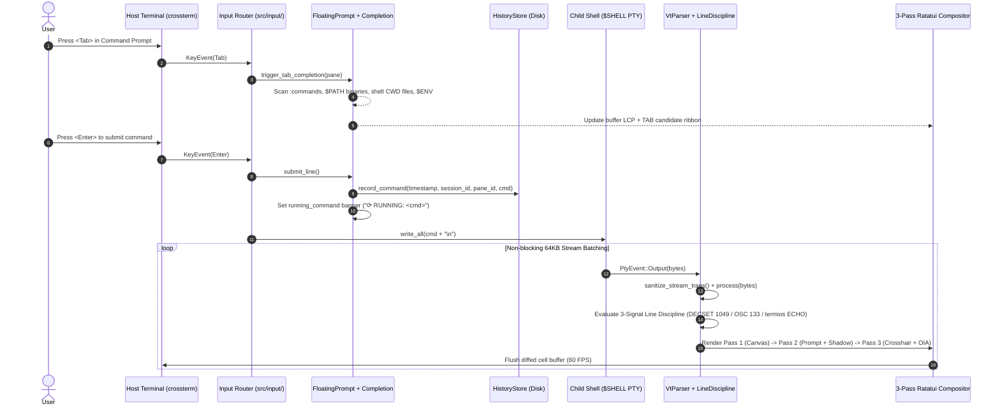

# System Architecture & Internals

[← Back to Documentation Hub](README.md) | [← Back to Project README](../README.md)

## Table of Contents

- [1. Architectural Overview](#1-architectural-overview)
- [2. Subsystem Breakdown](#2-subsystem-breakdown)
- [3. Runtime Execution & Input Lifecycle](#3-runtime-execution--input-lifecycle)
- [4. 3-Signal Line-Discipline State Machine](#4-3-signal-line-discipline-state-machine)
- [5. 3-Pass Ratatui Buffer Compositor](#5-3-pass-ratatui-buffer-compositor)
- [6. Persistent Storage & Dual-Mode `tmux` Bridge](#6-persistent-storage--dual-mode-tmux-bridge)

---

## 1. Architectural Overview

Bilterm is structured as a modular Rust 2024 crate (`src/lib.rs` + `src/main.rs`) driven by a single non-blocking `tokio::select!` event loop (`src/app.rs`).

*(See [`docs/diagrams/`](diagrams/README.md) for standalone `.mmd`, `.drawio` XML, and [`ascii_architecture.txt`](diagrams/ascii_architecture.txt) versions).*

---

## 2. Subsystem Breakdown

| Module | File Path | Responsibility |
|--------|-----------|----------------|
| **Application Loop** | `src/app.rs` | Multiplexes `crossterm::event::EventStream`, per-pane `PtyEvent` channels, live `termios` polling, query replies (`DSR`/`CPR`/`DA1`), and 60 FPS rendering |
| **PTY & Line Discipline** | `src/pty/mod.rs`, `src/pty/line_discipline.rs` | Cross-platform PTY spawning (`portable-pty`), `SIGWINCH` deduplication, 64KB `spawn_blocking` reader threads, and 3-signal line-discipline detection |
| **VT100/Xterm Engine** | `src/vt/mod.rs` | Wraps `vt100-ctt` with `DECSET ?1/?47/?1000..1006/?1047/?1049/?2004/?2026`, `OSC 0/2` titles, `OSC 7` CWD, `OSC 52` clipboard, `OSC 133` command blocks, `DSR/CPR/DA1` replies, and `sanitize_stream_traps` |
| **Composite Pane & Prompt** | `src/pane/mod.rs`, `src/pane/completion.rs`, `src/pane/history_store.rs`, `src/pane/highlight.rs`, `src/pane/fuzzy_history.rs`, `src/pane/colon_command.rs` | `CompositePane` state, `PromptAnchor` (`Top`, `Bottom`, `Floating`, `SplitTop`, `SplitBottom`), resizable width/height, scrolling, running command banner, Tab completion, `nucleo-matcher` fuzzy history, and persistent `HistoryStore` |
| **Window Manager** | `src/wm/mod.rs`, `src/wm/split_tree.rs`, `src/wm/z_stack.rs`, `src/wm/quick_terminal.rs` | Recursive H/V `SplitNode` BSP tree, overlapping `ZStack` window deck, persistent `QuakeQuickTerminal` (`F10`), and `<F1>` Help modal |
| **3-Pass UI Compositor** | `src/ui/mod.rs`, `src/ui/chrome.rs`, `src/ui/cursor.rs`, `src/ui/glyphs.rs`, `src/ui/occlusion.rs`, `src/ui/theme.rs` | Immediate-mode Ratatui buffer compositor, 8 `OutlineStyle` borders, 4 `ShadowStyle` DOS drop shadows, CJK `occlude_rect`, pane/full-screen IBM 3270 cross-hairs, and OIA status bar |
| **Configuration** | `src/config/mod.rs` | Declarative `~/.config/bilterm/config.toml` parser and `.ini` palette override loader |
| **Tmux Bridge** | `src/tmux/mod.rs` | Outer `$TMUX` `DCS tmux;` passthrough wrapper and `tmux -CC` Control Mode protocol parser |

---

## 3. Runtime Execution & Input Lifecycle

---

## 4. 3-Signal Line-Discipline State Machine

```mermaid
stateDiagram-v2
    [*] --> CmdBoxReady: Spawn $SHELL in CompositePane

    state "INPUT: CMD BOX (● READY)" as CmdBoxReady
    state "INPUT: CMD BOX (⟳ RUNNING)" as CmdBoxRunning
    state "INPUT: RAW PTY (▣ ALT SCR)" as AltScreen
    state "INPUT: RAW PTY (♦ !ECHO LOCK)" as EchoLock
    state "INPUT: RAW PTY (Manual)" as ManualRaw

    CmdBoxReady --> CmdBoxRunning: Enter submits command ( foreground_subcommand = true )
    CmdBoxRunning --> CmdBoxReady: OSC 133;D / Foreground job exits to shell prompt

    CmdBoxReady --> AltScreen: DECSET ?1049h / ?1047h / ?47h (vim, htop, less)
    CmdBoxRunning --> AltScreen: DECSET ?1049h / ?1047h / ?47h
    AltScreen --> CmdBoxReady: DECRST ?1049l (App exits alternate screen)

    CmdBoxReady --> EchoLock: termios !ECHO && ICANON (sudo, ssh, gpg password)
    CmdBoxRunning --> EchoLock: termios !ECHO && ICANON
    EchoLock --> CmdBoxReady: termios ECHO restored

    CmdBoxReady --> ManualRaw: Press F12 / Ctrl+G (:raw)
    ManualRaw --> CmdBoxReady: Press F12 / Ctrl+G (:raw)
```

---

## 5. 3-Pass Ratatui Buffer Compositor

Every frame in `src/ui/mod.rs` renders through a strict 3-pass pipeline directly into Ratatui's `Buffer`:

1. **Pass 1 (`OutputCanvas` & OIA Bar)**:
   - In Floating modes (`Top`, `Bottom`, `Floating`), the VT100 grid renders across the full height of the pane (`pane.height - 1`).
   - In Non-Overlapping Split modes (`SplitTop`, `SplitBottom`), the pane is partitioned into disjoint `prompt_rect` and `canvas_rect` regions so zero lines of output are covered by the prompt.
   - The bottom 1-row **3270-OIA** status bar renders state badges (`● READY`, `⟳ RUNNING`, `⇳ SCROLL`, `▣ ALT SCR`, `♦ !ECHO LOCK`), `≣ OUT:<lines>L/<bytes>`, and `⌖ R:xx C:xxx`.
2. **Pass 2 (`occlude_rect`, DOS Drop Shadows & Floating Overlays)**:
   - Calls `occlude_rect(buf, prompt_rect)` to blank any 2-column CJK/Emoji graphemes straddling the prompt's left or right border.
   - Renders the configured `ShadowStyle` (`Translucent`, `ThemeTinted`, `SolidHalfBlock`, or `None`) 2 columns to the right and 1 row below floating boxes.
   - Renders the command prompt frame (`OutlineStyle`), the **`⟳ RUNNING:` / `● LAST CMD:`** banner, syntax-highlighted multi-line input, vertical scrollbar (`█`/`░`), and the `TAB:` completion or `Ctrl+R` fuzzy-search ribbon.
3. **Pass 3 (IBM 3270 Software Cross-Hairs & Modal Overlays)**:
   - Applies non-destructive background tinting (`palette.crosshair_bg`) across the cursor's row and column — spanning either the active pane (`crosshair_fullscreen = false`) or the entire terminal screen (`crosshair_fullscreen = true`).
   - Renders the top-level **History Pop-up (`Alt+P`)**, **Guake Quick Terminal (`F10`)**, and **`<F1>` Help Modal** if active.

---

## 6. Persistent Storage & Dual-Mode `tmux` Bridge

- **Session Command History (`src/pane/history_store.rs`)**:
  - Writes `[YYYY-MM-DDTHH:MM:SSZ | session=<epoch>-<pid>-<seq> | pane=<id>] <command>` to `$XDG_STATE_HOME/bilterm/history/bilterm-history-<session_id>-pane-<id>.log`.
  - Automatically prunes the oldest `.log` files when the directory exceeds `history_max_files` (default `25`).
  - Supports instant export of the active pane's session commands to an executable shell script via `:history save [path]`.
- **Dual-Mode `tmux` Bridge (`src/tmux/mod.rs`)**:
  - **Mode A (Inside `$TMUX`)**: Wraps `OSC 52` clipboard sequences in `\x1bPtmux;\x1b...\x1b\\` (`wrap_tmux_dcs_passthrough`) and avoids `Ctrl+B` keybinding collisions.
  - **Mode B (`tmux -CC` Control Mode)**: Parses `%output %<pane_id>`, `%window-add`, `%layout-change`, and `%session-changed` notifications and formats prompt submissions as `send-keys -t %<id> -H <hex>`.
