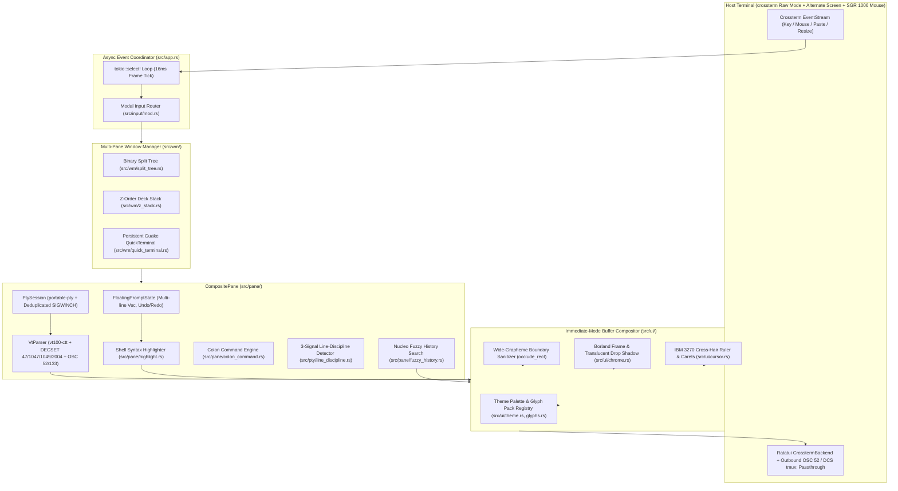

# Bilterm System Architecture Overview

Bilterm is a terminal user interface (TUI) multiplexer, shell wrapper, and terminal emulator written in Rust using `ratatui`, `crossterm`, `portable-pty`, `vt100-ctt`, and `tokio`. It fuses two classic computing paradigms into a single **Composite Window Pane** architecture:
1. **IBM 3270 Mainframe Terminals**: A movable, pinnable, resizable command entry field (`FloatingCommandPrompt`) and Operator Information Area (`OiaStatusBar`) overlaid over a full-height terminal output canvas (`OutputCanvas`).
2. **DOS Borland Turbo Vision (Turbo C / Turbo Pascal IDE)**: Double-line active window borders (`╔═╗`), single-line inactive borders (`┌─┐`), translucent 2-column right / 1-row bottom character-cell drop shadows (`0x08` attribute dimming), window number badges (`[1]`, `[2]`), clickable `[▪]` close / `[↕]` zoom / `◢` resize widgets, and a bottom Function-Key bar (`F1 Help  F2 Split ...`).

---

## 1. Component Architecture Diagram

---

## 2. Module Responsibilities

| Module | File Path | Core Types & Responsibilities |
|--------|-----------|-------------------------------|
| **Application Loop** | `src/app.rs` | `App`: Multiplexes `crossterm::event::EventStream`, multi-PTY reader channels, 16ms frame ticks, and outbound `OSC 52` / `DCS tmux;` clipboard flushing. |
| **Error & Lifecycle Guard** | `src/error.rs` | `BiltermError`, `TerminalRestoreGuard`: Idempotent RAII + panic-hook restoration of raw mode, alternate screen, SGR mouse capture, and bracketed paste. |
| **PTY Engine** | `src/pty/mod.rs` | `PtyConfig`, `PtySession`, `default_shell_for_platform`: Cross-platform PTY spawning (`portable-pty`) with background blocking reader threads and deduplicated `SIGWINCH` resizing. |
| **Line-Discipline Detector** | `src/pty/line_discipline.rs` | `LineDisciplineState`, `InputRoutingMode`, `inspect_pty_fd`: Combines `OSC 133`, `tcgetpgrp`, and `tcgetattr` (`!ECHO` / `!ICANON`) to protect `sudo`/`ssh` passwords and interactive REPLs. |
| **VT100 State Machine** | `src/vt/mod.rs` | `VtParser`, `Osc133Phase`, `CommandBlockRecord`: Tracks VT100/ANSI/TrueColor grids, `DECSET 47/1047/1049` alternate screen, `DECSET 2004` bracketed paste, `OSC 52` clipboard, and `OSC 133` command blocks. |
| **Composite Pane** | `src/pane/mod.rs` | `CompositePane`, `FloatingPromptState`, `PromptAnchor`: Couples a full-height `OutputCanvas` with an overlaid multi-line `FloatingCommandPrompt` while guaranteeing **zero `SIGWINCH`** when the prompt moves or hides. |
| **Syntax & Fuzzy History** | `src/pane/highlight.rs`, `src/pane/fuzzy_history.rs` | `tokenize_shell_line`, `FuzzyHistorySearchState`: Live lexical shell highlighting and `nucleo-matcher` `Ctrl+R` reverse history search. |
| **Colon Commands** | `src/pane/colon_command.rs` | `ColonCommand`, `parse_colon_command`, `execute_wm_colon_command`: In-prompt `:prompt`, `:split`, `:deck`, `:focus`, `:zoom`, `:layout`, `:quake`, `:theme`, `:glyphs`, `:cursor`, `:crosshair`, `:shadows`, `:yank`, `:quit`. |
| **Window Manager** | `src/wm/mod.rs`, `split_tree.rs`, `z_stack.rs`, `quick_terminal.rs` | `WindowManager`, `SplitTree`, `ZStack`, `QuickTerminal`: Manages H/V binary splits, z-order deck shuffling/selective raise, persistent Guake drop-down terminal, and SGR 1006 local mouse coordinate translation. |
| **UI Compositor** | `src/ui/mod.rs`, `occlusion.rs`, `chrome.rs`, `cursor.rs`, `theme.rs`, `glyphs.rs`, `status_bar.rs` | `WorkspaceWidget`, `CompositePaneWidget`, `occlude_rect`, `render_drop_shadow`, `render_crosshair_cursor`: Multi-pass painter's algorithm compositor with 2-column CJK/Emoji boundary sanitization. |
| **Configuration** | `src/config/mod.rs` | `BiltermConfig`, `parse_ini_theme`: Declarative `~/.config/bilterm/config.toml` and `.ini` theme import. |
| **Tmux Integration** | `src/tmux/mod.rs` | `TmuxEnv`, `wrap_tmux_dcs_passthrough`, `TmuxControlBridge`: Outer `$TMUX` coexistence + `tmux -CC` control mode parser and pane synchronizer. |

---

## 3. Architecture Decision Records (ADRs)

- [ADR-001: CompositePane Zero-SIGWINCH Overlay Geometry](adr/ADR-001-composite-pane-zero-sigwinch.md)
- [ADR-002: Three-Signal Line-Discipline & Password Lock Detection](adr/ADR-002-three-signal-line-discipline.md)
- [ADR-003: Hybrid Binary Split Tree & Z-Order Deck Stack Window Manager](adr/ADR-003-hybrid-split-tree-and-z-stack.md)
- [ADR-004: Two-Column Wide-Grapheme Occlusion Boundary Sanitization](adr/ADR-004-wide-grapheme-occlusion.md)
- [ADR-005: Dual-Mode `tmux` Coexistence & `tmux -CC` Control Mode Bridge](adr/ADR-005-dual-mode-tmux-integration.md)
