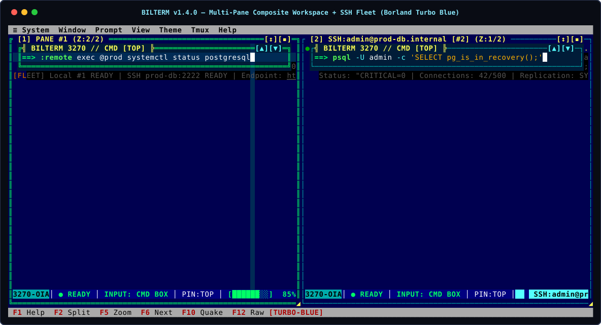

# Bilterm User Guide

[← Back to Project README](../../README.md)

Welcome to the official User Guide for **Bilterm (`v1.4.0`)** — the Rust + Ratatui terminal multiplexer, shell wrapper, remote SSH fleet manager, and AI-automatable terminal emulator inspired by **IBM 3270 Mainframe Terminals** and **DOS Borland Turbo Vision (Turbo C / Turbo Pascal IDE)**.

> **Quick Interactive Help (`<F1>`)**: At any time inside Bilterm, press **`F1`** or run **`:help`** to open the scrollable Borland Turbo Vision Help Modal directly on screen (`Up`/`Down`/`PageUp`/`PageDown` to scroll, `F1`/`Esc` to close).



---

## Table of Contents

- [Getting Started](#getting-started)
  - [Prerequisites](#prerequisites)
  - [Installation](#installation)
  - [Two-Minute First Run](#two-minute-first-run)
- [Modular User Guide Chapters](#modular-user-guide-chapters)
- [Examples](#examples)
  - [Example 1: Floating Prompt Over a High-Throughput Stream (`tail -f /dev/random`)](#example-1-floating-prompt-over-a-high-throughput-stream-tail--f-devrandom)
  - [Example 2: Switching Between Floating Mode and Non-Overlapping Split Mode](#example-2-switching-between-floating-mode-and-non-overlapping-split-mode)
  - [Example 3: Splitting Panes, Z-Order Stacking & Deck Shuffling](#example-3-splitting-panes-z-order-stacking--deck-shuffling)
  - [Example 4: Persistent Command History Pop-up & Temp-File Script Export](#example-4-persistent-command-history-pop-up--temp-file-script-export)
  - [Example 5: Retro Themes, Border Outlines, DOS Shadows & Full-Screen Cross-Hairs](#example-5-retro-themes-border-outlines-dos-shadows--full-screen-cross-hairs)
- [Reference](#reference)
  - [Configuration Schema (`~/.config/bilterm/config.toml`)](#configuration-schema-configbiltermconfigtoml)
  - [INI Theme Palette Override Keys](#ini-theme-palette-override-keys)
  - [Environment Variables](#environment-variables)
  - [Files & Runtime Paths](#files--runtime-paths)
  - [Exit Codes](#exit-codes)
- [Troubleshooting & FAQ](#troubleshooting--faq)

---

## Getting Started

### Prerequisites

- **Rust Toolchain**: `rustc` and `cargo` **`1.88+`** (Rust 2024 Edition).
- **Host Operating System**: Linux (primary POSIX PTY), macOS, or Windows (`ConPTY`).
- **Interactive Shell**: Any POSIX shell (`bash`, `zsh`, `fish`, `sh` via `$SHELL`) on Linux/macOS, or `powershell.exe` / `cmd.exe` (`%COMSPEC%`) on Windows.
- **Optional**: `tmux` `3.2+` for nested `DCS tmux;` clipboard passthrough or `tmux -CC` Control Mode integration.

### Installation

Clone the repository and build the optimized release binary:

```bash
git clone https://github.com/bsommers/bilterm.git
cd bilterm
cargo build --release
```

### Two-Minute First Run

Launch Bilterm from your terminal:

```bash
./target/release/bilterm
```

**Expected Initial Screen State:**
1. **Top Floating Command Prompt (`╔═╣ BILTERM 3270 ... ╠═╗`)**: Focused at the top of Composite Pane `#1` with the `==> ` input prompt.
2. **Underlying `OutputCanvas`**: Your interactive `$SHELL` running inside a full-height VT100/TrueColor PTY canvas underneath the floating prompt.
3. **Bottom IBM 3270 OIA Status Bar**: Displays `3270-OIA`, `● READY`, `INPUT: CMD BOX`, `PIN:TOP`, `≣ OUT:0L/0B`, and live cursor coordinates `⌖ R:01 C:001`.

Try running your first command inside the floating prompt:

```bash
ls -la
```

Press **`Enter`** — the command is sent to the underlying shell, the `OutputCanvas` scrolls smoothly underneath the floating prompt, and the top of the prompt displays `● LAST CMD:  ls -la`. Press **`F1`** at any time to view all keyboard shortcuts, or type **`:quit`** (or press **`Ctrl+Q`**) to exit cleanly.

---

## Modular User Guide Chapters

For deep dives into each subsystem, browse the dedicated chapters in [`docs/user-guide/`](.):

1. **[Chapter 1: Getting Started & Core Concepts](01-getting-started.md)**
   - Building from source, Composite Window Pane architecture (`OutputCanvas` + `FloatingCommandPrompt` + `OIA Status Bar`), Alternate Screen (`DECSET 1049`) auto-hide, and `!ECHO LOCK` password protection.
2. **[Chapter 2: The Command Prompt, Tab Completion, History & Command Blocks](02-floating-command-prompt.md)**
   - Top/Bottom/Floating/Split positioning (`Alt+T`, `Alt+B`, `Alt+S`), resizable width (`Alt+[`/`Alt+]`, mouse border drag) & height (`Alt+Plus`/`Alt+Minus`), scrollable multi-line editing (`Shift+PageUp`/`Shift+PageDown`), running command banner (`⟳ RUNNING:`), Tab completion (`Tab`/`Shift+Tab`), Borland Command History Pop-up (`Alt+P` / `:history`), session persistence, and `OSC 133` block jumping.
3. **[Chapter 3: Multi-Pane Window Manager, Z-Order Stacking & Guake Quick Terminal](03-window-manager-and-z-stack.md)**
   - Horizontal/Vertical binary splits (`F2`/`Alt+H`, `Alt+V`), Borland Turbo Vision overlapping Z-order stack (`Alt+M`), deck shuffling (`F6`/`Alt+Tab`), selective raise (`Alt+1..9`, mouse click), and the persistent Guake/Quake drop-down terminal (`F10` / `Alt+\`` / `:quake`).
4. **[Chapter 4: Retro Mainframe & DOS Aesthetics, Outlines, Drop Shadows, Cross-Hairs & Config](04-themes-glyphs-and-config.md)**
   - 8 border outline styles (`:outline`), 4 DOS drop-shadow modes (`:shadows`), 5 retro palettes (`:theme`), 4 glyph packs (`:glyphs`), pane-local vs. full-screen IBM 3270 cross-hairs (`Alt+X` / `:crosshair`), OIA status bar telemetry, and `config.toml` / `.ini` configuration.
5. **[Chapter 5: First-Class `tmux` Integration](05-tmux-integration.md)**
   - Outer `$TMUX` coexistence (`DCS tmux;` passthrough for `OSC 52` clipboard) and `tmux -CC` Control Mode synchronization.
6. **[Chapter 6: Complete Keyboard, Mouse & `:command` Reference](06-keyboard-mouse-and-command-reference.md)**
   - Exhaustive tables of function keys (`F1`–`F12`), `Alt+` chords, editor keybindings, mouse drag/click/scroll gestures, and all `:colon` commands.
7. **[Chapter 7: Troubleshooting & FAQ](07-troubleshooting-and-faq.md)**
   - Diagnostic log inspection (`bilterm.log`), terminal recovery, password prompt routing, CJK/Emoji border alignment, and common questions.

---

## Examples

### Example 1: Floating Prompt Over a High-Throughput Stream (`tail -f /dev/random`)

Run a continuous high-throughput command while keeping the floating command prompt responsive on top:

```text
==> base64 /dev/urandom | head -n 500
```

**Expected Output:**
- The top banner of the command prompt shows `⟳ RUNNING:  base64 /dev/urandom | head -n 500` while streaming and `● LAST CMD:  base64 /dev/urandom | head -n 500` afterwards.
- The `OutputCanvas` scrolls smoothly underneath the floating prompt at 60 FPS (bounded 64KB PTY batching prevents UI starvation).
- Even if you stream raw binary (`tail -f /dev/random`), Bilterm's `VtParser::sanitize_stream_traps` neutralizes accidental `DECSET 47/1047/1049` or `DECSTBM` scroll-region bytes when the foreground process is not in raw TUI mode, so the floating prompt never vanishes or locks up.
- Press **`Ctrl+C`** at any time while streaming to send `SIGINT` (`0x03`) to the foreground job.

### Example 2: Switching Between Floating Mode and Non-Overlapping Split Mode

By default, the command prompt floats over the top of the output canvas (`PIN:TOP`). To partition the pane into a dedicated command sub-pane and output sub-pane with **zero overlap**:

```text
==> :prompt split-top
```

*(Or press **`Alt+S`**, or run `:prompt split-bottom` to place the non-overlapping command pane at the bottom).*

**Expected Output:**
- The OIA status bar badge changes from `PIN:TOP` to `PIN:SPL-T` (or `PIN:SPL-B`).
- Line 1 of the `OutputCanvas` begins immediately below the command prompt border — zero lines of terminal output are occluded by the command box.
- Resize the prompt width or height dynamically:
  ```text
  ==> :prompt height 5
  ==> :prompt width 60
  ==> :prompt width full
  ```

### Example 3: Splitting Panes, Z-Order Stacking & Deck Shuffling

Create a multi-pane workspace and switch between tiled splits and overlapping Borland Turbo Vision windows:

```text
==> :split v
==> :split h
==> :layout stack
==> :deck next
==> :focus 1
```

**Expected Output:**
- `:split v` and `:split h` create 3 independent composite panes (`#1`, `#2`, `#3`), each with its own shell PTY and floating command prompt.
- `:layout stack` (or **`Alt+M`**) cascades the panes in overlapping z-order with window badges (`[1]`, `[2]`, `[3]`) and translucent 2-column right / 1-row bottom drop shadows.
- `:deck next` (or **`F6`** / **`Alt+Tab`**) shuffles the top pane to the bottom of the deck and raises the next pane to the front.
- `:focus 1` (or **`Alt+1`**) selectively raises Pane `#1` to the top of the Z-stack.

### Example 4: Persistent Command History Pop-up & Temp-File Script Export

Inspect your session's command history in a Borland modal dialog and export the commands to a runnable `.sh` file:

```text
==> :history
```

*(Or press **`Alt+P`**).*

**Expected Output:**
- Opens the centered **`╔═╣ COMMAND HISTORY [SESSION ... | PERSIST:ON] ╠═╗`** pop-up window.
- Press **`Up` / `Down`** to highlight a prior command and **`Enter`** to load it into the command prompt, or press **`s`** inside the pop-up (or run `:history save /tmp/my-session.sh`) to write all session commands to disk.
- Toggle persistence or adjust log file rotation at runtime:
  ```text
  ==> :history max-files 50
  ==> :history off
  ==> :history on
  ```

### Example 5: Retro Themes, Border Outlines, DOS Shadows & Full-Screen Cross-Hairs

Switch to an IBM 3279 Amber CRT aesthetic with rounded prompt borders, theme-tinted DOS drop shadows, and a full-screen cross-hair cursor:

```text
==> :theme 3279
==> :outline window double
==> :outline prompt rounded
==> :shadows tinted
==> :crosshair full
==> :fkeybar on
```

**Expected Output:**
- Palette switches to **`IBM-3279-AMBER`**.
- Workspace windows render with `╔═╗` double borders while the command prompt renders with `╭─╮` rounded borders.
- Drop shadows tint underlying character cells using the active palette's `shadow_fg` and `shadow_bg`.
- Horizontal and vertical IBM 3270 cross-hair lines span across the **entire terminal screen** intersecting at the active cursor (`Alt+X` cycles `Pane-Local` -> `Full-Screen` -> `Off`).

---

## Reference

### Configuration Schema (`~/.config/bilterm/config.toml`)

Bilterm loads `~/.config/bilterm/config.toml` (or `$XDG_CONFIG_HOME/bilterm/config.toml`). Every key is optional and falls back to `BiltermConfig::default()`:

| Key | Type | Allowed Values | Default | Description |
|-----|------|----------------|---------|-------------|
| `theme` | `string` | `"turbo-blue"`, `"turbo-cyan"`, `"ibm-3278-green"`, `"ibm-3279-amber"`, `"ibm-mono"` | `"turbo-blue"` | Active color theme preset (`UI-02`) |
| `glyphs` | `string` | `"unicode"`, `"cp437"`, `"nerd-font"`, `"ascii"` | `"unicode"` | Status bar and badge glyph pack (`UI-04`) |
| `cursor_style` | `string` | `"solid-block"`, `"blinking-hollow-block"`, `"underscore"`, `"vertical-bar"` | `"solid-block"` | Software cursor caret shape (`UI-05`) |
| `window_outline` | `string` | `"double"`, `"solid"`, `"rounded"`, `"thick"`, `"dotted"`, `"dashed"`, `"quadruple"`, `"ascii"` | `"double"` | Border outline style for workspace windows |
| `prompt_outline` | `string` | `"double"`, `"solid"`, `"rounded"`, `"thick"`, `"dotted"`, `"dashed"`, `"quadruple"`, `"ascii"` | `"double"` | Border outline style for the command prompt |
| `shadow_style` | `string` | `"none"`, `"translucent"`, `"theme-tinted"`, `"solid-half-block"` | `"translucent"` | DOS drop-shadow rendering mode (`UI-01`) |
| `drop_shadows` | `bool` | `true`, `false` | `false` | Enables 2-col right / 1-row bottom drop shadows |
| `crosshair_cursor` | `bool` | `true`, `false` | `false` | Enables the IBM 3270 cross-hair cursor ruler (`UI-05`) |
| `crosshair_fullscreen` | `bool` | `true`, `false` | `false` | Spans cross-hair across full screen when `true` (pane-local when `false`) |
| `show_dos_fkey_bar` | `bool` | `true`, `false` | `false` | Shows bottom 1-row Borland DOS `F1 Help ...` bar (`UI-03`) |
| `history_enabled` | `bool` | `true`, `false` | `true` | Automatically persists submitted commands to session log files |
| `history_max_files` | `usize` | `1..=10000` | `25` | Max named session directories retained (least-recently-used pruned, never the active one) |
| `history_session` | `string` | Session name | `"default"` | Named persistent history session (`--session <name>` overrides) |
| `history_max_entries` | `usize` | `1..` | `100000` | Entries kept per session file before compaction |
| `history_load_limit` | `usize` | `0..` | `10000` | Prior session commands restored into each new pane |
| `history_dir` | `string` (optional) | Any directory path | `None` | Custom directory override for persisted session history logs |
| `default_prompt_anchor` | `string` | `"top"`, `"bottom"`, `"floating"`, `"split-top"`, `"split-bottom"` | `"top"` | Initial command prompt placement for new panes |
| `default_prompt_height` | `u16` | `3..=12` | `3` | Initial command prompt box height in rows |
| `show_menu_bar` | `bool` | `true`, `false` | `false` | Shows top 1-row Borland Turbo Vision pull-down menu bar (`ECO-03`) |
| `crt_scanlines` | `bool` | `true`, `false` | `false` | Enables alternating scanline luminance modulation (`CRT-01`) |
| `triggers` | `array of strings` | Case-insensitive substring patterns | `[]` | Highlights matching tokens on the `OutputCanvas` (`TRG-01`) |
| `[keybindings]` | `table` | `"<KeyChord>" = ":<command>"` | `{}` | Custom user keybinding remapping table (`CFG-02`) |

### INI Theme Palette Override Keys

You can also parse custom `.ini` theme files via `bilterm::config::parse_ini_theme`:

```ini
[colors]
name = CUSTOM-BORLAND
prompt_surface_bg = #000084
window_frame_bg   = #000055
active_border_fg  = #FFFF55
inactive_border_fg = #55FFFF
title_fg          = #FFFFFF
crosshair_bg      = #002B55
oia_bg            = #008484
shadow_fg         = #555555
shadow_bg         = #000000
```

### Environment Variables

| Variable | Effect in Bilterm |
|----------|-------------------|
| `SHELL` | Default interactive shell spawned on Linux and macOS (falls back to `/bin/sh`) |
| `COMSPEC` | Default interactive shell spawned on Windows when `powershell.exe` is not explicitly configured |
| `TMUX` | Detected automatically (`TmuxEnv::detect_from_env`) to enable outer `tmux` coexistence and `DCS tmux;` passthrough wrapping |
| `XDG_CONFIG_HOME` | Base directory for `bilterm/config.toml` (falls back to `~/.config/bilterm/config.toml`) |
| `XDG_STATE_HOME` | Base directory for persisted command history logs `$XDG_STATE_HOME/bilterm/history/` (falls back to `~/.local/state/bilterm/history/`) |
| `RUST_LOG` | Controls diagnostic log verbosity written to `./bilterm.log` (e.g. `RUST_LOG=bilterm=debug`) |

### Files & Runtime Paths

| Path | Purpose |
|------|---------|
| `~/.config/bilterm/config.toml` | Declarative user configuration file |
| `~/.local/state/bilterm/history/sessions/<name>/history.log` | Append-only history of a named session (all panes and runs, `run=` segments) |
| `/tmp/bilterm-commands-<session_id>-pane-<id>.sh` | Default output path when exporting commands via `:history save` |
| `./bilterm.log` | Non-blocking background diagnostic log written by `tracing-appender` |

### Exit Codes

| Exit Code | Meaning |
|-----------|---------|
| `0` | Clean exit via `:quit` / `:q`, `Ctrl+Q`, or closing the last composite pane |
| `1` | Unrecoverable initialization or runtime I/O error (terminal state is automatically restored via `TerminalRestoreGuard` before printing the `color-eyre` report) |

---

## Troubleshooting & FAQ

See **[Chapter 7: Troubleshooting & FAQ](07-troubleshooting-and-faq.md)** for full diagnostics, or check these quick remedies:

- **Why did the floating command prompt disappear when I ran `vim`, `htop`, or `sudo`?**
  - By design! Bilterm automatically hides the floating prompt during `DECSET 47/1047/1049` alternate-screen apps (`▣ ALT SCR`) and `!ECHO` password prompts (`♦ !ECHO LOCK`) so keystrokes go directly to the underlying program. Exit the program or press **`F12` / `Ctrl+G`** (`:raw`) to toggle manually.
- **How do I stop the floating prompt from covering the top lines of my command output?**
  - Press **`Alt+S`** or run **`:prompt split-top`** (or **`:prompt split-bottom`**) to switch from Floating overlay mode to a non-overlapping Split Command & Output Pane.
- **How do I turn on full-screen vertical and horizontal cursor cross-hairs?**
  - Press **`Alt+X`** twice (or run **`:crosshair full`**) to extend the IBM 3270 cross-hair ruler across the entire screen.
- **Where are diagnostic logs written if something goes wrong?**
  - Because Bilterm owns the terminal's alternate screen, logs are never printed to `stdout`/`stderr` during execution; inspect `./bilterm.log` (and set `RUST_LOG=debug` for verbose trace output).
